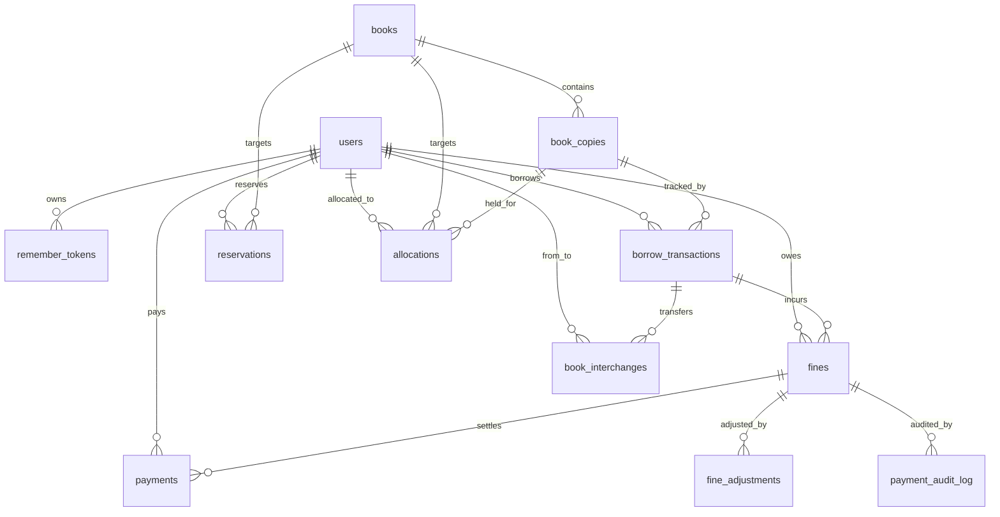

# PSG iTech Library - Resource and Queue Management System

**Institutional Digital Library, Automated Resource Allocation & Concurrent Queue Management**  
**PSG Institute of Technology and Applied Research (PSG iTech), Neelambur, Coimbatore**

---

## A. Project Overview

### 1. Introduction
**PSG iTech Library** is an enterprise-grade academic library resource and queue management system engineered in **Core Java (Java Servlets, JDBC, MySQL)** with a zero-dependency vanilla HTML5/CSS3/JavaScript web interface. Inspired by the scholarly elegance of Open Library and strict institutional academic guidelines, the system unifies catalogue searching, physical inventory tracking, circulation desk operations, automated FIFO reservation queues, hold-shelf allocations, fine lifecycle management with UPI reconciliation, fair concurrency admission control, and peer-to-peer student book interchanges.

### 2. The Problem It Solves
Traditional college library systems suffer from:
1. **Physical Queue Bottlenecks**: Students rush to the library counter when popular textbooks are returned, leading to favoritism and unfair access.
2. **Catalog vs. Inventory Mismatch**: A title may show as "in stock", but individual physical copies might be allocated, reserved, or damaged.
3. **Stale Due Dates & Manual Fines**: Inaccurate manual fine calculations and disconnected payment tracking without audit trails.
4. **Counter Congestion for Student Hand-offs**: Students who borrow books often hand them to classmates directly in dorms or classrooms without updating library records, keeping the original borrower legally and financially liable.
5. **Database Deadlocks & Race Conditions**: Under high concurrent access (e.g., semester exam book rushes), simultaneous borrowing, returns, allocations, and reservation requests cause database lock contention and race conditions.

### 3. Main Objectives
- **Strict Accountability**: Track physical assets down to individual barcode/copy identifiers (`book_copies.copy_code`).
- **Fair Resource Allocation**: Guarantee deterministic FIFO queue ordering and automated reservation hold shelves.
- **Audited Financials**: Automate overdue fine calculations with institutional grace periods and UPI verification workflows.
- **Safe Peer Hand-overs**: Allow student-to-student book transfers that update legal borrower responsibility while preserving original loan terms and preventing queue-jumping.
- **High Concurrency Resilience**: Implement admission control, bounded queues, and deterministic multi-resource lock ordering to eliminate deadlocks.

### 4. Target Users
- **Students**: Search the academic catalog, check availability, place FIFO reservations, manage active loans, initiate peer book transfers, pay fines via UPI, and generate digital receipts.
- **Librarians**: Perform circulation desk operations (issue/return), verify UPI fine payments, process waivers, manage book inventory, and audit transactions.
- **Administrators**: Manage student and staff accounts, oversee system roles and activations, configure concurrency parameters, and monitor live admission telemetry.

---

## B. Technology Stack

| Layer / Component | Technology | Version | Purpose in Project |
|---|---|---|---|
| **Programming Language** | Core Java | 17 (Target) / 25 (Runtime) | Object-oriented business logic, services, repositories, and domain models |
| **Web Container API** | Java Servlet API | 4.0.1 (`javax.servlet-api`) | HTTP request routing, session management, and filter chains |
| **Servlet Container** | Apache Tomcat | 10.1.61 | Web server running on HTTP port `8081` (via `jakartaee-migration` tool) |
| **Relational Database** | MySQL Community Server | 8.0.33+ | Persistent storage with ACID transactions, foreign keys, and generated columns |
| **Database Driver** | MySQL Connector/J | 8.0.33 | JDBC connection management and prepared statements |
| **In-Memory Database** | H2 Database | 2.2.224 | Isolated testing and configured development fallback |
| **Security & Hashing** | jBCrypt | 0.4 | Adaptive salted BCrypt hashing (cost factor 12) for student/staff credentials |
| **JSON Serialization** | Google Gson | 2.10.1 | REST API serialization and deserialization with custom date adapters |
| **Build & Dependency Tool** | Apache Maven | 3.9+ | Build lifecycle, dependency management, WAR packaging (`pom.xml`) |
| **Testing Framework** | JUnit 4 & Surefire | 4.13.2 / 3.2.5 | Unit, integration, and multi-threaded concurrency test suites |
| **Frontend Presentation** | HTML5 / CSS3 | Modern Standard | Academic UI adhering to institutional Times New Roman design language |
| **Frontend Scripting** | Vanilla JavaScript | ES6+ (Fetch API) | Client-side DOM rendering, asynchronous API calls (zero external JS libraries) |

---

## C. Implemented Features (Features 1 – 8)

Every feature listed below is **fully implemented across all architectural layers** (Database DDL, Repositories, Domain Services, Servlets, and Frontend UI):

```
┌─────────────────────────────────────────────────────────────────────────────┐
│                          PSG iTech Library System                           │
├───────────────┬───────────────┬───────────────┬─────────────────────────────┤
│ Feature 1     │ Feature 2     │ Feature 3     │ Feature 4                   │
│ User & Auth   │ Book & Copy   │ Borrowing &   │ FIFO Reservation            │
│ Management    │ Catalog       │ Desk Returns  │ Queue Engine                │
├───────────────┼───────────────┼───────────────┼─────────────────────────────┤
│ Feature 5     │ Feature 6     │ Feature 7     │ Feature 8                   │
│ Automated     │ Fines & UPI   │ Concurrency & │ Peer-to-Peer                │
│ Allocation    │ Payment Recon │ Limiter       │ Book Interchange            │
└───────────────┴───────────────┴───────────────┴─────────────────────────────┘
```

---

### Feature 1 – User Management & Authentication
- **Student Self-Registration**: Validates institutional email (`@psgitech.ac.in`), Anna University register number, department, year, phone, and password policy.
- **Multi-Identifier Login**: Authenticates via either Institutional Email, Register Number, or Employee ID with BCrypt hash verification.
- **Session Management & Remember Me**: 30-day persistent login via secure, random 64-character tokens stored as SHA-256 hashes in `remember_tokens` and tracked via HTTP cookies.
- **First-Login Security Guard**: Newly provisioned librarians have `must_change_password = TRUE`; intercepted by `AuthorizationFilter` and redirected to `first-login-change-password.html`.
- **Administrative Account Control**: Administrators can activate or deactivate accounts (`users.active`) with audit preservation; deactivated users are blocked from logging in or receiving books.
- **Profile Management**: Self-service profile viewing and password changes via `ProfileServlet` and `ChangePasswordServlet`.

### Feature 2 – Book & Physical Copy Management
- **Catalog Management**: Add, update, and search titles with ISBN-10/ISBN-13, title, author, publisher, edition, publication year, category, and department.
- **Physical Copy Architecture**: Decouples abstract bibliographic metadata (`books`) from concrete physical assets (`book_copies`). Each copy receives an institutional code (`PSG-BK<id>-C<no>`).
- **Atomic Creation Guardrail**: Books cannot be registered without physical copies; `BookRepository.createBookWithCopies` inserts both within a single database transaction.
- **Archive Guardrail**: Archived books cannot be issued or reserved. Books with active loans, reservations, or hold-shelf allocations cannot be archived (`InvalidBookOperationException`).
- **Dynamic Aggregate Joins**: Computes total, available, borrowed, reserved, and allocated counts in a single query, eliminating $N+1$ query overhead.

### Feature 3 – Book Borrowing & Circulation Operations
- **Desk Book Issue**: Librarians issue physical copies by scanning student register numbers and copy barcodes via `IssueBookServlet`.
- **Borrowing Quota Enforcement**: Configurable institutional borrowing limit (default 3 active books per student) checked atomically under lock.
- **Loan Duration & Due Dates**: Default 14-day borrowing duration with real-time countdown.
- **Same-Book Duplicate Prevention**: Students cannot borrow multiple physical copies of the same book title simultaneously.
- **Overdue Monitoring**: Live tracking of overdue loans via `OverdueBorrowingsServlet` with visual red danger badges.
- **Desk Book Return**: Librarians process returns via `ReturnBookServlet`, updating physical copy status and returning loan records.

### Feature 4 – Reservation Queue
- **Waitlist Enrollment**: When zero physical copies are available, eligible students can join the book's reservation queue via `ReservationServlet`.
- **Strict FIFO Ordering**: Reservations receive a timestamped queue position (`#1`, `#2`, etc.) determined by `reservation_date` and `reservation_id`.
- **Active Reservation Cap**: Enforces an institutional limit (default 2 active reservations per student).
- **Queue Cancellation**: Students can cancel their own pending reservations via `CancelReservationServlet`. When cancelled, subsequent students automatically shift forward in FIFO priority.
- **Eligibility Validation**: Students already holding an active copy of the book cannot join the reservation queue.

### Feature 5 – Automatic Book Allocation & Hold Shelf
- **Event-Driven Return Allocation**: When a borrowed book is returned at the circulation desk, `AllocationService.allocateReturnedCopy` is automatically invoked inside the return transaction.
- **FIFO Strategy Engine**: Uses `AllocationStrategy` and `FIFOAllocationStrategy` to evaluate the waiting queue in ascending order, skipping students who have reached quota or accumulated unpaid fines.
- **Hold-Shelf State Transition**: The physical copy transitions to `ALLOCATED` status, and an `allocations` record is generated with a collection deadline (configurable, default 24 hours).
- **Anti-Theft Collection Guard**: If another student attempts to check out an allocated copy at the desk, `BorrowRepository` validates the hold shelf; checkouts are permitted only to the allocated reservation holder.
- **Hold Release & Re-allocation**: Expired or librarian-cancelled allocations release the physical copy and automatically trigger the allocation engine for the next student in line.

### Feature 6 – Fine Calculation & UPI Payment Reconciliation
- **Automated Fine Assessment**: On book return, `FineService.createFineForReturn` calculates overdue duration based on `Asia/Kolkata` calendar days, applies the institutional grace period (0 days), and assesses fines at ₹2.00/day.
- **Outstanding Fine Tracking**: Tracks `original_amount`, `paid_amount`, `waived_amount`, and `outstanding_amount` across `fines` records with statuses `UNPAID`, `PARTIALLY_PAID`, `PAID`, `WAIVED`.
- **UPI QR & Reference Submission**: Students view fines on `my-fines.html`, scan the dynamic UPI QR code, and submit their 12-digit bank UPI Transaction Reference Number (UTR).
- **Duplicate UTR Protection**: Unique constraint on `payments.upi_reference` prevents replay attacks and double submissions.
- **Staff Verification & Waivers**: Librarians verify bank credits via `PaymentVerificationServlet`. Librarians can also grant authorized partial or full fine waivers with logged justification in `fine_adjustments`.
- **Tamper-Evident Receipts**: Generates print-ready digital receipts via `ReceiptServlet` and `receipt.html` with verification signatures.
- **Feature 6 Rule D10 Enforcement**: Unreturned overdue books do *not* block borrowing or transfers; only finalized unpaid fines exceeding ₹0 block access.

### Feature 7 – Concurrent Request Management & Admission Control
- **Fair Admission Control**: Mutating endpoints (issue, return, reserve, pay, interchange) are governed by `ConcurrencyFilter` backed by a fair `java.util.concurrent.Semaphore` (12 concurrent execution permits).
- **Bounded Waiting Room**: Excess requests enter a FIFO queue (capacity 24). If the wait exceeds 3,000 ms, the system responds with HTTP `429 Too Many Requests` and a `Retry-After: 3` header.
- **Per-User In-Flight Cap**: Prevents single-user script hammering by restricting any individual user ID or IP to at most 3 concurrent in-flight mutations.
- **Deadlock Mitigation & Transaction Retries**: Repositories use `TransactionRetryHelper` with exponential backoff (initial 50 ms, jitter, up to 3 retries) catching MySQL error 1213 (deadlock) and 1205 (lock wait timeout).
- **Admin Concurrency Monitor**: Real-time administrative dashboard (`concurrency-monitor.html` / `ConcurrencyMonitorServlet`) showing active permits, wait queue depth, per-user utilization, latency, and toggle controls.

### Feature 8 – Student-to-Student Book Interchange
- **Peer-to-Peer Transfer Workflow**: Student A initiates a transfer of an active borrowed book to Student B by entering B's register number on `my-borrowings.html`.
- **Strict Loan Invariance**: The loan record in `borrow_transactions` updates its borrower ID from Student A to Student B in place. `transaction_id`, `issue_date`, and `due_date` are strictly preserved (no loan renewal, no extension).
- **Copy Status Invariance**: Physical copy remains in `BORROWED` status throughout; no return or new checkout record is generated.
- **Reservation Queue Priority Guard**: Transfers are blocked if any students are waiting in the reservation queue (`WAITING` or `ALLOCATED`), preserving priority for high-demand titles.
- **Overdue Transfer Prohibition**: Books that are already overdue in `Asia/Kolkata` cannot be transferred; they must be returned to the desk.
- **Single-Active Pending Rule**: Enforced by a MySQL `STORED` generated column (`active_transaction_id`) with a `UNIQUE` index.
- **Two-Student Deadlock Elimination**: Locks users in deterministic ascending ID order (`Math.min(A, B)` then `Math.max(A, B)`).
- **Desk Return Race Protection**: If a book is returned to the desk while a transfer is pending, the desk return auto-cancels the interchange. If return and transfer race, `BorrowRepository` verifies borrower identity under lock, rolling back and retrying with the new borrower if changed.
- **Dual History Visibility**: Sender sees the loan marked *"Transferred to [Recipient] on [Date]"*; recipient sees the active loan tagged *"Acquired via Peer Transfer from [Sender]"*.

---

## D. User Roles and Permissions

Permissions are enforced on the backend by [`AuthorizationFilter.java`](file:///Users/srisaran/Oops/Library-Management/src/main/java/com/psgitech/library/filter/AuthorizationFilter.java) and checked in each servlet:

| Operation / Path | Student | Librarian | Admin | Enforcement Mechanism |
|---|:---:|:---:|:---:|---|
| **Browse Catalog & Details** (`/books`, `/books/details`) | Yes | Yes | Yes | Public / Authenticated read |
| **Self-Registration & Login** (`/register`, `/login`) | Yes | Yes | Yes | Open unauthenticated endpoints |
| **View Student Portal** (`/student-home.html`, `/my-borrowings.html`) | Yes | No | Yes | `AuthorizationFilter` (Role check) |
| **Place & Cancel Reservations** (`/reservations`, `/reservations/cancel`) | Yes | No | Yes | `AuthorizationFilter` + Session validation |
| **Peer Book Transfer** (`/interchanges`, `/interchanges/accept`, `/cancel`) | Yes | No | Yes | `AuthorizationFilter` + Ownership checks |
| **Submit UPI Payment** (`/payments`) | Yes | No | Yes | `AuthorizationFilter` + Student ID match |
| **View Digital Receipt** (`/receipt`, `/receipt.html`) | Yes | Yes | Yes | Authenticated session check |
| **Circulation Desk Issue/Return** (`/borrow/issue`, `/borrow/return`) | No | Yes | Yes | `AuthorizationFilter` (`LIBRARIAN` or `ADMIN`) |
| **Catalog Management** (`/books/add`, `/books/update`, `/books/archive`) | No | Yes | Yes | `AuthorizationFilter` (`LIBRARIAN` or `ADMIN`) |
| **Verify UPI & Waive Fines** (`/payments/verify`, `/fines`) | No | Yes | Yes | `AuthorizationFilter` (`LIBRARIAN` or `ADMIN`) |
| **Audit Peer Transfers** (`/api/admin/interchanges`) | No | Yes | Yes | `AuthorizationFilter` (`LIBRARIAN` or `ADMIN`) |
| **User Management** (`/admin/users`, `admin-users.html`) | No | No | Yes | `AuthorizationFilter` (`ADMIN` only) |
| **Concurrency Monitoring & Control** (`/api/admin/concurrency/*`) | No | No | Yes | `AuthorizationFilter` (`ADMIN` only) |

---

## E. Application Workflows

### 1. Standard Borrowing & Automatic Queue Workflow
```mermaid
sequenceDiagram
    autonumber
    actor S1 as Student 1 (Borrower)
    actor L as Librarian
    actor S2 as Student 2 (Waiting)
    participant Sys as Library System (Backend & DB)

    S1->>L: Presents book at Circulation Desk
    L->>Sys: Issue copy PSG-BK1-C01 to Student 1
    Sys-->>L: Loan created (Due in 14 days, Status: ACTIVE)
    
    Note over S2,Sys: All copies are now BORROWED
    S2->>Sys: Joins reservation queue for Book 1
    Sys-->>S2: Reserved (FIFO Position #1)

    Note over S1,L: After 10 days, Student 1 returns book
    S1->>L: Returns book at desk
    L->>Sys: Return copy PSG-BK1-C01
    Sys->>Sys: Assess fines (₹0 if on-time)
    Sys->>Sys: Trigger FIFOAllocationStrategy
    Sys-->>Sys: Copy PSG-BK1-C01 status -> ALLOCATED
    Sys-->>Sys: Creates 24-hour hold shelf for Student 2
    Sys-->>L: Return confirmed; Alert: Book allocated to Student 2

    S2->>L: Arrives at desk to collect allocated book
    L->>Sys: Issue copy PSG-BK1-C01 to Student 2
    Sys->>Sys: Validates collection hold against Student 2
    Sys-->>L: Allocation FULFILLED; Loan created for Student 2
```

### 2. Peer Book Transfer Workflow
```mermaid
sequenceDiagram
    autonumber
    actor A as Student A (Current Borrower)
    actor B as Student B (Recipient)
    participant Sys as Library System

    A->>Sys: Initiates transfer of active loan to Student B
    Sys->>Sys: Checks book not overdue, queue depth = 0, B eligible
    Sys-->>A: Request submitted (Status: REQUESTED)

    B->>Sys: Inspects Incoming Transfers tab
    B->>Sys: Accepts transfer (Confirms physical receipt)
    Sys->>Sys: Lock User A & User B (ascending ID order)
    Sys->>Sys: Re-verify quota & eligibility under lock
    Sys->>Sys: Update borrow_transactions.student_id = B (in-place)
    Sys->>Sys: Preserves original issue_date and due_date
    Sys->>Sys: Update book_interchanges status -> COMPLETED
    Sys-->>B: Transfer complete; book now in B's Active Loans
    Sys-->>A: Loan moved to A's Borrowing History (Transferred)
```

---

## F. System Architecture

The application adheres to a clean, decoupled layered architecture:

```
┌────────────────────────────────────────────────────────────────────────┐
│                        Presentation Layer                              │
│   HTML5 / CSS3 (Times New Roman Institutional Theme) / Vanilla JS      │
└───────────────────────────────────┬────────────────────────────────────┘
                                    │ HTTP Requests (JSON / Forms)
┌───────────────────────────────────▼────────────────────────────────────┐
│                      Filter & Interceptor Pipeline                     │
│  1. RequestIdFilter  2. AuthenticationFilter  3. AuthorizationFilter   │
│  4. ConcurrencyFilter (Admission Control & Fair Semaphore)             │
└───────────────────────────────────┬────────────────────────────────────┘
                                    │ Cleaned & Authorized Requests
┌───────────────────────────────────▼────────────────────────────────────┐
│                          Servlet / API Layer                           │
│  33 Java Servlets (@WebServlet): Request validation & JSON formatting  │
└───────────────────────────────────┬────────────────────────────────────┘
                                    │ Method Invocations
┌───────────────────────────────────▼────────────────────────────────────┐
│                         Service & Domain Layer                         │
│  Orchestration, Business Policies, FIFO Allocation, Fine Calculator    │
└───────────────────────────────────┬────────────────────────────────────┘
                                    │ Pure JDBC Transactions
┌───────────────────────────────────▼────────────────────────────────────┐
│                        Data Access Layer (DAO)                         │
│  10 Repositories: PreparedStatements, Row Locks (FOR UPDATE), Retries  │
└───────────────────────────────────┬────────────────────────────────────┘
                                    │ SQL Queries & Connection Pool
┌───────────────────────────────────▼────────────────────────────────────┐
│                           Database Layer                               │
│  MySQL 8.0 (Tomcat JNDI Connection Pool / DriverManager fallback)      │
└────────────────────────────────────────────────────────────────────────┘
```

---

## G. Database Design

The database schema is structured into **12 relational tables** with foreign key constraints, indexes, and stored generated columns:



### Table Summary
1. **`users`**: User records with `role` (`STUDENT`, `LIBRARIAN`, `ADMIN`), BCrypt hash, active flag, and student/staff metadata.
2. **`remember_tokens`**: Persistent login tokens with SHA-256 hashed values and expiry timestamps.
3. **`books`**: Master catalog of titles, ISBNs, authors, publishers, categories, and archive flags.
4. **`book_copies`**: Physical copy inventory with unique copy codes (`PSG-BK<id>-C<no>`) and statuses (`AVAILABLE`, `BORROWED`, `RESERVED`, `ALLOCATED`, `LOST`, `DAMAGED`, `ARCHIVED`, `TRANSFER_PENDING`).
5. **`borrow_transactions`**: Circulation records tracking `student_id`, `copy_id`, `issue_date`, `due_date`, `return_date`, and transfer flags.
6. **`reservations`**: FIFO reservation queue with queue timestamps and statuses (`WAITING`, `ALLOCATED`, `FULFILLED`, `CANCELLED`, `EXPIRED`).
7. **`allocations`**: Hold-shelf records linking a returned physical copy to a reserved student with a collection deadline.
8. **`fines`**: Overdue fine ledgers tracking original, paid, waived, and outstanding amounts.
9. **`payments`**: Fine payment transactions with unique `upi_reference` constraints and verification states (`SUBMITTED`, `VERIFIED`, `REJECTED`).
10. **`fine_adjustments`**: Audit log of fine waivers, reductions, and refunds.
11. **`payment_audit_log`**: Tamper-evident chronological audit trail of all financial events.
12. **`book_interchanges`**: Student peer transfer ledger with `STORED` generated column `active_transaction_id` enforcing single active transfer per loan.

---

## H. Java OOP Concepts Used in Codebase

| OOP Concept | Actual Class in Source Code | Practical Application in Project |
|---|---|---|
| **Encapsulation** | [`BookInterchange.java`](file:///Users/srisaran/Oops/Library-Management/src/main/java/com/psgitech/library/model/BookInterchange.java) | All fields are private; state transitions (`complete()`, `reject()`, `cancel()`) require valid status preconditions. |
| **Abstraction** | [`User.java`](file:///Users/srisaran/Oops/Library-Management/src/main/java/com/psgitech/library/model/User.java) | Abstract base class defining common properties while requiring subclasses to define role-specific identities. |
| **Inheritance** | [`Student.java`](file:///Users/srisaran/Oops/Library-Management/src/main/java/com/psgitech/library/model/Student.java), [`Librarian.java`](file:///Users/srisaran/Oops/Library-Management/src/main/java/com/psgitech/library/model/Librarian.java), [`Admin.java`](file:///Users/srisaran/Oops/Library-Management/src/main/java/com/psgitech/library/model/Admin.java) | Subclasses inherit user fields from `User` and extend with register number, employee ID, and department. |
| **Polymorphism** | [`AllocationStrategy.java`](file:///Users/srisaran/Oops/Library-Management/src/main/java/com/psgitech/library/interfaces/AllocationStrategy.java) | Dynamic strategy dispatch where `AllocationService` invokes `selectNext()` without depending on concrete queue algorithms. |
| **Interfaces** | [`EligibilityChecker.java`](file:///Users/srisaran/Oops/Library-Management/src/main/java/com/psgitech/library/interfaces/EligibilityChecker.java), [`FinePolicy.java`](file:///Users/srisaran/Oops/Library-Management/src/main/java/com/psgitech/library/interfaces/FinePolicy.java) | Contracts defining eligibility checks and fine calculation rules across borrowing, allocation, and fine services. |
| **Strategy Pattern** | [`FIFOAllocationStrategy.java`](file:///Users/srisaran/Oops/Library-Management/src/main/java/com/psgitech/library/service/FIFOAllocationStrategy.java), [`StandardFinePolicy.java`](file:///Users/srisaran/Oops/Library-Management/src/main/java/com/psgitech/library/service/StandardFinePolicy.java) | Interchangeable algorithmic strategies for reservation queue allocation and overdue fine calculation. |
| **Enums** | [`Role.java`](file:///Users/srisaran/Oops/Library-Management/src/main/java/com/psgitech/library/enums/Role.java), [`CopyStatus.java`](file:///Users/srisaran/Oops/Library-Management/src/main/java/com/psgitech/library/enums/CopyStatus.java), [`InterchangeStatus.java`](file:///Users/srisaran/Oops/Library-Management/src/main/java/com/psgitech/library/enums/InterchangeStatus.java) | Type-safe domain representations preventing invalid status transitions across the application. |
| **Exception Hierarchy** | [`com.psgitech.library.exception.*`](file:///Users/srisaran/Oops/Library-Management/src/main/java/com/psgitech/library/exception/) | 23 fine-grained domain exceptions (e.g., `ActiveReservationQueueException`, `RecipientNotEligibleException`) mapped to clean HTTP status codes. |
| **Multithreading** | [`ConcurrencyManager.java`](file:///Users/srisaran/Oops/Library-Management/src/main/java/com/psgitech/library/concurrency/ConcurrencyManager.java) | Fair `Semaphore` permit acquisition, `AtomicInteger` counters, and concurrent in-flight map coordination. |

---

## I. Security Implementation

1. **Password Security**: Passwords are never stored in plaintext. They are hashed using `jBCrypt` with a cost factor of 12 and cryptographic salts.
2. **SQL Injection Prevention**: 100% of database interactions use JDBC `PreparedStatement` with typed parameter binding. No string concatenation is used in queries.
3. **Role-Based Access Control (RBAC)**: Enforced centrally by `AuthorizationFilter` before requests hit servlets. Unauthorized requests receive HTTP 401 or 403.
4. **Session Hijacking Mitigation**: Authenticated user sessions are stored in memory (`HttpSession`). Remember Me tokens use SHA-256 hashes for lookup and are cleared upon logout.
5. **Deterministic Filter Order**: Filters are registered in `web.xml` in strict order:
   $$\text{RequestIdFilter} \longrightarrow \text{AuthenticationFilter} \longrightarrow \text{AuthorizationFilter} \longrightarrow \text{ConcurrencyFilter}$$
6. **Log Spoofing Prevention**: `RequestIdFilter` generates unique server-side correlation IDs (`req_<uuid16>`), ignoring any client-supplied `X-Request-ID` headers.
7. **Audit Trails**: All financial events (fine generation, payment submissions, verifications, waivers) are immutably logged in `payment_audit_log`.

---

## J. Testing and Verification

The test suite runs against an isolated MySQL database (`psgitech_library_test`) configured in `pom.xml`.

### Maven Test Results (`mvn test`)
```
-------------------------------------------------------
 T E S T S
-------------------------------------------------------
Running com.psgitech.library.ReservationServiceTest          [15 tests - PASS]
Running com.psgitech.library.UserServiceTest                 [ 6 tests - PASS]
Running com.psgitech.library.AllocationServiceTest            [11 tests - PASS]
Running com.psgitech.library.FineServiceTest                  [13 tests - PASS]
Running com.psgitech.library.ConcurrencyIntegrationTest       [ 9 tests - PASS]
Running com.psgitech.library.BookServiceTest                  [10 tests - PASS]
Running com.psgitech.library.AuthenticationServiceTest        [ 4 tests - PASS]
Running com.psgitech.library.ConcurrencyConfigTest            [ 2 tests - PASS]
Running com.psgitech.library.ConcurrencyFilterTest            [ 3 tests - PASS]
Running com.psgitech.library.ConcurrencyManagerTest           [ 6 tests - PASS]
Running com.psgitech.library.ConcurrencyMetricsTest           [ 2 tests - PASS]
Running com.psgitech.library.FilterChainInvocationTest        [ 1 test  - PASS]
Running com.psgitech.library.BorrowingServiceTest             [11 tests - PASS]
Running com.psgitech.library.PasswordUtilTest                 [ 2 tests - PASS]
Running com.psgitech.library.RouteClassifierTest              [ 2 tests - PASS]
Running com.psgitech.library.RouteCoverageTest                [ 1 test  - PASS]
Running com.psgitech.library.ValidationUtilTest               [ 5 tests - PASS]
Running com.psgitech.library.BookInterchangeServiceTest       [16 tests - PASS]

Results:
Tests run: 119, Failures: 0, Errors: 0, Skipped: 0
[INFO] BUILD SUCCESS
```

---

## K. Project Directory Structure

```text
Library-Management/
├── pom.xml                                  # Maven project configuration & test DB profile
├── README.md                                # Root project documentation
├── PROJECT_IMPLEMENTATION_REPORT.md         # In-depth academic & viva verification report
├── server.js                                # Legacy Node.js mock development server (Port 8080)
├── database/                                # Historical SQL scripts
├── sql/                                     # Production migration, rollback, and test scripts
│   ├── 02_book_management.sql
│   ├── 03_book_borrowing.sql
│   ├── 04_reservation_queue.sql
│   ├── 05_automatic_allocation.sql
│   ├── 06_fine_payment.sql
│   └── 08_book_interchange.sql
└── src/
    ├── main/
    │   ├── java/com/psgitech/library/
    │   │   ├── concurrency/                 # Semaphore limiter, metrics, admission tickets
    │   │   ├── config/                      # Borrowing & fine institutional policies
    │   │   ├── enums/                       # Domain status and role enumerations
    │   │   ├── exception/                   # 23 domain runtime exceptions
    │   │   ├── filter/                      # RequestId, Auth, RBAC, Concurrency filters
    │   │   ├── interfaces/                  # Strategy, Policy, and Checker interfaces
    │   │   ├── listener/                    # AppContextListener (lifecycle initialization)
    │   │   ├── model/                       # Domain models and entities
    │   │   ├── repository/                  # JDBC DAOs with row-level locks
    │   │   ├── service/                     # Business logic and coordination services
    │   │   ├── servlet/                     # 33 HTTP Servlets (@WebServlet)
    │   │   └── util/                        # DBConnection, PasswordUtil, TransactionRetryHelper
    │   ├── resources/
    │   │   ├── db.properties                # Database connection & concurrency configuration
    │   │   ├── schema.sql                   # Complete unified MySQL schema (12 tables)
    │   │   └── seed_data.sql                # Default accounts and catalog seed data
    │   └── webapp/
    │       ├── META-INF/context.xml         # Tomcat JNDI DataSource configuration
    │       ├── WEB-INF/web.xml              # Filter chain and servlet mapping definitions
    │       ├── css/library-theme.css        # Academic Times New Roman design system
    │       ├── js/                          # Vanilla JS client logic (books, borrowing, fines, etc.)
    │       └── *.html                       # 17 responsive web portal pages
    └── test/
        ├── java/com/psgitech/library/       # 18 JUnit test classes (119 automated tests)
        └── resources/db.properties          # Test database credentials
```

---

## L. Local Setup and Execution

### Prerequisites
- **JDK**: Java 17 or higher (tested on Eclipse Temurin JDK 25).
- **Build Tool**: Apache Maven 3.9+.
- **Database**: MySQL 8.0+ running on `localhost:3306`.
- **Application Server**: Apache Tomcat 10.1+ (configured on port `8081`).

### Step 1: Database Setup
1. Open the MySQL terminal:
   ```bash
   mysql -u root -p
   ```
2. Create the development and isolated test databases:
   ```sql
   CREATE DATABASE IF NOT EXISTS psgitech_library CHARACTER SET utf8mb4 COLLATE utf8mb4_unicode_ci;
   CREATE DATABASE IF NOT EXISTS psgitech_library_test CHARACTER SET utf8mb4 COLLATE utf8mb4_unicode_ci;
   ```
3. Execute the unified schema and seed data on `psgitech_library`:
   ```bash
   mysql -u root psgitech_library < src/main/resources/schema.sql
   mysql -u root psgitech_library < src/main/resources/seed_data.sql
   mysql -u root psgitech_library < sql/08_book_interchange.sql
   ```
4. Execute the schema on `psgitech_library_test` for automated tests:
   ```bash
   mysql -u root psgitech_library_test < src/main/resources/schema.sql
   mysql -u root psgitech_library_test < sql/08_book_interchange.sql
   ```

### Step 2: Build Application with Maven
Run the full test suite and build the WAR package:
```bash
mvn clean package
```
*Verification: Confirms 119 tests pass and generates `target/psgitech-library.war`.*

### Step 3: Deploy to Apache Tomcat 10.1
Because Tomcat 10.1 uses Jakarta EE (`jakarta.servlet.*`), migrate and deploy the WAR using Tomcat's migration tool:
```bash
java -jar <TOMCAT_HOME>/lib/jakartaee-migration-*.jar \
  target/psgitech-library.war \
  <TOMCAT_HOME>/webapps/psgitech-library.war
```

### Step 4: Start Tomcat
```bash
<TOMCAT_HOME>/bin/startup.sh
```

### Step 5: Access the Application
Open your browser and navigate to:
```
http://localhost:8081/psgitech-library/
```

### Default Accounts for Verification
| Role | Email / Login Identifier | Password | Access Capabilities |
|---|---|---|---|
| **Admin** | `admin@psgitech.ac.in` | `AdminPassword@123` | User administration, concurrency monitor, full access |
| **Librarian** | `librarian@psgitech.ac.in` (`LIB101`) | `Librarian@123` | Circulation desk, book catalog, UPI verification, fine waivers |
| **Student** | `sivakathir.22cs@psgitech.ac.in` (`715522104045`) | `Student@123` | Catalog, borrow history, reservation queue, peer transfer, UPI pay |
| **Student** | `ananya.23ai@psgitech.ac.in` (`715523105012`) | `Student@123` | Catalog, borrow history, reservation queue, peer transfer, UPI pay |

---

## M. Current Implementation Status

| Feature / Subsystem | Implementation Status | Concrete Evidence in Codebase |
|---|:---:|---|
| **Feature 1: User Management** | **Fully Implemented (+ Email OTP)** | `UserService.java`, `UserRepository.java`, `OtpService.java`, `AuthenticationFilter.java`, `LoginServlet.java`, `RegisterServlet.java`, `VerifyOtpServlet.java`, `admin-users.html`, `users` table |
| **Feature 2: Book Management** | **Fully Implemented (+ Code 128 Barcodes)** | `BookService.java`, `BookRepository.java`, `BarcodeService.java`, `BarcodeServlet.java`, `barcode-labels.html`, `manage-books.html`, `books` & `book_copies` tables |
| **Feature 3: Book Borrowing** | **Fully Implemented (+ Loan Renewals)** | `BorrowingService.java`, `BorrowRepository.java`, `RenewalRepository.java`, `RenewBookServlet.java`, `IssueBookServlet.java`, `ReturnBookServlet.java`, `borrowing-management.html`, `my-borrowings.html` |
| **Feature 4: Reservation Queue** | **Fully Implemented (+ Estimated Wait Time)** | `ReservationService.java`, `ReservationRepository.java`, `WaitEstimator.java`, `ReservationServlet.java`, `CancelReservationServlet.java`, `my-reservations.html` |
| **Feature 5: Automatic Allocation** | **Fully Implemented (+ Expiry Engine & Reminders)** | `AllocationService.java`, `AllocationRepository.java`, `AllocationExpiryScheduler.java`, `FIFOAllocationStrategy.java`, `AllocationServlet.java`, `allocations` table |
| **Feature 6: Fines & UPI Payment** | **Fully Implemented (+ PDF Receipts)** | `FineService.java`, `PaymentService.java`, `PdfReceiptService.java`, `PdfReceiptServlet.java`, `FineRepository.java`, `PaymentRepository.java`, `PaymentServlet.java`, `receipt.html` |
| **Feature 7: Concurrency Management** | **Fully Implemented (+ Latency Percentiles & Histogram)** | `ConcurrencyManager.java`, `ConcurrencyFilter.java`, `ConcurrencyMetrics.java`, `CsrfFilter.java`, `RouteClassifier.java`, `ConcurrencyMonitorServlet.java`, `concurrency-monitor.html` |
| **Feature 8: Peer Book Interchange** | **Fully Implemented (+ Handover OTP Verification)** | `BookInterchangeService.java`, `BookInterchangeRepository.java`, `InterchangeOtpServlet.java`, `InterchangeServlet.java`, `InterchangeActionServlet.java`, `book_interchanges` table |
| **Node.js Server (`server.js`)** | **Mock / Dev Artifact** | `server.js` (Used strictly as a lightweight local mockup for early UI prototype review; independent of Java Tomcat backend) |

---

## N. Future Enhancements

The following capabilities are planned for future long-term iterations:
1. **Automated Payment Gateway Webhooks**: Replace manual UPI reference verification with direct webhooks (e.g., Razorpay / Cashfree) for instantaneous payment reconciliation.
2. **RFID Hardware Integration**: Native browser WebUSB/Serial integration for automated RFID antenna scanning at the circulation desk.
3. **Inter-Library Loan (ILL)**: Cross-institutional borrowing and resource sharing across consortium colleges.
