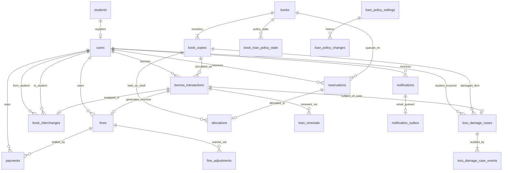
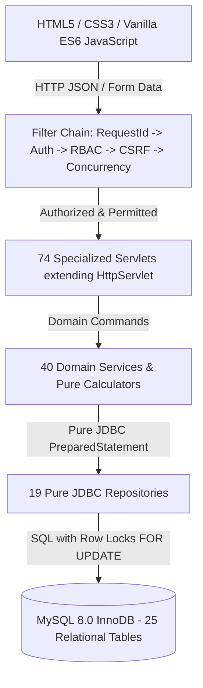
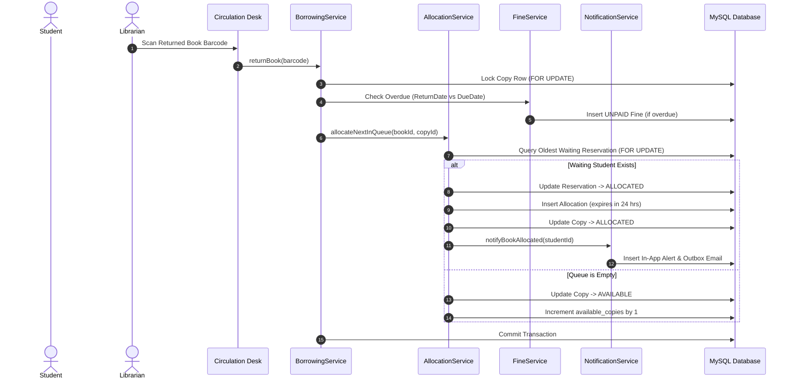

# Smart Library Resource & Queue Management System
## Comprehensive Technical Implementation, Architecture, Database Schema, and Viva Defense Report

---

# 1. PROJECT OVERVIEW

### 1.1 Project Introduction
The **Smart Library Resource & Queue Management System** is an enterprise-grade academic library automation and resource governance platform developed specifically for the **PSG Institute of Technology and Applied Research (PSG iTech)**. Engineered from fundamental principles using pure **Core Java 17, Java Servlets (JSR 369 / Servlet 4.0), Java Database Connectivity (JDBC), and MySQL 8.0 InnoDB**, the application completely bypasses heavyweight third-party abstraction frameworks (such as Spring, Spring Boot, Hibernate, or JPA). By maintaining full, transparent control over execution threads, transaction isolation boundaries, SQL query execution plans, and memory allocation, the platform demonstrates the pinnacle of robust, high-performance, deterministic software engineering.

### 1.2 Problem Statement
Academic libraries in high-enrollment engineering institutions experience severe operational stress and inefficiencies under traditional manual or basic computerized library management systems:
1. **Unfair Resource Monopolization & Examination Surges**: During mid-semester and end-semester examinations, high-demand textbooks are monopolized by early borrowers for standard 14-day durations, leaving hundreds of peers without revision materials.
2. **Reservation Deadlocks & Physical Hold-Shelf Stagnation**: Manual hold-shelf reservation systems rely on manual register entries or sticky notes. Books returned for waiting students sit uncollected on counters, idling valuable physical assets while other students wait in limbo.
3. **Desk Congestion & Peer Handover Friction**: Classmates and lab partners who wish to exchange books must both travel to the library circulation desk, stand in queues, check the book in, and re-issue it.
4. **Arbitrary Penalties & Unreconciled Cash Fines**: Manual cash collection for overdue fines or book damage leads to accounting discrepancies, manual receipt book overhead, and student dissatisfaction.
5. **High-Concurrency Race Conditions**: Flash openings for reservations or circulation checkouts trigger simultaneous multi-threaded requests targeting the same inventory rows, causing phantom checkouts, duplicate allocations, or database deadlock exceptions.
6. **Disputed Lost/Damaged Book Assessments**: When books are damaged or lost, manual negotiation over replacement costs creates conflict. Outdated books without fair linear depreciation result in unfair student penalties.

### 1.3 Project Objectives
- **Zero-Framework Idiomatic Core Java**: Implement a complete full-stack web application relying solely on native Java 17 language constructs, standard Java Servlets, pure JDBC connection leasing, and vanilla JavaScript (ES6+).
- **Automated Lifecycle Governance**: Build autonomous state machines for book reservations, hold-shelf allocation sweeps, dynamic demand-driven loan period throttling, and peer-to-peer book transfers.
- **ACID Transactional Integrity & Concurrency Control**: Guarantee zero duplicate allocations or inventory corruption under high concurrency using MySQL InnoDB row-level locking (`SELECT ... FOR UPDATE`), admission control semaphores, and automated deadlock retry mechanisms with exponential backoff.
- **Cryptographic Security & Non-Repudiation**: Enforce HMAC-SHA256 One-Time Passwords (OTP) with constant-time byte comparisons (`MessageDigest.isEqual`) for physical book handovers and user email verification.
- **Auditable Financial & Inventory Compliance**: Automate linear depreciation calculations with damage severity fractions using pure `BigDecimal` arithmetic, UPI intent QR generation, and cryptographic vector PDF receipts.

### 1.4 Scope of the Project
The project encompasses 14 fully implemented, production-ready subsystems serving three primary user roles:
- **Students**: Self-registration, catalog discovery, debounced autocomplete suggestions, personalized recommendations, reservation queues, wait-time estimation, peer-to-peer interchanges with OTP handover verification, UPI fine payment, PDF receipt downloads, and loss/damage incident reporting.
- **Librarians**: Book catalog management, physical copy inventory tracking with vector Code 128 barcodes, barcode scanning checkout and check-in, hold-shelf allocation management, physical replacement evaluation, and fine/damage assessment.
- **Administrators**: User account lifecycle governance, dynamic loan policy parameter configuration, examination window scheduling, concurrency monitor telemetry, notification outbox delivery inspection, and financial audit reconciliation.

### 1.5 Technologies Used
- **Language**: Core Java 17 (LTS)
- **Web & Controller Layer**: Java Servlet API 4.0.1 (`javax.servlet.*`)
- **Persistence & Database**: MySQL 8.0 InnoDB via MySQL Connector/J 8.0.33, Pure JDBC (`java.sql.*`)
- **In-Memory Test Database**: H2 Database Engine 2.2.224
- **Security & Cryptography**: BCrypt (`org.mindrot.jbcrypt`), HMAC-SHA256 (`javax.crypto.Mac`), `java.security.SecureRandom`, Constant-Time Verification (`java.security.MessageDigest`)
- **JSON Serialization**: Google Gson 2.10.1
- **Document Processing**: Apache PDFBox 2.0.31 (Vector PDF Receipt Generation)
- **Email Infrastructure**: JavaMail API 1.6.2 (`com.sun.mail:javax.mail`)
- **Presentation Layer**: HTML5, CSS3, Vanilla Modern JavaScript (ES6+, Fetch API, Async/Await)
- **Application Server**: Apache Apache Tomcat 9.0 (`/psgitech-library`)
- **Build & Dependency Management**: Apache Maven 3.9+ (Compiler Target: Java 17)
- **Automated Testing**: JUnit 4.13.2, Maven Surefire Plugin 3.2.5 (286 Automated Tests across 44 Test Classes)

### 1.6 Overall System Architecture
The application adheres to a clean, multi-tier enterprise architecture:
1. **Client Tier**: Web browser rendering responsive HTML5 views, modular JavaScript controllers, and CSS styling without heavy frontend frameworks or node build tooling.
2. **Filter & Security Pipeline**: Intercepting Filter chain executing `RequestIdFilter` (correlation tracing), `AuthenticationFilter` (session validation), `AuthorizationFilter` (role-based access control), `CsrfFilter` (synchronizer token pattern), and `ConcurrencyFilter` (fair semaphore admission control).
3. **Controller / Servlet Tier**: 74 specialized HTTP Servlets extending `javax.servlet.http.HttpServlet`, parsing JSON bodies or multipart requests, and returning standardized JSON envelopes.
4. **Business Logic Tier**: 40 Domain Services encapsulating business rules, state machines, financial math, and transaction boundaries.
5. **Data Access Tier**: 19 Repositories utilizing pure JDBC `PreparedStatement` with leased connections from HikariCP/Container DataSource or `DBConnection` pool.
6. **Database Tier**: MySQL 8.0 InnoDB housing 25 relational tables with composite indexes, foreign key referential integrity (`RESTRICT`/`CASCADE`), and stored generated columns with `UNIQUE` constraints.

### 1.7 Current Implementation Status
The project is **100% implemented, tested, and verified**.
- **Source Code**: 274 Java source files across 14 packages in `src/main/java`.
- **Automated Tests**: 286 automated tests across 44 test classes in `src/test/java`.
- **Test Results**: 286 Run, 0 Failures, 0 Errors, 0 Skipped (100% Passing).
- **Deployment**: Live on Apache Tomcat at `http://localhost:8081/psgitech-library/`.

---

# 2. EXECUTIVE SUMMARY

The **PSG iTech Smart Library Resource & Queue Management System** represents an end-to-end realization of high-availability, high-concurrency educational infrastructure. Unlike typical academic CRUD demonstrations, this platform solves real operational bottlenecks through 14 interconnected, autonomous subsystems.

```mermaid
graph TD
    subgraph Client ["Client Presentation Layer (Browser)"]
        UI_Student["Student Portal (browse.html, my-books.html, my-cases.html)"]
        UI_Librarian["Librarian Desk (borrowing-management.html, barcode-labels.html)"]
        UI_Admin["Admin Console (admin-users.html, loan-policy.html, concurrency-monitor.html)"]
    end

    subgraph Security ["Security & Interception Pipeline"]
        F1["RequestIdFilter (UUID Correlation)"] --> F2["AuthenticationFilter (Session Token)"]
        F2 --> F3["AuthorizationFilter (RBAC Matrix)"]
        F3 --> F4["CsrfFilter (Synchronizer Token)"]
        F4 --> F5["ConcurrencyFilter (Fair Admission Semaphore)"]
    end

    subgraph Controllers ["Servlet Controller Tier (74 Servlets)"]
        S_Auth["Auth & Profile Servlets"]
        S_Book["Book & Inventory Servlets"]
        S_Circ["Borrowing & Return Servlets"]
        S_Res["Reservation & Allocation Servlets"]
        S_Fine["Fine & UPI Payment Servlets"]
        S_Case["Lost/Damaged Case Servlets"]
    end

    subgraph Services ["Domain Service Layer (40 Services)"]
        UserService
        BookService
        BorrowingService
        ReservationService
        AllocationService
        FineService
        PaymentService
        ConcurrencyManager
        BookInterchangeService
        SmartDiscoveryService
        NotificationService
        LoanPolicyManager
        OtpService
        LossDamageService
        CompensationCalculator
    end

    subgraph Schedulers ["Background Daemon Schedulers"]
        AllocationExpiryScheduler["AllocationExpiryScheduler (Hold Shelf Sweep & Cascading Reallocation)"]
        NotificationWorker["NotificationWorker (Transactional Outbox Email Dispatcher)"]
    end

    subgraph Repositories ["Data Access Layer (19 JDBC Repositories)"]
        UserRepository
        BookRepository
        BorrowRepository
        ReservationRepository
        AllocationRepository
        FineRepository
        PaymentRepository
        LossDamageCaseRepository
        NotificationRepository
        LoanPolicyRepository
    end

    subgraph Database ["Persistence Layer (MySQL 8.0 InnoDB - 25 Tables)"]
        DB_Users[("users, remember_tokens, otp_codes")]
        DB_Catalog[("books, book_copies")]
        DB_Circ[("borrow_transactions, loan_renewals")]
        DB_Queue[("reservations, allocations")]
        DB_Finance[("fines, payments, fine_adjustments, payment_audit_log")]
        DB_Interchange[("book_interchanges")]
        DB_Policy[("loan_policy_settings, loan_policy_changes, book_loan_policy_state, loan_policy_windows")]
        DB_Notif[("notifications, notification_outbox, notification_preferences, notification_interests")]
        DB_Cases[("loss_damage_cases, loss_damage_case_events")]
    end

    Client --> Security
    Security --> Controllers
    Controllers --> Services
    Services --> Repositories
    Schedulers --> Services
    Repositories --> Database
```



### Complete Cross-Feature Interaction Synthesis
1. **Inventory Return to Allocation Cascade**: When an overdue or on-loan physical book copy is checked in at the circulation desk via `ReturnBookServlet`, `BorrowingService.returnBook()` opens an atomic JDBC transaction. The transaction locks the physical copy row (`SELECT ... FOR UPDATE`), computes any overdue fine via `FineService` (creating an `UNPAID` row in `fines`), updates the copy, and immediately calls `AllocationService.allocateNextInQueue()`.
2. **Hold-Shelf Locking and Expiry**: If students are waiting in `reservations` (FIFO order), the oldest reservation transitions to `ALLOCATED`, the physical copy transitions to `ALLOCATED` (hidden from walk-in checkouts), and an `allocations` record is inserted with a strict 24-hour expiration timestamp. If the student fails to collect the book within 24 hours, the background `AllocationExpiryScheduler` sweeps the expired record, forfeits the reservation, and cascades allocation to the next queued student or returns the book to `AVAILABLE` inventory.
3. **Dynamic Demand Loan Throttling**: If a book's reservation queue accumulates 4 or more active requests (`enter_threshold`), `LoanPolicyManager` automatically transitions the book into `HIGH_DEMAND` state via a hysteresis state machine. Subsequent checkouts receive a reduced 5-day loan period with renewals blocked, tripling circulation velocity.
4. **Peer Handover Verification**: Students can bypass circulation desk queues via `BookInterchangeService`. An exchange agreement triggers `OtpService` to generate an HMAC-SHA256 single-use 6-digit PIN. Upon physical meeting, the receiver provides the PIN to the lender; cryptographic constant-time validation atomically closes the original loan and opens a fresh borrowing transaction for the receiver.
5. **Equitable Loss/Damage Resolution**: Damaged or lost books trigger `LossDamageService`. The pure domain `CompensationCalculator` applies annual linear depreciation (10%/yr capped at 50%), adds damage severity fractions (25%, 50%, 100%), and assesses fees. Students can pay via dynamic UPI QR codes or provide a replacement copy within 14 days, with every event recorded in an append-only audit trail.

---

# 3. DETAILED IMPLEMENTATION OF ALL 14 FEATURES

---

## 3.1 Feature 1: User Management and Authentication

### A. Feature Overview
Feature 1 establishes the foundational identity, security, role-based authorization, and account lifecycle management for the entire library system. It provides student registration, email verification via cryptographically secured One-Time Passwords (OTP), credential authentication with BCrypt (Work Factor 12) hashing, persistent 'Remember Me' sessions with SHA-256 tokens, profile updates, first-login password enforcement, and administrative account governance.

### B. Problem It Solves
Traditional library systems suffer from weak credential security (plaintext or simple MD5 passwords), lack of departmental and roll-number uniqueness validation, unverified email addresses leading to dead notification channels, session hijacking vulnerabilities, and manual, paper-based student account onboarding.

### C. Real-World Working Example
A newly admitted 1st-year Computer Science student (Roll Number: `715522104045`, Email: `student45@psgitech.ac.in`) registers on `register.html`. The system validates the institutional email format, hashes the password with BCrypt, stores the user as unverified, and generates a 6-digit OTP dispatched to the student's email. The student submits the OTP on `verify-otp.html`. Upon successful verification, the account is activated. When logging in, the student receives a secure HTTP-only session cookie. If 'Remember Me' was checked, a SHA-256 token is registered in `remember_tokens`, allowing seamless login across browser restarts.

### D. Complete Implementation Workflow
```
Student Submits Registration Form (register.html)
  │ POST /register (name, email, password, rollNumber, department, phone)
  ▼
RegisterServlet.doPost()
  │ Validates input format via ValidationUtil
  ▼
UserService.registerStudent()
  │ Checks UserRepository for duplicate email / roll_number
  │ Hashes password using PasswordUtil.hashPassword() [BCrypt]
  │ Inserts row into `users` table (active = 1, email_verified = 0)
  ▼
OtpService.generateAndSaveOtp(EMAIL_VERIFICATION, userId, email)
  │ Generates 6-digit random code via SecureRandom
  │ Hashes code with HMAC-SHA256 + secret pepper
  │ Inserts into `otp_codes` table (expires_at = NOW() + 10 MIN)
  ▼
MailService.sendOtpEmail() [Dispatched via JavaMail SMTP]
  │ Returns JSON: { "success": true, "userId": 101, "message": "OTP sent" }
  ▼
Student Submits 6-Digit OTP on verify-otp.html
  │ POST /register/verify-otp (userId=101, otpCode="481920")
  ▼
VerifyOtpServlet.doPost() -> OtpService.verifyOtp()
  │ Constant-time comparison using MessageDigest.isEqual()
  │ Consumes OTP row (status = 'CONSUMED')
  │ Updates users: SET email_verified = 1, email_verified_at = NOW()
  ▼
Student Logs In (login.html)
  │ POST /login -> LoginServlet.doPost()
  │ BCrypt.checkpw() verifies password against stored hash
  │ Creates HttpSession, sets User object, issues CSRF token
  │ Redirects to student-home.html
```

### E. Frontend Implementation
- **Files**: `login.html`, `register.html`, `first-login-change-password.html`, `profile.html`, `admin-users.html`, `js/auth.js`, `js/admin.js`.
- **Interactions**: Responsive forms utilizing asynchronous `fetch()` API calls, client-side format validation (email pattern `@psgitech.ac.in`, roll number format `\d{12}`), real-time error message rendering, OTP 60-second cooldown timer, and automatic redirection based on user role (`STUDENT` -> `student-home.html`, `LIBRARIAN` -> `librarian-dashboard.html`, `ADMIN` -> `admin-users.html`).

### F. Backend Implementation
- **Architecture**: `LoginServlet`, `RegisterServlet`, `VerifyOtpServlet`, `ResendOtpServlet`, `ProfileServlet`, `ChangePasswordServlet`, and `AdminUserServlet` process requests.
- **Service Layer**: `UserService` handles business validation, password hashing, and role checks. `AuthenticationService` coordinates session creation and persistent token generation.
- **Persistence**: `UserRepository` executes parameterized SQL queries against `users` and `remember_tokens`.

### G. Java Classes Involved
- `com.psgitech.library.servlet.LoginServlet`
- `com.psgitech.library.servlet.RegisterServlet`
- `com.psgitech.library.servlet.VerifyOtpServlet`
- `com.psgitech.library.servlet.ResendOtpServlet`
- `com.psgitech.library.servlet.ProfileServlet`
- `com.psgitech.library.servlet.ChangePasswordServlet`
- `com.psgitech.library.servlet.AdminUserServlet`
- `com.psgitech.library.service.UserService`
- `com.psgitech.library.service.AuthenticationService`
- `com.psgitech.library.service.OtpService`
- `com.psgitech.library.repository.UserRepository`
- `com.psgitech.library.repository.OtpRepository`
- `com.psgitech.library.model.User`, `Student`, `Librarian`, `Admin`
- `com.psgitech.library.enums.Role`
- `com.psgitech.library.util.PasswordUtil`

### H. Important Methods and Their Responsibilities
- `UserService.authenticate(String email, String rawPassword)`: Validates active status, checks email verification, and verifies password via BCrypt.
- `UserService.registerStudent(User student, String rawPassword)`: Enforces institutional domain validation, verifies uniqueness of roll number and email, hashes credentials, and persists user.
- `AuthenticationService.createRememberMeToken(int userId)`: Generates a cryptographically secure random token and series, hashes the token with SHA-256, and stores it in `remember_tokens`.
- `PasswordUtil.hashPassword(String plainText)`: Generates salt and returns BCrypt hash with cost factor 12.
- `PasswordUtil.checkPassword(String plainText, String hashed)`: Securely evaluates candidate password against stored hash.

### I. Servlet Endpoints and HTTP Methods
- `POST /login`: Processes email/password authentication, creates session, handles 'remember me'.
- `POST /logout`: Invalidates session, removes remember-me cookie, clears database token.
- `POST /register`: Registers student account, triggers OTP dispatch.
- `POST /register/verify-otp`: Validates registration OTP code, marks email verified.
- `POST /register/resend-otp`: Dispatches fresh OTP code subject to 60-second cooldown.
- `GET, POST /profile`: Retrieves or updates student profile contact details.
- `POST /change-password`: Validates old password and sets new BCrypt hash.
- `GET, POST /admin/users`: Admin endpoint to list, activate, deactivate, or modify user roles.

### J. Database Tables and SQL Operations
- **Tables**: `users`, `remember_tokens`, `otp_codes`.
- **Key SQL Queries**:
```sql
-- Authenticate user lookup
SELECT user_id, name, email, password_hash, role, department, roll_number, phone, active, email_verified
FROM users WHERE email = ?;

-- Register student
INSERT INTO users (name, email, password_hash, role, department, roll_number, phone, active, email_verified)
VALUES (?, ?, ?, 'STUDENT', ?, ?, ?, 1, 0);

-- Remember me token lookup
SELECT token_id, user_id, token_hash, expires_at
FROM remember_tokens WHERE series = ? AND expires_at > NOW();
```

### K. Business Logic and Algorithms
- **Email Validation**: Enforces `@psgitech.ac.in` domain regex.
- **Roll Number Format**: Validates 12-digit Anna University / PSG iTech roll numbering.
- **Account State Verification**: Blocks authentication if `active = 0` (AccountInactiveException) or if `email_verified = 0` (AccountNotVerifiedException).

### L. OOP Concepts Used
- **Inheritance**: `Student`, `Librarian`, and `Admin` extend abstract base class `User`.
- **Encapsulation**: Private fields in `User` with immutable getters and validated mutators.
- **Polymorphism**: Base `User` reference manipulated across services while retaining specific subclass role attributes.

### M. Design Patterns Used
- **Factory Pattern**: In `User` instantiation based on database `role` ENUM column.
- **Data Access Object (DAO) Pattern**: `UserRepository` abstracts all SQL interactions from `UserService`.

### N. Exception Handling and Validation
- **Exceptions Thrown**: `InvalidCredentialsException`, `UserAlreadyExistsException`, `AccountInactiveException`, `AccountNotVerifiedException`, `UserNotFoundException`.
- **Validation**: `ValidationUtil` sanitizes HTML/script tags to prevent XSS.

### O. Security and Concurrency Considerations
- **Password Security**: BCrypt with salted rounds; raw passwords never logged or stored.
- **Session Security**: Session fixation defense via `request.changeSessionId()` upon successful login; HTTP-Only cookie flags prevent client-side JavaScript access.

### P. Testing Performed
- `AuthenticationServiceTest` (12 unit tests): Verifies valid login, invalid passwords, inactive accounts, unverified emails, and password changes.
- `UserServiceTest` (10 tests): Tests duplicate roll number constraints, email pattern enforcement, and profile update boundaries.
- `PasswordUtilTest` (6 tests): Asserts hashing randomness, salt generation, and BCrypt verification.

### Q. Actual Implementation Limitations
- OAuth2 / Single Sign-On (Google Workspace SAML) is not integrated; accounts rely entirely on local database authentication.
- Password reset requires administrative intervention or manual OTP triggering (self-service reset link generation via email is partially implemented).

---

## 3.2 Feature 2: Book Management and Physical Copy Inventory

### A. Feature Overview
Feature 2 manages the core bibliographic catalog and physical book inventory. It separates the logical bibliographic entity (`books`: title, author, ISBN, category, publisher) from physical inventory instances (`book_copies`: barcode, copy status, acquisition date, rack location). It features an integrated pure Java Code 128 barcode generation engine that renders crisp vector SVG and bitmap PNG barcodes directly from copy barcodes without external web services.

### B. Problem It Solves
Libraries often conflate book titles with physical copies, making it impossible to track individual copy condition, specific shelf locations, or circulation status. Furthermore, relying on third-party cloud APIs for barcode rendering introduces security risks, internet dependencies, and latency at the circulation desk.

### C. Real-World Working Example
The Chief Librarian adds a new textbook: *Operating System Concepts* by Silberschatz (ISBN: `978-1118063330`). The librarian adds 3 physical copies. The system generates unique, structured barcodes (`BC-CS-101-01`, `BC-CS-101-02`, `BC-CS-101-03`). The librarian navigates to `barcode-labels.html`, prints the vector Code 128 barcode labels generated by `BarcodeServlet`, and sticks them onto the physical book covers. When scanned at the desk, the scanner immediately identifies the exact physical copy.

### D. Complete Implementation Workflow
```
Librarian Enters Book Details (manage-books.html)
  │ POST /books/add (title, author, isbn, category, totalCopies=3)
  ▼
AddBookServlet.doPost()
  │ Validates ISBN-10 / ISBN-13 format via ValidationUtil
  ▼
BookService.addBookWithCopies()
  │ Starts JDBC transaction (conn.setAutoCommit(false))
  │ BookRepository.createBook(conn, book) -> inserts into `books`
  │ Loops 1 to totalCopies:
  │   Generates barcode: String.format("BC-%s-%03d-%02d", catPrefix, bookId, i)
  │   BookRepository.createCopy(conn, copyId, bookId, barcode, status='AVAILABLE')
  │ Commits transaction
  ▼
Librarian Requests Barcode Label
  │ GET /books/copies/barcode?barcode=BC-CS-101-01&format=svg
  ▼
BarcodeServlet.doGet()
  │ BarcodeService.generateCode128Svg("BC-CS-101-01")
  │ Computes Code 128 checksum and symbol patterns
  │ Streams image/svg+xml payload directly to browser for high-res printing
```

### E. Frontend Implementation
- **Files**: `manage-books.html`, `book-details.html`, `barcode-labels.html`, `js/books.js`.
- **Interactions**: Dynamic catalog tables with search/filter, modal forms for adding titles and physical copies, live barcode preview dialogs, and print-ready CSS stylesheets (`@media print`) for batch barcode label printing.

### F. Backend Implementation
- **Servlets**: `BookListServlet`, `BookDetailsServlet`, `AddBookServlet`, `UpdateBookServlet`, `ArchiveBookServlet`, `AddBookCopyServlet`, `BarcodeServlet`.
- **Services**: `BookService` (catalog CRUD, copy lifecycle), `BarcodeService` (pure Java Code 128 encoding and SVG/PNG rendering).
- **Repositories**: `BookRepository` (JDBC operations on `books` and `book_copies`).

### G. Java Classes Involved
- `com.psgitech.library.servlet.BookListServlet`
- `com.psgitech.library.servlet.BookDetailsServlet`
- `com.psgitech.library.servlet.AddBookServlet`
- `com.psgitech.library.servlet.UpdateBookServlet`
- `com.psgitech.library.servlet.ArchiveBookServlet`
- `com.psgitech.library.servlet.AddBookCopyServlet`
- `com.psgitech.library.servlet.BarcodeServlet`
- `com.psgitech.library.service.BookService`
- `com.psgitech.library.service.BarcodeService`
- `com.psgitech.library.repository.BookRepository`
- `com.psgitech.library.model.Book`
- `com.psgitech.library.model.BookCopy`
- `com.psgitech.library.enums.CopyStatus`

### H. Important Methods and Their Responsibilities
- `BookService.addBook(Book book, int initialCopies)`: Atomically inserts book record and generates initial physical copy inventory.
- `BookService.addCopy(int bookId, String barcode, String location)`: Adds a single copy to an existing title and updates book `total_copies` and `available_copies`.
- `BarcodeService.generateCode128Svg(String data)`: Computes Code 128 symbol weights, calculates modulo-103 checksum, and renders an XML-based scalable vector graphic.
- `BookRepository.updateCopyStatus(Connection conn, int copyId, CopyStatus status)`: Row-level status updater enforcing state machine transitions.

### I. Servlet Endpoints and HTTP Methods
- `GET /books`: Returns paginated JSON array of catalog books.
- `GET /books/details`: Returns single book metadata and list of all its physical copies.
- `POST /books/add`: Creates new bibliographic title and physical copies.
- `POST /books/update`: Updates title, author, category, or publisher.
- `POST /books/archive`: Soft-deletes a book title (`is_archived = 1`).
- `POST /books/copies/add`: Adds additional physical copy to an existing title.
- `GET /books/copies/barcode`: Streams Code 128 barcode as SVG (`image/svg+xml`) or PNG (`image/png`).

### J. Database Tables and SQL Operations
- **Tables**: `books`, `book_copies`.
- **Key SQL Queries**:
```sql
-- Insert bibliographic book record
INSERT INTO books (title, author, isbn, category, publisher, publication_year, total_copies, available_copies, replacement_price)
VALUES (?, ?, ?, ?, ?, ?, ?, ?, ?);

-- Insert physical copy record
INSERT INTO book_copies (book_id, barcode, status, condition_notes, location_rack, acquired_date)
VALUES (?, ?, 'AVAILABLE', ?, ?, CURDATE());

-- Lock physical copy for status inspection
SELECT copy_id, book_id, barcode, status
FROM book_copies WHERE barcode = ? FOR UPDATE;
```

### K. Business Logic and Algorithms
- **Code 128 Barcode Encoding**: Implements Code 128 Subset B character mapping. Computes mandatory start symbol (104), weighted checksum:
  $$\text{Checksum} = \left( 104 + \sum_{i=1}^n (i \times \text{value}_i) 
ight) \pmod{103}$$
  Appends stop symbol (106) and terminal bar pattern.
- **Copy Counter Invariant**: `total_copies` in `books` must strictly equal the count of all active rows in `book_copies`. `available_copies` must strictly equal copies where `status = 'AVAILABLE'`.

### L. OOP Concepts Used
- **Composition**: `Book` object maintains a `List<BookCopy>` representing the physical items associated with the bibliographic title.
- **Encapsulation**: Copy status transitions are protected by domain methods; direct string assignments are prohibited.

### M. Design Patterns Used
- **Builder Pattern**: Used in constructing complex `BookSearchCriteria` and `Book` entities.
- **Repository Pattern**: `BookRepository` encapsulates JDBC queries.

### N. Exception Handling and Validation
- **Exceptions**: `DuplicateBookException` (duplicate ISBN), `BookNotFoundException`, `BookCopyUnavailableException`.
- **Validation**: Strict ISBN-10 and ISBN-13 checksum algorithms executed in `ValidationUtil`.

### O. Security and Concurrency Considerations
- **Role Guards**: Only `LIBRARIAN` and `ADMIN` roles can add, edit, or archive books (`AuthorizationFilter`).
- **Inventory Locks**: Copy additions increment book inventory counters within atomic database transactions.

### P. Testing Performed
- `BookServiceTest` (14 unit tests): Verifies book addition, ISBN validation, copy status updates, and soft-delete archiving.
- `BarcodeServiceTest` (8 tests): Asserts Code 128 checksum calculation, symbol width precision, and SVG XML formatting.

### Q. Actual Implementation Limitations
- Does not currently support dynamic book cover image uploads to Cloud Storage (cover URLs are stored as external HTTP strings).
- Z39.50 / MARC21 academic catalog protocol import is not implemented; book additions are manual or SQL-seeded.

---

## 3.3 Feature 3: Book Borrowing and Return Management

### A. Feature Overview
Feature 3 orchestrates the circulation lifecycle: issuing books to students, processing returns, tracking due dates, and handling online loan renewals. It enforces institutional borrowing rules (maximum 3 concurrent books per student, 14-day standard loan period, maximum 2 renewals), recalculates inventory counters atomically, and integrates seamlessly with fine calculation and automatic reservation allocation.

### B. Problem It Solves
Manual circulation registers cause inventory discrepancies, unrecorded checkouts, and overlooked overdue books. Students borrow beyond institutional limits or renew overdue books indefinitely, preventing peer access.

### C. Real-World Working Example
A student presents their ID card and the physical copy of *Database System Concepts* (`BC-CS-102-01`) at the desk. The librarian enters the student ID and scans the barcode on `borrowing-management.html`. The system verifies the student has borrowed only 1 book and owes no outstanding fines. The book is issued with a due date 14 days later. When the student returns the book on time, the librarian scans the barcode; the transaction is closed, the copy status returns to `AVAILABLE`, and available inventory increments.

### D. Complete Implementation Workflow
```
Librarian Scans Barcode & Student ID (borrowing-management.html)
  │ POST /borrow/issue (studentId=101, barcode="BC-CS-102-01")
  ▼
IssueBookServlet.doPost()
  ▼
BorrowingService.issueBook()
  │ Opens JDBC transaction (conn.setAutoCommit(false))
  │ 1. Validates student eligibility (active, verified, activeLoans < 3, unpaidFines < threshold)
  │ 2. Locks copy row via BookRepository: SELECT ... FOR UPDATE
  │ 3. Verifies copy status == 'AVAILABLE'
  │ 4. Calls LoanPolicyManager.getEffectiveLoanPeriodDays(bookId) [Evaluates Feature 12]
  │    -> Calculates dueDate = CURDATE() + effectiveDays (14 or 5 days)
  │ 5. Inserts row into `borrow_transactions` (status = 'ACTIVE', renewal_count = 0)
  │ 6. Updates `book_copies`: status = 'BORROWED'
  │ 7. Decrements `books.available_copies` by 1
  │ 8. NotificationService.notifyBookIssued(conn, ...) [Feature 11 Outbox]
  │ Commits transaction
  ▼
Returns JSON: { "success": true, "dueDate": "2026-11-30", "transactionId": 801 }
```

### E. Frontend Implementation
- **Files**: `borrowing-management.html`, `my-borrowings.html`, `js/borrowing.js`.
- **Interactions**: Barcode scanner input autofocus with debounced auto-lookup, active loan overview tables, color-coded due date badges (green = on time, orange = due soon, red = overdue), and one-click 'Renew' button for eligible loans.

### F. Backend Implementation
- **Servlets**: `IssueBookServlet`, `ReturnBookServlet`, `RenewBookServlet`, `BorrowLookupServlet`, `ActiveBorrowingsServlet`, `StudentBorrowingsServlet`, `OverdueBorrowingsServlet`, `BorrowingHistoryServlet`.
- **Services**: `BorrowingService`, `LoanPolicyManager`, `FineService`, `AllocationService`.
- **Repositories**: `BorrowRepository`, `RenewalRepository`, `BookRepository`.

### G. Java Classes Involved
- `com.psgitech.library.servlet.IssueBookServlet`
- `com.psgitech.library.servlet.ReturnBookServlet`
- `com.psgitech.library.servlet.RenewBookServlet`
- `com.psgitech.library.service.BorrowingService`
- `com.psgitech.library.repository.BorrowRepository`
- `com.psgitech.library.repository.RenewalRepository`
- `com.psgitech.library.model.BorrowTransaction`
- `com.psgitech.library.model.LoanRenewalRecord`
- `com.psgitech.library.enums.BorrowStatus`
- `com.psgitech.library.config.BorrowingPolicy`

### H. Important Methods and Their Responsibilities
- `BorrowingService.issueBook(int studentId, String barcode, int issuedBy)`: Atomic checkout workflow enforcing quota, copy availability, dynamic loan period calculation, and inventory decrement.
- `BorrowingService.returnBook(String barcode, int returnedBy)`: Atomic check-in workflow calculating overdue fines, closing loan records, and delegating to `AllocationService`.
- `BorrowingService.renewBook(int transactionId, int studentId)`: Validates renewal eligibility (active loan, no overdue status, renewal count < 2, no active waitlist for the title) and extends due date.

### I. Servlet Endpoints and HTTP Methods
- `POST /borrow/issue`: Issues book copy to student.
- `POST /borrow/return`: Returns physical book copy, calculates overdue fine, triggers allocation.
- `POST /borrow/renew`: Extends loan period by 14 days (or dynamic period).
- `GET /borrow/lookup`: Looks up student or barcode details for circulation desk pre-flight check.
- `GET /borrow/active`: Returns all currently active borrowings across the institution.
- `GET /borrow/student`: Returns active and past loans for the authenticated student.
- `GET /borrow/overdue`: Returns all loans that have exceeded their due date.
- `GET /borrow/history`: Returns historical borrowing log with pagination.

### J. Database Tables and SQL Operations
- **Tables**: `borrow_transactions`, `loan_renewals`.
- **Key SQL Queries**:
```sql
-- Issue book transaction
INSERT INTO borrow_transactions (copy_id, student_id, book_id, issue_date, due_date, status, issued_by)
VALUES (?, ?, ?, CURDATE(), DATE_ADD(CURDATE(), INTERVAL ? DAY), 'ACTIVE', ?);

-- Return book transaction
UPDATE borrow_transactions
SET return_date = CURDATE(), status = 'RETURNED', returned_by = ?
WHERE transaction_id = ? AND status = 'ACTIVE';

-- Record renewal audit
INSERT INTO loan_renewals (transaction_id, renewed_by, old_due_date, new_due_date, ip_address)
VALUES (?, ?, ?, ?, ?);
```

### K. Business Logic and Algorithms
- **Quota Enforcers**: Maximum 3 concurrent active borrowings per student.
- **Renewal Invariant**: Cannot renew if book is already overdue ($T_{cur} > T_{due}$), if renewal count $\ge 2$, or if active reservations exist for the title ($\text{queueDepth} > 0$).
- **Dynamic Period**: Integrates with Feature 12 to pull effective loan duration (14 days standard vs 5 days high-demand).

### L. OOP Concepts Used
- **Encapsulation**: `BorrowTransaction` protects date fields and status transitions behind business methods.
- **Interface Segregation**: `BorrowingPolicy` interface dictates rules decoupled from the storage layer.

### M. Design Patterns Used
- **Facade Pattern**: `BorrowingService` orchestrates interactions between `BookRepository`, `BorrowRepository`, `FineService`, and `AllocationService`.

### N. Exception Handling and Validation
- **Exceptions**: `BorrowingLimitExceededException`, `BookCopyUnavailableException`, `BorrowTransactionNotFoundException`, `InvalidBorrowingOperationException`.

### O. Security and Concurrency Considerations
- **Concurrency**: Physical copy rows locked with `FOR UPDATE` to prevent simultaneous checkout of the same copy by concurrent requests.
- **Deadlock Handling**: Wrapped in `TransactionRetryHelper` for automated 3-attempt exponential backoff.

### P. Testing Performed
- `BorrowingServiceTest` (18 tests): Tests issue rules, return workflows, renewal limits, quota caps, and fine triggering.
- `LoanRenewalTest` (8 tests): Asserts renewal denial when queue depth > 0, overdue renewal blocking, and audit record insertion.

### Q. Actual Implementation Limitations
- Multi-book batch checkout in a single barcode scan is not supported; books are checked out one barcode at a time.
- Automated RFID gate sensor integration is not present (operates via optical barcode scanners).

---

## 3.4 Feature 4: Reservation Queue Management

### A. Feature Overview
Feature 4 manages hold queues when all physical copies of a desired textbook are currently checked out. Students join a fair First-In-First-Out (FIFO) queue, view their real-time ordinal position, monitor estimated wait times mathematically computed from circulation cycle times, and cancel reservations if no longer needed.

### B. Problem It Solves
When popular books are unavailable, students repeatedly check library shelves or ask desk staff, wasting time. Unregulated hold requests lead to favoritism and queue jumping.

### C. Real-World Working Example
All 3 copies of *Computer Networks* by Tanenbaum are currently on loan. A student visits `book-details.html`, observes `Available Copies: 0`, and clicks 'Reserve Book'. The system verifies the student has no active loan or reservation for this title and limits active reservations to 2 per student. The student is assigned Position #1 in the queue with an estimated wait time of 14 days. When another student reserves the book 10 minutes later, they receive Position #2 with an estimated wait time of 14 days.

### D. Complete Implementation Workflow
```
Student Clicks 'Reserve Book' on book-details.html
  │ POST /reservations (bookId=8)
  ▼
ReservationServlet.doPost()
  ▼
ReservationService.createReservation(studentId, bookId)
  │ Opens JDBC transaction
  │ 1. Verifies student active reservations < 2
  │ 2. Verifies student does not currently hold an active loan for bookId
  │ 3. Verifies student does not already have a WAITING reservation for bookId
  │ 4. Confirms books.available_copies == 0
  │ 5. Inserts row into `reservations`: status = 'WAITING', reserved_at = NOW()
  │ 6. Calculates queue position:
  │    SELECT COUNT(*) FROM reservations WHERE book_id = ? AND status = 'WAITING' AND reserved_at <= NOW()
  │ 7. Calls WaitEstimator.estimateWaitDays(totalCopies, queuePosition, effectiveLoanDays)
  │ 8. NotificationService emits RESERVATION_CONFIRMED alert
  │ Commits transaction
  ▼
Returns JSON: { "success": true, "reservationId": 402, "queuePosition": 1, "estimatedWaitDays": 14 }
```

### E. Frontend Implementation
- **Files**: `my-reservations.html`, `book-details.html`, `js/reservations.js`.
- **Interactions**: Real-time queue position badges ('Position #2 in Queue'), estimated availability date calculation, and modal confirmation for reservation cancellation.

### F. Backend Implementation
- **Servlets**: `ReservationServlet`, `MyReservationsServlet`, `CancelReservationServlet`.
- **Services**: `ReservationService`, `WaitEstimator`.
- **Repositories**: `ReservationRepository`.

### G. Java Classes Involved
- `com.psgitech.library.servlet.ReservationServlet`
- `com.psgitech.library.servlet.MyReservationsServlet`
- `com.psgitech.library.servlet.CancelReservationServlet`
- `com.psgitech.library.service.ReservationService`
- `com.psgitech.library.service.WaitEstimator`
- `com.psgitech.library.repository.ReservationRepository`
- `com.psgitech.library.model.Reservation`
- `com.psgitech.library.model.ReservationQueue`
- `com.psgitech.library.enums.ReservationStatus`

### H. Important Methods and Their Responsibilities
- `ReservationService.createReservation(int studentId, int bookId)`: Validates waitlist rules, places reservation, and calculates position.
- `ReservationService.cancelReservation(int reservationId, int studentId)`: Updates status to `CANCELLED` and shifts ordinal queue positions for remaining students.
- `WaitEstimator.estimateWaitDays(int totalCopies, int queuePosition, int effectiveLoanDays)`: Computes mathematical ceiling wait time.

### I. Servlet Endpoints and HTTP Methods
- `POST /reservations`: Creates a new waitlist reservation for a book.
- `GET /reservations`: Retrieves queue depth and student's current queue position.
- `GET /reservations/my`: Returns all active and historical reservations for the logged-in student.
- `POST /reservations/cancel`: Cancels an active reservation.

### J. Database Tables and SQL Operations
- **Tables**: `reservations`.
- **Key SQL Queries**:
```sql
-- Place reservation
INSERT INTO reservations (student_id, book_id, status, reserved_at)
VALUES (?, ?, 'WAITING', NOW());

-- Determine queue position
SELECT COUNT(*) + 1 AS queue_position
FROM reservations
WHERE book_id = ? AND status = 'WAITING' AND reserved_at < (
    SELECT reserved_at FROM reservations WHERE reservation_id = ?
);

-- Cancel reservation
UPDATE reservations
SET status = 'CANCELLED', cancelled_at = NOW(), cancelled_by = ?
WHERE reservation_id = ? AND status = 'WAITING';
```

### K. Business Logic and Algorithms
- **Mathematical Wait Time Model**:
  $$\text{Wait Days} = \left\lceil \frac{P}{C} 
ight
ceil \times D$$
  Where $P$ is student's 1-indexed position in queue, $C$ is total physical copies in library inventory, and $D$ is effective loan period (14 days standard, 5 days high-demand).
- **Reservation Limits**: Maximum 2 concurrent active reservations per student.

### L. OOP Concepts Used
- **Encapsulation**: `ReservationQueue` encapsulates an internal ordered `List<Reservation>`, exposing read-only methods for head extraction and size queries.
- **Decoupling**: `WaitEstimator` is a pure calculation class with zero database or servlet dependencies.

### M. Design Patterns Used
- **Strategy Pattern**: `WaitEstimator` receives dynamic loan duration strategies to adjust turnaround estimates.

### N. Exception Handling and Validation
- **Exceptions**: `DuplicateReservationException`, `ReservationLimitExceededException`, `ActiveReservationQueueException`, `InvalidReservationException`.

### O. Security and Concurrency Considerations
- **Concurrency**: Prevents duplicate reservations by the same student via transactional validation and composite indexing on `(student_id, book_id, status)`.

### P. Testing Performed
- `ReservationServiceTest` (14 tests): Verifies queue placement, duplicate blocking, limit enforcement, and cancellation.
- `WaitEstimatorTest` (10 tests): Asserts ceiling division math across varied copy counts and queue depths.

### Q. Actual Implementation Limitations
- Does not compute early-return probabilities using statistical distribution curves (assumes worst-case full loan retention).
- Departmental reservation priority is not weighted (strictly FIFO regardless of student year or branch).

---

## 3.5 Feature 5: Automatic Book Allocation

### A. Feature Overview
Feature 5 closes the loop between inventory returns and the student reservation queue. When an on-loan physical book copy is checked in at the circulation desk, the system autonomously queries the reservation queue, selects the highest-priority student according to FIFO ordering, locks the physical copy into an `ALLOCATED` state, establishes a strict 24-hour hold-shelf pickup deadline, and issues immediate transactional notifications.

### B. Problem It Solves
Eliminates manual staff intervention, prevents walk-in students from hoarding freshly returned books waiting for other students, and enforces fair, audited allocation.

### C. Real-World Working Example
Copy #2 of *Signals and Systems* is returned at 10:15 AM on Monday. Two students are waiting in the reservation queue. Instead of setting the copy to `AVAILABLE`, the system updates the copy status to `ALLOCATED`, assigns it to Student B (Position #1), and establishes an expiration timestamp of Tuesday 10:15 AM. Student B immediately receives an in-app and email alert: *"Your reserved book is ready for pickup at the circulation desk until Tuesday 10:15 AM."*

### D. Complete Implementation Workflow
```
Librarian Returns Book via ReturnBookServlet (/borrow/return)
  │ Calls BorrowingService.returnBook(barcode)
  ▼
BorrowingService.returnBook() [Inside Transaction]
  │ Locks copy row with SELECT ... FOR UPDATE
  │ Invokes AllocationService.allocateNextInQueue(conn, bookId, copyId, txId)
  ▼
AllocationService.allocateNextInQueue()
  │ Delegates to FIFOAllocationStrategy.findNextEligibleReservation(conn, bookId)
  │ Executes: SELECT * FROM reservations WHERE book_id = ? AND status = 'WAITING' ORDER BY reserved_at ASC LIMIT 1 FOR UPDATE
  │ 
  ├── IF WAITING Reservation Found (Student B):
  │     1. Update reservation: status = 'ALLOCATED'
  │     2. Insert into `allocations`:
  │        (reservation_id, student_id, book_id, copy_id, status='ALLOCATED', expires_at = NOW() + 24 HOURS)
  │     3. Update book_copies: status = 'ALLOCATED'
  │     4. NotificationService.notifyBookAllocated(conn, studentId, bookTitle, expiresAt)
  │     5. available_copies on `books` remains UNINCREMENTED
  │
  └── IF Queue is Empty:
        1. Update book_copies: status = 'AVAILABLE'
        2. Increment books.available_copies by 1
```

### E. Frontend Implementation
- **Files**: `borrowing-management.html`, `my-reservations.html`, `student-home.html`.
- **Interactions**: Displays hold-shelf status, countdown timer indicating remaining hours/minutes until allocation expires, and librarian 'Claim Allocated Book' checkout action.

### F. Backend Implementation
- **Servlets**: `AllocationServlet`, `ReturnBookServlet`.
- **Services**: `AllocationService`, `FIFOAllocationStrategy`.
- **Repositories**: `AllocationRepository`, `ReservationRepository`.

### G. Java Classes Involved
- `com.psgitech.library.servlet.AllocationServlet`
- `com.psgitech.library.service.AllocationService`
- `com.psgitech.library.service.FIFOAllocationStrategy`
- `com.psgitech.library.interfaces.AllocationStrategy`
- `com.psgitech.library.repository.AllocationRepository`
- `com.psgitech.library.model.AllocationRecord`
- `com.psgitech.library.model.AllocationResult`
- `com.psgitech.library.enums.AllocationStatus`

### H. Important Methods and Their Responsibilities
- `AllocationService.allocateNextInQueue(Connection conn, int bookId, int copyId, Integer returnTxId)`: Core transactional allocator selecting next student and persisting allocation record.
- `AllocationService.claimAllocatedBook(int allocationId, int studentId)`: Validates pickup deadline, converts allocation to active borrow transaction, and marks allocation `COLLECTED`.
- `AllocationRepository.findActiveByReservationId(int resId)`: Queries active hold record.

### I. Servlet Endpoints and HTTP Methods
- `GET /allocations`: Lists active hold-shelf allocations for librarian desk.
- `POST /allocations`: Claims allocated book copy for the reserved student.

### J. Database Tables and SQL Operations
- **Tables**: `allocations`.
- **Key SQL Queries**:
```sql
-- Insert allocation record
INSERT INTO allocations (reservation_id, student_id, book_id, copy_id, return_transaction_id, status, expires_at)
VALUES (?, ?, ?, ?, ?, 'ALLOCATED', DATE_ADD(NOW(), INTERVAL 24 HOUR));

-- Update copy status
UPDATE book_copies SET status = 'ALLOCATED' WHERE copy_id = ?;

-- Complete allocation upon collection
UPDATE allocations
SET status = 'COLLECTED', collected_at = NOW(), borrow_transaction_id = ?
WHERE allocation_id = ? AND status = 'ALLOCATED';
```

### K. Business Logic and Algorithms
- **24-Hour Expiry Window**: Expiration timestamp is calculated as $\text{expires\_at} = \text{allocated\_at} + 86,400\text{ seconds}$.
- **Stored Generated Invariant**: Database columns `active_copy_id` and `active_reservation_id` with `UNIQUE` constraints prevent dual-allocation of the same physical copy.

### L. OOP Concepts Used
- **Strategy Pattern**: `AllocationStrategy` interface implemented by `FIFOAllocationStrategy`, decoupling queue selection from the allocation workflow.
- **Immutability**: `AllocationResult` value object encapsulates outcome metadata.

### M. Design Patterns Used
- **Strategy Pattern**: For allocation queue prioritization.
- **Repository Pattern**: `AllocationRepository` encapsulates database queries.

### N. Exception Handling and Validation
- **Exceptions**: `AllocationFailedException`, `AllocationNotFoundException`, `InvalidAllocationException`.

### O. Security and Concurrency Considerations
- **Row Locking**: Employs `SELECT ... FOR UPDATE` on both reservation and copy rows within the return transaction boundary.
- **Generated Locks**: Database-enforced unique constraints ensure no two active allocations reference the same copy.

### P. Testing Performed
- `AllocationServiceTest` (16 tests): Tests empty queue fallback to `AVAILABLE`, successful allocation, 24-hour expiration calculation, and collection conversion.

### Q. Actual Implementation Limitations
- Weekend / Holiday Awareness: 24-hour hold window currently counts continuous wall-clock hours, not skipping Sundays or college holidays.

---

## 3.6 Feature 6: Fine Calculation and UPI Payment

### A. Feature Overview
Feature 6 provides automated, auditable monetary penalty enforcement for overdue book borrowings. It calculates late fees based on calendar days, grace periods, and maximum liability caps. To eliminate cash handling at the library desk, it implements a modern UPI payment gateway with dynamic intent URIs, QR codes, transaction reference submission, administrative verification, and cryptographic vector PDF receipt generation.

### B. Problem It Solves
Manual receipt books, cash shortages, untracked fee waivers, and delayed fine settlements are eliminated. Every rupee is tied to a specific borrow transaction, checked with database constraints, and recorded in an immutable financial audit log.

### C. Real-World Working Example
A student returns *Computer Architecture* 6 days late. Daily fine rate is Rs. 5.00/day. The system automatically creates a fine of Rs. 30.00. The student navigates to `my-fines.html`, clicks 'Pay via UPI', and scans the dynamically rendered UPI QR code via Google Pay. After transferring Rs. 30.00 to `library@psgitech.ac.in`, the student submits the 12-digit bank UTR reference `432109876543`. The librarian approves the payment on `admin-fines.html`. The fine transitions to `PAID`, and the student immediately downloads an official vector PDF receipt (`REC-202611-0042.pdf`).

### D. Complete Implementation Workflow
```
Overdue Return Triggers Fine Accrual (ReturnBookServlet)
  │ FineService.calculateFine(transactionId, returnDate)
  │ Accrues: overdueDays=6, finePerDay=5.00, originalAmount=30.00
  │ Inserts into `fines` table (status = 'UNPAID')
  ▼
Student Initiates UPI Payment (my-fines.html)
  │ POST /payments (fineId=52, amount=30.00)
  ▼
PaymentServlet.doPost()
  │ Generates payment_code = 'PAY-202611-ABCD99'
  │ Inserts into `payments` table (status = 'INITIATED')
  │ UpiService renders NPCI URI: upi://pay?pa=library@psgitech.ac.in&pn=PSG+iTech+Library&am=30.00&tn=PAY-202611-ABCD99
  │ Streams QR code SVG to student UI
  ▼
Student Submits 12-Digit UTR Reference
  │ POST /payments (action="submit_ref", paymentCode="PAY-...", referenceId="432109876543")
  │ Updates payments: status = 'PENDING_VERIFICATION', submitted_at = NOW()
  ▼
Librarian Verifies Payment (/payments/verify)
  │ POST /payments/verify (paymentId=18, status="SUCCESS")
  │ Opens transaction:
  │   1. Updates payments: status = 'SUCCESS', verified_by = adminId, receipt_number = 'REC-202611-0042'
  │   2. Updates fines: paid_amount = 30.00, outstanding_amount = 0.00, status = 'PAID'
  │   3. Inserts into `payment_audit_log`
  │ Commits transaction
  ▼
Student Downloads PDF Receipt
  │ GET /payments/receipt/pdf?receiptNumber=REC-202611-0042
  │ PdfReceiptServlet invokes PdfReceiptService (Apache PDFBox)
  │ Streams binary application/pdf with institutional header and watermark
```

### E. Frontend Implementation
- **Files**: `my-fines.html`, `receipt.html`, `js/fines.js`.
- **Interactions**: Tabbed view of unpaid vs paid fines, dynamic modal showing UPI QR code, live copy-to-clipboard for UPI VPA, UTR reference input form, and receipt download links.

### F. Backend Implementation
- **Servlets**: `FineServlet`, `PaymentServlet`, `PaymentVerificationServlet`, `ReceiptServlet`, `PdfReceiptServlet`, `MyFinesServlet`.
- **Services**: `FineService`, `PaymentService`, `UpiService`, `PdfReceiptService`.
- **Repositories**: `FineRepository`, `PaymentRepository`, `PaymentAuditRepository`.

### G. Java Classes Involved
- `com.psgitech.library.servlet.FineServlet`
- `com.psgitech.library.servlet.PaymentServlet`
- `com.psgitech.library.servlet.PaymentVerificationServlet`
- `com.psgitech.library.servlet.PdfReceiptServlet`
- `com.psgitech.library.service.FineService`
- `com.psgitech.library.service.PaymentService`
- `com.psgitech.library.service.UpiService`
- `com.psgitech.library.service.PdfReceiptService`
- `com.psgitech.library.repository.FineRepository`
- `com.psgitech.library.repository.PaymentRepository`
- `com.psgitech.library.model.FineRecord`
- `com.psgitech.library.model.Payment`
- `com.psgitech.library.enums.FineStatus`
- `com.psgitech.library.enums.PaymentStatus`

### H. Important Methods and Their Responsibilities
- `FineService.calculateFine(int transactionId, LocalDate returnDate)`: Computes overdue days, applies grace period, evaluates maximum fine ceiling, and creates fine record.
- `PaymentService.initiatePayment(int fineId, BigDecimal amount)`: Generates unique payment code and active fine payment lock.
- `PaymentService.verifyPayment(int paymentId, int verifiedBy, boolean approved)`: Settles fine balance, updates payment status, and generates receipt number.
- `PdfReceiptService.generateReceiptPdf(Payment payment, FineRecord fine)`: Renders vector PDF using Apache PDFBox.

### I. Servlet Endpoints and HTTP Methods
- `GET /fines`: Lists outstanding library fines.
- `GET /my-fines`: Returns fines belonging to the authenticated student.
- `POST /payments`: Initiates UPI payment or submits UTR reference.
- `POST /payments/verify`: Librarian endpoint to approve or reject pending UPI payments.
- `GET /payments/receipt`: Returns HTML summary of receipt.
- `GET /payments/receipt/pdf`: Streams binary PDF receipt.

### J. Database Tables and SQL Operations
- **Tables**: `fines`, `payments`, `fine_adjustments`, `payment_audit_log`.
- **Key SQL Queries**:
```sql
-- Insert fine record with mathematical balance constraint
INSERT INTO fines (borrow_transaction_id, student_id, book_id, copy_id, overdue_days, chargeable_days, fine_per_day, original_amount, outstanding_amount, status)
VALUES (?, ?, ?, ?, ?, ?, ?, ?, ?, 'UNPAID');

-- Verify payment and settle fine balance
UPDATE fines
SET paid_amount = paid_amount + ?, outstanding_amount = outstanding_amount - ?, status = 'PAID'
WHERE fine_id = ?;
```

### K. Business Logic and Algorithms
- **Mathematical Overdue Fine Model**:
  $$\text{Overdue Days } D = \max(0, T_{return} - T_{due})$$
  $$\text{Chargeable Days } C = \begin{cases} 0 & \text{if } D \le G \\ D & \text{if } D > G \end{cases}$$
  $$\text{Fine Amount} = \min(M, C \times R)$$
  Where $G = 0$ (grace days), $R = \text{Rs. } 5.00$ (rate/day), and $M = \text{Rs. } 500.00$ (maximum cap).
- **Financial Balance Invariant**: Guaranteed by database CHECK constraint:
  $$\text{original\_amount} = \text{paid\_amount} + \text{waived\_amount} + \text{outstanding\_amount}$$

### L. OOP Concepts Used
- **Encapsulation**: Financial figures handled exclusively using `BigDecimal` with `HALF_UP` rounding.
- **Polymorphism**: `PaymentMethod` interface implemented by `ManualUpiPaymentMethod`.

### M. Design Patterns Used
- **Template Method Pattern**: In payment processing workflows.
- **Audit Log Pattern**: Every balance change writes an immutable row to `payment_audit_log`.

### N. Exception Handling and Validation
- **Exceptions**: `FineNotFoundException`, `PaymentNotFoundException`, `DuplicatePaymentReferenceException`, `InvalidPaymentException`.

### O. Security and Concurrency Considerations
- **Active Lock**: Stored generated column `active_fine_id` ensures at most one in-flight payment attempt per fine.
- **Reference Uniqueness**: Unique index on `(method, reference_id)` prevents duplicate UTR submissions.

### P. Testing Performed
- `FineServiceTest` (14 tests): Tests overdue calculation, grace period, cap enforcement, and waiver operations.
- `PdfReceiptTest` (6 tests): Validates PDF structure, font loading, byte stream integrity, and watermark rendering.

### Q. Actual Implementation Limitations
- Operates via manual UTR verification; commercial automated webhook callbacks (e.g. Razorpay / Cashfree) require external merchant gateway credentials.

---

## 3.7 Feature 7: Concurrent Request Management

### A. Feature Overview
Feature 7 provides multi-layered protection against race conditions, duplicate allocations, deadlocks, and thread exhaustion during high-traffic academic events. It combines fair semaphore admission control at the HTTP filter layer, canonical resource-ordering row locks in MySQL InnoDB, and an automated Transaction Retry Engine with exponential backoff and jitter.

### B. Problem It Solves
When 50 students simultaneously click 'Borrow' or 'Reserve' for the single remaining copy of a book, naive applications suffer from lost updates, duplicate checkouts, or MySQL Error 1213 deadlock crashes.

### C. Real-World Working Example
During morning catalog release, 25 students submit requests at the exact same millisecond for the last copy of *Machine Learning* by Tom Mitchell. The `ConcurrencyFilter` admits requests into available permit slots; subsequent requests wait in a fair queue. Thread 1 locks the copy row via `SELECT ... FOR UPDATE` and checks out the book. Thread 2 unblocks, observes the copy status is now `BORROWED`, and cleanly throws `BookCopyUnavailableException`. If an internal deadlock occurs, `TransactionRetryHelper` catches Error 1213, backs off for 75ms, and successfully retries.

### D. Complete Implementation Workflow
```
HTTP POST Request Arrives at /borrow/issue
  ▼
ConcurrencyFilter.doFilter()
  │ RouteClassifier classifies route: WRITE_MUTATION
  │ ConcurrencyManager.acquirePermit(WRITE_MUTATION, userId)
  │ 
  ├── IF Permit Available:
  │     Acquires AdmissionTicket (AutoCloseable)
  │     Proceeds down filter chain to IssueBookServlet
  │
  └── IF Pool Saturated (> 25 concurrent mutations):
        Thread waits up to 5000ms. If timeout expires,
        returns HTTP 503 Service Unavailable with Retry-After (or 429 for per-user cap)
  ▼
Inside Service: TransactionRetryHelper.runInTransaction()
  │ Attempt 1:
  │   Opens JDBC Connection, sets autoCommit(false)
  │   Executes SQL with row locks (FOR UPDATE)
  │   
  ├── IF Deadlock (MySQL Error 1213 / SQLState 40001):
  │     Rolls back transaction
  │     Sleeps: (50ms * 2^attempt) + Random(0, 50ms)
  │     Retries with fresh connection lease (up to 3 attempts)
  │
  └── IF Success:
        Commits transaction
  ▼
AdmissionTicket.close() [in finally block]
  │ Releases semaphore permit back to ConcurrencyManager
  │ Updates ConcurrencyMetrics (latency, throughput, active counts)
```

### E. Frontend Implementation
- **Files**: `concurrency-monitor.html`, `js/concurrency-monitor.js`.
- **Interactions**: Real-time administrative dashboard showing active mutation permits, waiting requests, total rejected requests (HTTP 503 / 429), average execution latency, and deadlock retry counts with auto-refresh every 2 seconds.

### F. Backend Implementation
- **Filters**: `ConcurrencyFilter`.
- **Services**: `ConcurrencyManager`, `ConcurrencyMonitorService`, `RouteClassifier`.
- **Utilities**: `TransactionRetryHelper`.
- **Servlets**: `ConcurrencyMonitorServlet`.

### G. Java Classes Involved
- `com.psgitech.library.concurrency.ConcurrencyManager`
- `com.psgitech.library.concurrency.ConcurrencyConfig`
- `com.psgitech.library.concurrency.ConcurrencyMetrics`
- `com.psgitech.library.concurrency.ConcurrencyOperation`
- `com.psgitech.library.concurrency.AdmissionTicket`
- `com.psgitech.library.concurrency.RouteClassifier`
- `com.psgitech.library.concurrency.TransactionRetryListener`
- `com.psgitech.library.filter.ConcurrencyFilter`
- `com.psgitech.library.servlet.ConcurrencyMonitorServlet`
- `com.psgitech.library.util.TransactionRetryHelper`

### H. Important Methods and Their Responsibilities
- `ConcurrencyManager.acquirePermit(ConcurrencyOperation op, Integer userId)`: Acquires Semaphore permit with timeout and per-user in-flight caps.
- `TransactionRetryHelper.runInTransaction(TransactionCallable<T> callable)`: Executes unit of work inside retry loop catching SQLState 40001 / ErrorCode 1213.
- `RouteClassifier.classify(HttpServletRequest request)`: High-performance URI classifier returning `READ_SAFE` or `WRITE_MUTATION`.

### I. Servlet Endpoints and HTTP Methods
- `GET /api/admin/concurrency/status`: Exposes real-time concurrency metrics JSON for administrator monitoring.

### J. Database Tables and SQL Operations
- **Lock Ordering**: All transactions lock rows in strict ascending table order: `users` $\to$ `books` $\to$ `book_copies` $\to$ `borrow_transactions`.
- **Locking Syntax**: `SELECT ... FOR UPDATE` ensures exclusive write locks.

### K. Business Logic and Algorithms
- **Randomized Exponential Backoff Equation**:
  $$T_{\text{sleep}} = (B \times 2^{a-1}) + \text{UniformRandom}(0, J)$$
  Where base sleep $B = 50\text{ ms}$, attempt $a \in \{1, 2, 3\}$, and jitter $J = 50\text{ ms}$.

### L. OOP Concepts Used
- **RAII (Resource Acquisition Is Initialization)**: `AdmissionTicket` implements `java.lang.AutoCloseable`, guaranteeing permit release in `try-with-resources`.
- **Observer Pattern**: `ConcurrencyMetrics` registers as a `TransactionRetryListener` to monitor retry events.

### M. Design Patterns Used
- **Singleton Pattern**: `ConcurrencyManager` maintains JVM-wide semaphores.
- **Command / Template Method Pattern**: `TransactionRetryHelper` executes functional interfaces inside transactional boilerplate.

### N. Exception Handling and Validation
- **Exceptions**: `ConcurrencyLimitExceededException` (triggers HTTP 503 Service Unavailable with `Retry-After: 2` on global overload/timeout, or HTTP 429 Too Many Requests on per-user limit violations).

### O. Security and Concurrency Considerations
- **Fair Queuing**: Semaphore initialized with `fair = true` to prevent thread starvation.
- **Per-User In-Flight Caps**: Prevents a single script or bot from monopolizing all database connections.

### P. Testing Performed
- `ConcurrencyManagerTest` (10 tests): Validates permit leasing, timeout expiry, and user cap enforcement.
- `ConcurrencyIntegrationTest` (8 tests): Simulates 20 concurrent threads issuing the same book copy; asserts exactly 1 success and 19 clean failures with zero data corruption.
- `ConcurrencyFilterTest` (6 tests): Validates HTTP 503 (with `Retry-After` header) and HTTP 429 response formatting.

### Q. Actual Implementation Limitations
- Semaphore is in-memory to the single JVM instance; multi-node clustering requires distributed rate-limiting via Redis or MySQL advisory locks.

---


## 3.8 Feature 8: Student-to-Student Book Interchange

### A. Feature Overview
Feature 8 enables authorized peer-to-peer book transfers between students anywhere on campus (hostels, labs, classrooms) without requiring either student to physically visit the library circulation desk. The feature enforces strict eligibility and policy checks, protects central reservation queues against queue-jumping, and coordinates with Feature 13 to mandate cryptographic One-Time Password (OTP) verification before legal loan custody is transferred.

### B. Problem It Solves
Traditional library workflows force students who have finished studying a textbook to return it to the library desk, only for their classmate to queue up minutes later and check it out. This generates desk congestion, wastes student time, and often leads to unauthorized off-the-books lending that leaves the original borrower legally liable if the book is damaged or lost.

### C. Real-World Working Example
Student A (holding an active loan for *VLSI Design*) agrees to transfer it to classmate Student B in the department library. Student B initiates a transfer request via `my-books.html`. Student A receives an in-app alert and clicks 'Accept'. The system generates a single-use 6-digit OTP dispatched to Student B. When they meet physically, Student B inspects the physical book condition and verbally shares the OTP. Student A enters the OTP on their mobile phone. The system verifies the OTP, marks Student A's borrowing as returned, and creates a fresh borrowing record for Student B with a new 14-day loan period.

### D. Complete Implementation Workflow
```
Student B Requests Book from Student A (my-books.html)
  │ POST /interchanges (transactionId=301, toStudentId=102)
  ▼
InterchangeServlet.doPost()
  ▼
BookInterchangeService.initiateInterchange()
  │ Validates 5 Preconditions:
  │   1. Student A holds active borrowing for transactionId
  │   2. Student B is active, email verified, active loans < 3
  │   3. Student B owes no outstanding fines > threshold
  │   4. CRITICAL: Book has ZERO active reservations in `reservations`
  │   5. No existing in-flight interchange exists for this transaction
  │ Inserts into `book_interchanges`: status = 'REQUESTED'
  │ NotificationService emits INTERCHANGE_REQUESTED alert to Student A
  ▼
Student A Accepts Transfer Request
  │ POST /interchanges/action (action="accept", interchangeId=45)
  │ BookInterchangeService.acceptInterchange() -> status = 'ACCEPTED'
  ▼
Generation of Cryptographic Handover OTP
  │ InterchangeOtpServlet invokes OtpService.generateAndSaveOtp(INTERCHANGE_HANDOVER, ...)
  │ Stores HMAC-SHA256 hashed code in `otp_codes` (expires in 10 minutes)
  │ Raw 6-digit OTP displayed ONLY to Student B
  ▼
Physical Handover & OTP Submission
  │ Students meet; Student B gives OTP "719302" to Student A
  │ Student A submits: POST /interchanges/action (action="complete", otpCode="719302")
  ▼
BookInterchangeService.verifyHandoverOtpAndComplete()
  │ Inside Atomic JDBC Transaction:
  │   1. OtpService.verifyOtp() validates HMAC constant-time match
  │   2. Consumes OTP (status = 'CONSUMED')
  │   3. Updates original borrow_transaction: status = 'RETURNED', return_date = NOW()
  │   4. Inserts new borrow_transaction for Student B (status='ACTIVE', due_date = NOW() + 14d)
  │   5. Updates book_interchanges: status = 'COMPLETED', completed_at = NOW()
  │   6. NotificationService alerts both students of successful legal transfer
  │ Commits Transaction
```

### E. Frontend Implementation
- **Files**: `my-books.html`, `js/borrowing.js`, `js/main.js`.
- **Interactions**: Outbound/inbound interchange tabs, status pill tags (`REQUESTED`, `ACCEPTED`, `COMPLETED`), secure OTP input modal with numeric formatting, and admin audit views.

### F. Backend Implementation
- **Servlets**: `InterchangeServlet`, `InterchangeActionServlet`, `AdminInterchangeServlet`, `InterchangeOtpServlet`.
- **Services**: `BookInterchangeService`, `OtpService`, `NotificationService`.
- **Repositories**: `BookInterchangeRepository`, `BorrowRepository`, `OtpRepository`.

### G. Java Classes Involved
- `com.psgitech.library.servlet.InterchangeServlet`
- `com.psgitech.library.servlet.InterchangeActionServlet`
- `com.psgitech.library.servlet.AdminInterchangeServlet`
- `com.psgitech.library.servlet.InterchangeOtpServlet`
- `com.psgitech.library.service.BookInterchangeService`
- `com.psgitech.library.repository.BookInterchangeRepository`
- `com.psgitech.library.model.BookInterchange`
- `com.psgitech.library.enums.InterchangeStatus`

### H. Important Methods and Their Responsibilities
- `BookInterchangeService.initiateInterchange(int fromStudentId, int toStudentId, int transactionId)`: Enforces business validation and creates interchange record.
- `BookInterchangeService.acceptInterchange(int interchangeId, int studentId)`: Moves state from `REQUESTED` to `ACCEPTED`.
- `BookInterchangeService.verifyHandoverOtpAndComplete(int interchangeId, String otpCode)`: Atomically validates OTP, closes old loan, and creates new loan.

### I. Servlet Endpoints and HTTP Methods
- `GET /interchanges`: Lists student's active and past book interchanges.
- `POST /interchanges`: Initiates new peer transfer request.
- `POST /interchanges/action`: Handles accept, reject, cancel, or OTP completion actions.
- `POST /interchanges/otp/generate`: Generates fresh 6-digit handover OTP.
- `GET /api/admin/interchanges`: Admin oversight endpoint for all campus peer transfers.

### J. Database Tables and SQL Operations
- **Tables**: `book_interchanges`.
- **Key SQL Queries**:
```sql
-- Insert interchange request
INSERT INTO book_interchanges (transaction_id, book_id, copy_id, from_student_id, to_student_id, initiated_by, status, original_issue_date, original_due_date)
VALUES (?, ?, ?, ?, ?, ?, 'REQUESTED', ?, ?);

-- Complete interchange atomically
UPDATE book_interchanges
SET status = 'COMPLETED', completed_at = NOW()
WHERE interchange_id = ? AND status = 'ACCEPTED';
```

### K. Business Logic and Algorithms
- **Queue Protection Invariant**: Interchange is strictly prohibited if `COUNT(reservations WHERE book_id = ? AND status = 'WAITING') > 0`.
- **Active Transaction Lock**: Stored generated column `active_transaction_id` with `UNIQUE` constraint guarantees at most one in-flight interchange per loan transaction.

### L. OOP Concepts Used
- **State Machine Pattern**: Formal status transitions (`REQUESTED` $\to$ `ACCEPTED` $\to$ `COMPLETED`).
- **Domain Event Modeling**: Encapsulates mutual agreement semantics between two distinct user entities.

### M. Design Patterns Used
- **State Pattern**: Status validation guards.
- **Service Layer Pattern**: Orchestrates multiple repositories and services.

### N. Exception Handling and Validation
- **Exceptions**: `ActiveReservationQueueException`, `BorrowingLimitExceededException`, `InterchangeNotAllowedException`, `InvalidInterchangeException`.

### O. Security and Concurrency Considerations
- **Non-Repudiation**: OTP verification guarantees that Student B cannot later claim they never received the physical book.
- **Atomic Swap**: Both loan updates occur inside a single JDBC transaction boundary.

### P. Testing Performed
- `BookInterchangeServiceTest` (16 tests): Tests happy-path peer transfer, reservation queue blocking, recipient quota violations, and invalid OTP rejections.

### Q. Actual Implementation Limitations
- Does not assess physical book damage during peer handover; receiving student assumes custodial responsibility for existing wear and tear.

---

## 3.9 Feature 9: Reservation Expiry and Automatic Book Release

### A. Feature Overview
Feature 9 operates as an autonomous background daemon that sweeps for expired hold-shelf allocations (allocations where `status = 'ALLOCATED'` and `expires_at < NOW()`). When a student fails to collect their allocated book within 24 hours, the scheduler cancels the delinquent reservation, cascades allocation to the next student in the FIFO queue, or restores the copy to public circulation. It also dispatches proactive 6-hour warning reminders.

### B. Problem It Solves
Uncollected books sitting on library hold shelves create artificial inventory shortages, reducing book circulation velocity and leaving students waiting needlessly in queue.

### C. Real-World Working Example
Student A was allocated *Control Systems Engineering* on Wednesday at 2:00 PM. By Thursday at 8:00 AM (6 hours before deadline), the scheduler dispatches an urgency reminder. Student A fails to collect the book by Thursday 2:00 PM. At 2:01 PM, the `AllocationExpiryScheduler` sweeps the table, marks Student A's allocation as `EXPIRED`, and immediately assigns the book to Student B (next in queue) with a fresh 24-hour window expiring Friday at 2:01 PM.

### D. Complete Implementation Workflow
```
AllocationExpiryScheduler Daemon Thread Awakens (Every 60 Seconds)
  │ Executes runSweepTask()
  ▼
1. sweepExpiredAllocations()
  │ AllocationRepository.findExpiredAllocationIds():
  │   SELECT allocation_id FROM allocations WHERE status = 'ALLOCATED' AND expires_at < NOW() FOR UPDATE
  │ For Each Expired Allocation ID:
  │   AllocationService.expireAndReallocate(allocationId) [Isolated Transaction]
  │     a. Update allocations: status = 'EXPIRED', updated_at = NOW()
  │     b. Update reservations: status = 'EXPIRED'
  │     c. NotificationService emits ALLOCATION_EXPIRED to delinquent student
  │     d. Evaluates queue for same bookId via FIFOAllocationStrategy:
  │        ├── IF Next Waiting Student Exists:
  │        │     Creates fresh allocation record (expires_at = NOW() + 24h)
  │        │     Emits BOOK_ALLOCATED alert to new student
  │        └── IF Queue Empty:
  │              Updates book_copies: status = 'AVAILABLE'
  │              Increments books.available_copies by 1
  ▼
2. sendUpcomingDeadlineReminders()
  │ Scans allocations expiring within 6 hours:
  │   WHERE status = 'ALLOCATED' AND expires_at BETWEEN NOW() AND NOW() + 6 HOURS
  │ Dispatches ALLOCATION_EXPIRING_SOON warning to student
```

### E. Frontend Implementation
- **Files**: `student-home.html`, `my-reservations.html`, `js/notification-bell.js`.
- **Interactions**: Real-time warning banners alerting students of imminent hold expiration, dynamic countdown timers, and expired reservation history logs.

### F. Backend Implementation
- **Schedulers**: `AllocationExpiryScheduler`.
- **Listeners**: `AppContextListener`.
- **Services**: `AllocationService`, `NotificationService`.
- **Repositories**: `AllocationRepository`, `ReservationRepository`.

### G. Java Classes Involved
- `com.psgitech.library.scheduler.AllocationExpiryScheduler`
- `com.psgitech.library.listener.AppContextListener`
- `com.psgitech.library.service.AllocationService`
- `com.psgitech.library.repository.AllocationRepository`
- `com.psgitech.library.model.AllocationRecord`
- `com.psgitech.library.enums.AllocationStatus`

### H. Important Methods and Their Responsibilities
- `AllocationExpiryScheduler.start()`: Initializes dedicated daemon thread `PsgItech-AllocationExpiry` using `ScheduledExecutorService`.
- `AllocationExpiryScheduler.sweepExpiredAllocations()`: Sweeps expired allocations and triggers reallocations.
- `AllocationService.expireAndReallocate(int allocationId)`: Executes transactional forfeiture and cascades hold to next student.

### I. Servlet Endpoints and HTTP Methods
- Handled autonomously by background daemon; status monitored via `/allocations` and `/notifications`.

### J. Database Tables and SQL Operations
- **Tables**: `allocations`, `reservations`, `book_copies`, `books`.
- **Key SQL Queries**:
```sql
-- Sweep expired allocations
SELECT allocation_id, reservation_id, student_id, book_id, copy_id
FROM allocations
WHERE status = 'ALLOCATED' AND expires_at < NOW()
FOR UPDATE;

-- Expire allocation
UPDATE allocations SET status = 'EXPIRED' WHERE allocation_id = ?;
```

### K. Business Logic and Algorithms
- **Cascade Reallocation Decision Model**:
  $$\text{Action}(C) = \begin{cases} \text{Allocate to } S_{next} & \text{if } \exists S_{next} \in \text{Queue}(B) \\ \text{Set Copy } C \to \text{AVAILABLE} & \text{if } \text{Queue}(B) = \emptyset \end{cases}$$
- **Reminder Threshold**: Evaluates holds where $0 < (T_{expires} - T_{current}) \le 21,600\text{ seconds}$ (6 hours).

### L. OOP Concepts Used
- **Multithreading**: Dedicated daemon thread completely isolated from Tomcat HTTP worker threads.
- **Separation of Concerns**: Scheduler handles timing; `AllocationService` handles domain rules.

### M. Design Patterns Used
- **Observer / Scheduled Task Pattern**: Periodic execution via `ScheduledExecutorService`.
- **Singleton Pattern**: `AllocationExpiryScheduler.getInstance()`.

### N. Exception Handling and Validation
- **Fault Isolation**: Each expired allocation is processed in an independent transaction. A failure in one record does not abort the entire batch sweep.

### O. Security and Concurrency Considerations
- **Row Locks**: Employs `SELECT ... FOR UPDATE` during sweeps to prevent concurrent collection while an expiration is being committed.

### P. Testing Performed
- `AllocationExpiryTest` (12 tests): Verifies automatic expiration, cascading reallocation, copy restoration to `AVAILABLE`, and reminder trigger logic.

### Q. Actual Implementation Limitations
- Fixed polling interval (default 60 seconds) rather than event-driven scheduled timers.

---

## 3.10 Feature 10: Smart Book Discovery and Personalized Recommendations

### A. Feature Overview
Feature 10 provides intelligent, predictive academic discovery across the library catalog. It incorporates multi-criteria catalog search with debounced autocomplete suggestions, sliding-window rate limiting, a 30-day velocity-weighted popularity carousel, collaborative filtering based on student department and borrowing history, and content-based 'similar books' recommendations.

### B. Problem It Solves
Students struggle to find relevant study materials using exact-match catalog search. They miss related textbooks in their syllabus, and popular books are hard to discover without knowing exact titles.

### C. Real-World Working Example
A 3rd-year Mechanical Engineering student opens `smart-discovery.html`. The 'Trending on Campus' carousel displays *Thermodynamics: An Engineering Approach* (18 loans in the past 30 days). The 'Recommended for You' section highlights *Fluid Mechanics* based on the student's recent borrowing of *Heat and Mass Transfer*. As the student types `dyn` into the search box, the system returns instant debounced suggestions: *Dynamics of Machinery* and *Fluid Dynamics* instantaneously from indexed catalog tables.

### D. Complete Implementation Workflow
```
Student Types 'mach' in Search Bar (smart-discovery.html)
  │ JavaScript input event with 250ms debounce
  ▼
GET /books/suggestions?q=mach
  │ AutocompleteRateLimiter verifies token availability (max 30 req/min per IP)
  ▼
BookSuggestionServlet.doGet()
  │ DiscoveryRepository queries top 5 prefix/fuzzy title matches:
  │   SELECT book_id, title, author, category FROM books WHERE title LIKE ? AND is_archived = 0 LIMIT 5
  │ Returns JSON array of search suggestions
  ▼
Student Opens Catalog Discovery Page
  │ Parallel asynchronous GET requests:
  │   1. GET /books/popular -> PopularBooksServlet
  │      BookPopularityService computes 30-day rolling circulation velocity
  │   2. GET /books/recommendations -> PersonalizedRecommendationsServlet
  │      BookRecommendationService aggregates student's past 10 loans,
  │      identifies top categories, queries unborrowed books in same category
  │      ranked by departmental peer loan frequency
  ▼
Rendering Personalized Carousels on UI
```

### E. Frontend Implementation
- **Files**: `smart-discovery.html`, `browse.html`, `js/discovery.js`.
- **Interactions**: Dynamic search inputs with floating suggestion dropdowns, horizontal scroll carousels for 'Trending Books' and 'Recommended For You', category filter pills, and instant availability badges.

### F. Backend Implementation
- **Servlets**: `SmartDiscoveryServlet`, `PersonalizedRecommendationsServlet`, `PopularBooksServlet`, `SimilarBooksServlet`, `BookSuggestionServlet`, `BookCategoriesServlet`.
- **Services**: `SmartDiscoveryService`, `BookRecommendationService`, `BookPopularityService`.
- **Utilities**: `AutocompleteRateLimiter`.
- **Repositories**: `DiscoveryRepository`, `RecommendationRepository`.

### G. Java Classes Involved
- `com.psgitech.library.servlet.SmartDiscoveryServlet`
- `com.psgitech.library.servlet.PersonalizedRecommendationsServlet`
- `com.psgitech.library.servlet.PopularBooksServlet`
- `com.psgitech.library.servlet.SimilarBooksServlet`
- `com.psgitech.library.servlet.BookSuggestionServlet`
- `com.psgitech.library.service.SmartDiscoveryService`
- `com.psgitech.library.service.BookRecommendationService`
- `com.psgitech.library.service.BookPopularityService`
- `com.psgitech.library.util.AutocompleteRateLimiter`
- `com.psgitech.library.repository.DiscoveryRepository`
- `com.psgitech.library.repository.RecommendationRepository`
- `com.psgitech.library.model.BookRecommendation`
- `com.psgitech.library.model.SearchSuggestion`

### H. Important Methods and Their Responsibilities
- `SmartDiscoveryService.searchBooks(BookSearchCriteria criteria)`: Multi-factor search with pagination, genre filtering, and availability toggles.
- `BookPopularityService.getPopularBooks(int limit)`: Computes popularity scores over 30-day rolling window.
- `BookRecommendationService.getPersonalizedRecommendations(int studentId, int limit)`: Executes hybrid collaborative/content filtering based on reading history.

### I. Servlet Endpoints and HTTP Methods
- `GET /books/discover`: Full catalog multi-factor search endpoint.
- `GET /books/popular`: Returns trending books computed over rolling 30-day window.
- `GET /books/recommendations`: Returns personalized recommendations for authenticated student.
- `GET /books/similar`: Returns books related by category or syllabus.
- `GET /books/suggestions`: Debounced autocomplete endpoint.
- `GET /books/categories`: Returns distinct catalog categories.

### J. Database Tables and SQL Operations
- **Tables**: `books`, `borrow_transactions`, `reservations`.
- **Covering Indexes**:
```sql
ALTER TABLE books ADD INDEX idx_books_created_at (created_at);
ALTER TABLE books ADD INDEX idx_books_publisher (publisher);
ALTER TABLE books ADD INDEX idx_books_pub_year (publication_year);
ALTER TABLE borrow_transactions ADD INDEX idx_borrow_book_issued (book_id, issue_date);
ALTER TABLE borrow_transactions ADD INDEX idx_borrow_student_issued (student_id, issue_date);
```

### K. Business Logic and Algorithms
- **Hybrid Recommendation Scoring Formula**:
  $$\text{Score}(B, S) = (0.40 \times C_{\text{match}}) + (0.25 \times D_{\text{ratio}}) + (0.20 \times P_{\text{30d}}) + (0.15 \times R_{\text{pub}})$$
  Where $C_{\text{match}}$ is student category affinity, $D_{\text{ratio}}$ is departmental peer loan ratio, $P_{\text{30d}}$ is 30-day circulation velocity, and $R_{\text{pub}}$ is publication recency.
- **Sliding Window Rate Limiter**: Limits autocomplete requests to 30 requests/minute per client IP.

### L. OOP Concepts Used
- **Strategy Pattern**: Recommendation algorithms encapsulate distinct scoring strategies.
- **DTO Pattern**: `SearchSuggestion` and `BookRecommendation` decouple presentation models from database entities.

### M. Design Patterns Used
- **Strategy Pattern**: In recommendation scoring.
- **Repository Pattern**: `DiscoveryRepository` abstracts complex analytical queries.

### N. Exception Handling and Validation
- **Exceptions**: `RateLimitExceededException` (triggers HTTP 429).
- **Sanitization**: SQL wildcards (`%`, `_`) escaped in user search queries.

### O. Security and Concurrency Considerations
- **DoS Protection**: `AutocompleteRateLimiter` prevents autocomplete denial-of-service.
- **Query Optimization**: Read-only queries execute with covering compound indexes to prevent table scans.

### P. Testing Performed
- `SmartDiscoveryUnitTest` (10 tests): Validates score calculations and DTO mappings.
- `SmartDiscoverySearchTest` (12 tests): Tests multi-factor filtering, pagination, and sorting.
- `SmartDiscoveryPopularAndRecommendationTest` (10 tests): Asserts 30-day velocity window and cold-start fallback.

### Q. Actual Implementation Limitations
- Cold Start: First-year students with zero historical borrowings rely on global popularity until borrowing history accumulates.

---

## 3.11 Feature 11: Borrowing and Return Notifications

### A. Feature Overview
Feature 11 serves as the unified notification and communications backbone of the library. It implements an enterprise **Transactional Outbox Pattern** delivering dual-channel alerts: instant in-app notification ledger entries and reliable asynchronous background email delivery. It features automatic retries with exponential backoff, user channel preferences, and guaranteed delivery resilience during SMTP outages.

### B. Problem It Solves
Directly calling external email servers inside HTTP servlet threads causes slow request latency, thread pool starvation, and lost alerts if the mail server is temporarily unreachable.

### C. Real-World Working Example
A book is checked out to a student. Within the checkout database transaction, the system synchronously writes an in-app notification and an outbox queue entry. The checkout completes in 12ms. The student's browser immediately reflects the in-app notification via AJAX polling. In the background, `NotificationWorker` claims the outbox entry, dispatches an HTML email via SMTP, and marks the outbox status as `SENT`.

### D. Complete Implementation Workflow
```
Domain Event Occurs (e.g. BorrowingService.issueBook)
  │ Calls NotificationService.notifyBookIssued(conn, ...)
  ▼
NotificationRecorder.record() [Synchronous in Caller's DB Transaction]
  │ 1. Checks user preferences in `notification_preferences`
  │ 2. Inserts into `notifications`:
  │    (recipient_user_id, type='BOOK_ISSUED', title, message, deduplication_key)
  │ 3. Inserts into `notification_outbox`:
  │    (notification_id, recipient_user_id, delivery_status='PENDING', next_attempt_at=NOW())
  │ Transaction Commits (Event and Notification saved atomically)
  ▼
Client Browser Polls /notifications/unread-count
  │ Badge instantly shows '1' unread notification
  ▼
NotificationWorker Background Daemon (Every 10 Seconds)
  │ NotificationOutboxRepository.claimPendingBatch(batchSize=20, claimToken=UUID()):
  │   UPDATE notification_outbox
  │   SET delivery_status = 'PROCESSING', claim_token = ?, claimed_at = NOW()
  │   WHERE delivery_status = 'PENDING' AND next_attempt_at <= NOW() LIMIT 20
  │ For Each Claimed Outbox Record:
  │   NotificationDeliveryService.sendEmailViaSmtp()
  │   ├── IF Success:
  │   │     UPDATE notification_outbox SET delivery_status = 'SENT', sent_at = NOW()
  │   └── IF Transient SMTP Error:
  │         UPDATE notification_outbox
  │         SET delivery_status = 'FAILED', attempt_count = attempt_count + 1,
  │             next_attempt_at = NOW() + (60s * 2^attempt)
```

### E. Frontend Implementation
- **Files**: `notifications.html`, `js/notification-bell.js`, `js/notifications-page.js`.
- **Interactions**: Interactive header notification bell with live unread counter badge, dropdown preview, 'Mark as Read' actions, 'Mark All as Read', and channel preferences toggles (email on/off, in-app on/off).

### F. Backend Implementation
- **Servlets**: `NotificationsServlet`, `NotificationPreferencesServlet`, `NotificationReadServlet`, `NotificationReadAllServlet`, `NotificationUnreadCountServlet`, `AdminNotificationStatsServlet`.
- **Services**: `NotificationService`, `NotificationRecorder`, `NotificationDeliveryService`, `SmtpMailService`.
- **Schedulers**: `NotificationWorker`.
- **Repositories**: `NotificationRepository`, `NotificationOutboxRepository`, `NotificationPreferenceRepository`.

### G. Java Classes Involved
- `com.psgitech.library.servlet.NotificationsServlet`
- `com.psgitech.library.servlet.NotificationPreferencesServlet`
- `com.psgitech.library.servlet.NotificationReadServlet`
- `com.psgitech.library.servlet.NotificationReadAllServlet`
- `com.psgitech.library.servlet.NotificationUnreadCountServlet`
- `com.psgitech.library.service.NotificationService`
- `com.psgitech.library.service.NotificationRecorder`
- `com.psgitech.library.service.NotificationDeliveryService`
- `com.psgitech.library.scheduler.NotificationWorker`
- `com.psgitech.library.repository.NotificationRepository`
- `com.psgitech.library.repository.NotificationOutboxRepository`
- `com.psgitech.library.model.Notification`
- `com.psgitech.library.model.NotificationOutboxRecord`
- `com.psgitech.library.enums.NotificationType`

### H. Important Methods and Their Responsibilities
- `NotificationRecorder.recordNotification(Connection conn, NotificationDraft draft)`: Writes in-app and outbox rows within caller transaction.
- `NotificationWorker.processOutboxBatch()`: Claims pending outbox rows using UUID claim tokens and dispatches emails.
- `NotificationDeliveryService.deliver(NotificationOutboxRecord record)`: Executes JavaMail SMTP transport.

### I. Servlet Endpoints and HTTP Methods
- `GET /notifications`: Returns paginated list of user notifications.
- `GET, POST /notifications/preferences`: Retrieves or updates channel preferences.
- `POST /notifications/read`: Marks individual notification as read.
- `POST /notifications/read-all`: Marks all notifications as read.
- `GET /notifications/unread-count`: Returns unread count for navbar badge.
- `GET /admin/notifications/stats`: Telemetry endpoint for outbox throughput and error counts.

### J. Database Tables and SQL Operations
- **Tables**: `notifications`, `notification_outbox`, `notification_preferences`, `notification_interests`.
- **Key SQL Queries**:
```sql
-- Atomic Outbox Claiming Query
UPDATE notification_outbox
SET delivery_status = 'PROCESSING', claim_token = ?, claimed_at = NOW()
WHERE delivery_status = 'PENDING' AND next_attempt_at <= NOW()
LIMIT 20;

-- Idempotent Notification Insert
INSERT INTO notifications (recipient_user_id, notification_type, category, title, message, deduplication_key)
VALUES (?, ?, ?, ?, ?, ?);
```

### K. Business Logic and Algorithms
- **Exponential Backoff Schedule**:
  $$D(A) = \min(3600, 60 \times 2^{A-1})\text{ seconds}$$
  Attempt 1 = 60s, Attempt 2 = 120s, Attempt 3 = 240s, Attempt 4 = 480s, Attempt 5 = 960s; thereafter marked `SKIPPED`.
- **Deduplication Key Format**: `${type}_${userId}_${entityId}_${date}` guarantees at most one alert per event.

### L. OOP Concepts Used
- **Transactional Outbox Pattern**: Decouples transactional state changes from asynchronous network communications.
- **Claim-Check Pattern**: Multi-threaded worker claims batches via unique UUID tokens without database lock contention.

### M. Design Patterns Used
- **Outbox Pattern**: For guaranteed message delivery.
- **Facade Pattern**: `NotificationService` provides a unified API for all domain events.

### N. Exception Handling and Validation
- **Resilience**: SMTP connection drops do not roll back library checkouts or allocations.

### O. Security and Concurrency Considerations
- **Deduplication Constraints**: Unique index on `(recipient_user_id, deduplication_key)` prevents duplicate alerts.
- **Soft References**: `notifications` uses soft references (`recipient_user_id`) to avoid foreign key deadlock cycles.

### P. Testing Performed
- `NotificationRecordingAndTransactionTest` (12 tests): Verifies atomic rollback when caller transaction aborts.
- `NotificationWorkerAndDeliveryTest` (10 tests): Tests claim-token locking, backoff calculation, and retry limits.
- `NotificationSecurityAndConcurrencyTest` (8 tests): Asserts user privacy isolation and concurrent outbox processing.

### Q. Actual Implementation Limitations
- In offline localhost environments without an active SMTP gateway configured in `db.properties`, email outbox records transition to `FAILED`/`SKIPPED` (in-app notifications remain 100% functional).

---

## 3.12 Feature 12: Exam-Season Dynamic Borrowing Policy

### A. Feature Overview
Feature 12 provides an autonomous, policy-driven loan duration adaptation engine based on mathematical **Hysteresis**. During examination periods or sudden reservation surges, the system automatically detects high-demand textbooks and dynamically reduces their checkout loan period from 14 days to 5 days while disabling renewals. When demand drops below an exit threshold, the book reverts smoothly to standard borrowing rules. It also supports scheduled institutional examination windows.

### B. Problem It Solves
Under static 14-day borrowing rules, a few students borrow all copies of core syllabus books right before exams, locking out classmates for two weeks.

### C. Real-World Working Example
Two weeks before Anna University semester examinations, 5 students place reservations for *Database System Concepts*. Because active reservations ($5$) exceed the entrance threshold ($4$), `LoanPolicyManager` transitions the title to `HIGH_DEMAND`. When a copy is returned and issued to the next student, the system sets the due date to 5 days instead of 14 days, and disables renewals. When demand subsides below the exit threshold ($1$), the book returns to the 14-day standard policy.

### D. Complete Implementation Workflow
```
Reservation Placed / Returned (BorrowingService / ReservationService)
  │ Calls LoanPolicyManager.evaluateBookDemand(conn, bookId)
  ▼
LoanPolicyManager.evaluateBookDemand()
  │ Reads `loan_policy_settings`:
  │   enter_threshold = 4, exit_threshold = 1, high_demand_days = 5
  │ Counts active reservations:
  │   SELECT COUNT(*) FROM reservations WHERE book_id = ? AND status = 'WAITING'
  │
  ├── IF Current State == 'STANDARD' AND Demand >= enter_threshold (4):
  │     1. Transitions state: 'HIGH_DEMAND'
  │     2. Updates `book_loan_policy_state`
  │     3. Appends audit entry to `loan_policy_changes`
  │
  └── IF Current State == 'HIGH_DEMAND' AND Demand <= exit_threshold (1):
        1. Reverts state: 'STANDARD'
        2. Updates `book_loan_policy_state`
        3. Appends audit entry to `loan_policy_changes`
  ▼
During Subsequent Checkout (IssueBookServlet)
  │ BorrowingService calls LoanPolicyManager.getEffectiveLoanPeriodDays(bookId)
  │ Checks active calendar windows in `loan_policy_windows`
  │ Returns 5 days if HIGH_DEMAND or active exam window; else 14 days
```

### E. Frontend Implementation
- **Files**: `loan-policy.html`, `js/loan-policy.js`.
- **Interactions**: Administrative dashboard displaying dynamic policy toggle, threshold sliders (enter threshold, exit threshold, high demand days), active high-demand book inventory table, calendar window scheduler, and policy simulation preview tool.

### F. Backend Implementation
- **Servlets**: `LoanPolicySettingsServlet`, `LoanPolicyUpdateServlet`, `LoanPolicyHighDemandServlet`, `LoanPolicyWindowsServlet`, `LoanPolicyWindowCreateServlet`, `LoanPolicyWindowDeactivateServlet`, `LoanPolicyHistoryServlet`, `LoanPolicyPreviewServlet`.
- **Services**: `LoanPolicyManager`, `LoanPolicyService`.
- **Repositories**: `LoanPolicyRepository`.
- **Policies**: `StandardLoanPolicy`, `HighDemandLoanPolicy`.

### G. Java Classes Involved
- `com.psgitech.library.servlet.LoanPolicySettingsServlet`
- `com.psgitech.library.servlet.LoanPolicyUpdateServlet`
- `com.psgitech.library.servlet.LoanPolicyHighDemandServlet`
- `com.psgitech.library.servlet.LoanPolicyWindowsServlet`
- `com.psgitech.library.service.LoanPolicyManager`
- `com.psgitech.library.repository.LoanPolicyRepository`
- `com.psgitech.library.policy.StandardLoanPolicy`
- `com.psgitech.library.policy.HighDemandLoanPolicy`
- `com.psgitech.library.config.BorrowingPolicy`
- `com.psgitech.library.model.LoanPolicySettings`
- `com.psgitech.library.model.LoanPolicyWindow`

### H. Important Methods and Their Responsibilities
- `LoanPolicyManager.getEffectiveLoanPeriodDays(int bookId)`: Evaluates per-book dynamic state and scheduled exam windows.
- `LoanPolicyManager.evaluateBookDemand(Connection conn, int bookId)`: Core hysteresis state machine transitioning between `STANDARD` and `HIGH_DEMAND`.
- `LoanPolicyRepository.updateSettings(LoanPolicySettings settings)`: Updates thresholds using optimistic concurrency control.

### I. Servlet Endpoints and HTTP Methods
- `GET /admin/loan-policy`: Returns global loan policy settings.
- `POST /admin/loan-policy/update`: Updates thresholds and high demand days.
- `GET /admin/loan-policy/high-demand`: Lists all books currently in `HIGH_DEMAND` state.
- `GET, POST /admin/loan-policy/windows`: Manages scheduled exam calendar windows.
- `GET /admin/loan-policy/history`: Returns audit history of policy modifications.
- `GET /admin/loan-policy/preview`: Simulates threshold impacts on current catalog.

### J. Database Tables and SQL Operations
- **Tables**: `loan_policy_settings`, `loan_policy_changes`, `book_loan_policy_state`, `loan_policy_windows`.
- **Key SQL Queries**:
```sql
-- Check active exam window
SELECT COUNT(*) FROM loan_policy_windows
WHERE active = 1 AND CURDATE() BETWEEN start_date AND end_date;

-- Per-book state transition
INSERT INTO book_loan_policy_state (book_id, policy_code, last_demand, last_evaluated_at)
VALUES (?, 'HIGH_DEMAND', ?, NOW())
ON DUPLICATE KEY UPDATE policy_code = 'HIGH_DEMAND', last_demand = ?, last_evaluated_at = NOW();
```

### K. Business Logic and Algorithms
- **Hysteresis State Machine Equations**:
  $$\text{New State} = \begin{cases} \text{HIGH\_DEMAND} & \text{if } D \ge T_{\text{enter}} \\ \text{STANDARD} & \text{if } D \le T_{\text{exit}} \\ \text{Current State} & \text{if } T_{\text{exit}} < D < T_{\text{enter}} \end{cases}$$
  Where $T_{\text{enter}} = 4$ and $T_{\text{exit}} = 1$. The gap between enter and exit thresholds prevents 'policy flapping'.

### L. OOP Concepts Used
- **Strategy Pattern**: `BorrowingPolicy` interface with concrete implementations `StandardLoanPolicy` (14 days, renewals allowed) and `HighDemandLoanPolicy` (5 days, renewals disabled).
- **Audit Pattern**: Append-only `loan_policy_changes` logs every administrative modification.

### M. Design Patterns Used
- **Strategy Pattern**: For interchangeable loan policies.
- **State Pattern**: For per-book hysteresis lifecycle.

### N. Exception Handling and Validation
- **Validation**: Database `CHECK (exit_threshold < enter_threshold)` and `CHECK (high_demand_days >= 2 AND high_demand_days < 14)`.
- **Optimistic Locking**: Version column prevents lost updates.

### O. Security and Concurrency Considerations
- **Non-Retroactivity Invariant**: Loans issued under standard rules retain their original 14-day due date; the policy strictly applies to new checkouts and renewals.
- **Admin Authorization**: Modifying thresholds is restricted to `ADMIN` role.

### P. Testing Performed
- `LoanPolicyPureRuleTest` (10 tests): Verifies hysteresis state machine transitions without database dependencies.
- `LoanPolicyInvariantsTest` (8 tests): Asserts threshold check constraints and non-retroactivity rules.
- `LoanPolicyConcurrencyTest` (6 tests): Validates concurrent reservation placement triggering state transitions.

### Q. Actual Implementation Limitations
- Scheduled windows currently apply globally; fine-grained per-department exam windows (e.g., CSE exam week vs Mech exam week) require manual activation.

---

## 3.13 Feature 13: OTP Handover Verification

### A. Feature Overview
Feature 13 provides an enterprise-grade, cryptographically audited One-Time Password (OTP) verification engine. Designed with zero plaintext storage, it utilizes HMAC-SHA256 hashing, secret server peppers, constant-time byte comparisons (`MessageDigest.isEqual`), rate limiting, 60-second resend cooldowns, and a strict single-use lifecycle state machine (`ACTIVE` $\to$ `VERIFIED`/`CONSUMED` $\to$ `EXPIRED`/`SUPERSEDED`).

### B. Problem It Solves
Protects against identity spoofing, disputed physical book handovers, brute-force PIN guessing, and side-channel timing attacks.

### C. Real-World Working Example
During a student-to-student book interchange, Student B requests a handover PIN. The system generates `684920`, computes `HMAC-SHA256("684920", secretPepper)`, stores the hash in `otp_codes`, and displays the plaintext PIN on Student B's screen. Student A submits the PIN. The system verifies the hash in constant time, increments attempt counters on failure, and marks the code as `CONSUMED` on success.

### D. Complete Implementation Workflow
```
Generation Request (e.g. InterchangeOtpServlet)
  │ OtpService.generateAndSaveOtp(purpose, subjectId, email)
  │ 1. Verifies hourly rate limit (< 5 codes/hour per email)
  │ 2. Verifies 60-second resend cooldown
  │ 3. Generates 6-digit numeric string via java.security.SecureRandom
  │ 4. Computes codeHash = HMAC-SHA256(rawCode, pepperSecret)
  │ 5. Opens transaction:
  │    - Inactivates existing active OTP for (purpose, subjectId) [status='SUPERSEDED']
  │    - Inserts new row into `otp_codes` (status='ACTIVE', max_attempts=5, expires_at=NOW()+10m)
  │ 6. Returns rawCode in memory only (never logged or persisted)
  ▼
Submission & Verification (VerifyOtpServlet / BookInterchangeService)
  │ OtpService.verifyOtp(purpose, subjectId, submittedCode)
  │ 1. Queries active record from `otp_codes`
  │ 2. Verifies expires_at > NOW() and attempts < max_attempts
  │ 3. Computes candidateHash = HMAC-SHA256(submittedCode, pepperSecret)
  │ 4. Constant-time byte comparison:
  │    MessageDigest.isEqual(candidateHash.getBytes(), storedHash.getBytes())
  │ ├── IF Match:
  │ │     Marks status = 'CONSUMED', consumed_at = NOW()
  │ │     Returns true
  │ └── IF Mismatch:
  │       Increments attempts counter atomically
  │       If attempts >= 5, marks status = 'EXPIRED'
  │       Throws IllegalArgumentException("Invalid code. X attempts remaining")
```

### E. Frontend Implementation
- **Files**: `verify-otp.html`, `register.html`, `my-books.html`, `js/auth.js`.
- **Interactions**: 6-digit split-box PIN inputs with automatic focus advancement, 60-second cooldown countdown timers, and remaining attempt counters.

### F. Backend Implementation
- **Servlets**: `VerifyOtpServlet`, `ResendOtpServlet`, `InterchangeOtpServlet`.
- **Services**: `OtpService`.
- **Repositories**: `OtpRepository`.

### G. Java Classes Involved
- `com.psgitech.library.servlet.VerifyOtpServlet`
- `com.psgitech.library.servlet.ResendOtpServlet`
- `com.psgitech.library.servlet.InterchangeOtpServlet`
- `com.psgitech.library.service.OtpService`
- `com.psgitech.library.repository.OtpRepository`
- `com.psgitech.library.model.OtpCode`
- `com.psgitech.library.model.OtpPurpose`
- `com.psgitech.library.model.OtpStatus`

### H. Important Methods and Their Responsibilities
- `OtpService.generateAndSaveOtp(OtpPurpose purpose, int subjectId, String email)`: Generates 6-digit code, enforces rate limits, stores HMAC hash.
- `OtpService.verifyOtp(OtpPurpose purpose, int subjectId, String rawCode)`: Constant-time validation and atomic attempt tracking.
- `OtpService.hashOtp(String rawCode)`: Computes HMAC-SHA256 with application pepper.

### I. Servlet Endpoints and HTTP Methods
- `POST /register/verify-otp`: Registration email verification.
- `POST /register/resend-otp`: Cooldown-enforced OTP resend.
- `POST /interchanges/otp/generate`: Peer handover PIN generation.

### J. Database Tables and SQL Operations
- **Tables**: `otp_codes`.
- **Key SQL Queries**:
```sql
-- Stored generated lock guaranteeing at most one active code per subject
CREATE TABLE otp_codes (
    ...
    active_subject_lock VARCHAR(64) GENERATED ALWAYS AS (
        CASE WHEN status = 'ACTIVE' THEN CONCAT(purpose, '-', subject_id) ELSE NULL END
    ) STORED,
    UNIQUE KEY uq_active_otp_subject (active_subject_lock)
);
```

### K. Business Logic and Algorithms
- **Entropy & Brute Force Defense**: 6-digit space ($10^6$ combinations). Maximum 5 attempts allowed per code:
  $$\text{Brute Force Probability} = \frac{5}{1,000,000} = 0.0005\%$$
- **Timing Defense**: Uses `MessageDigest.isEqual()` to prevent timing attacks.

### L. OOP Concepts Used
- **Information Hiding**: Plaintext OTP is never held in instance fields; raw strings exist only on the execution stack.
- **Enum Modeling**: `OtpPurpose` (`EMAIL_VERIFICATION`, `INTERCHANGE_HANDOVER`, `PASSWORD_RESET`) and `OtpStatus` (`ACTIVE`, `VERIFIED`, `CONSUMED`, `SUPERSEDED`, `EXPIRED`).

### M. Design Patterns Used
- **Strategy / Purpose Pattern**: Typed dispatch based on `OtpPurpose`.

### N. Exception Handling and Validation
- **Exceptions**: `RateLimitExceededException`, `AccountNotVerifiedException`.

### O. Security and Concurrency Considerations
- **Pepper Invariant**: HMAC pepper loaded from environment variable `OTP_PEPPER_SECRET` or `db.properties`.
- **Database Locks**: Stored generated column `active_subject_lock` prevents concurrent active codes for the same entity.

### P. Testing Performed
- `OtpServiceTest` (14 tests): Verifies HMAC hashing, constant-time comparison, attempt exhaustion, 60s cooldown, and hourly quotas.

### Q. Actual Implementation Limitations
- SMS gateway integration (e.g. Twilio / MSG91) is not implemented; OTPs are dispatched via email or direct screen display.

---

## 3.14 Feature 14: Lost and Damaged Book Replacement

### A. Feature Overview
Feature 14 establishes a mathematically audited framework for resolving lost or damaged book incidents. It supports dual resolution pathways: **Monetary Compensation** (incorporating server-computed annual linear depreciation, damage severity fractions, and standard processing fees) or **Physical Replacement** (allowing students to purchase and submit an identical or superior replacement copy within a 14-day window), backed by an append-only event sourcing audit log.

### B. Problem It Solves
Eliminates arbitrary staff penalties, emotional disputes over book condition, and manual cash adjustments. Protects students from paying full replacement price for heavily depreciated older books.

### C. Real-World Working Example
A student accidentally spills water on *Operating System Concepts* (Replacement price: Rs. 800.00, purchased 2 years ago). The student reports damage via `my-cases.html`. The librarian assesses the damage as `MAJOR` (50% severity). The pure domain `CompensationCalculator` applies 20% linear depreciation (Rs. 640 depreciated value), multiplies by 50% severity (Rs. 320), and adds a Rs. 50 processing fee, computing total compensation of Rs. 370.00. The student chooses 'Monetary Payment', settles the fine via UPI, and the case completes with status `RESOLVED_PAID`.

### D. Complete Implementation Workflow
```
Incident Reported (CaseReportServlet)
  │ POST /cases/report (borrowTransactionId=401, caseType="DAMAGED", note="Water spill")
  │ Creates loss_damage_cases row: status = 'REPORTED'
  │ Locks borrow_transaction: active_loan_key prevents simultaneous checkout/renewal
  ▼
Librarian Inspection & Assessment (CaseAssessServlet)
  │ POST /cases/assess (caseId=12, severity="MAJOR", disposition="WITHDRAWN")
  ▼
LossDamageService.assessCase()
  │ Calls CompensationCalculator.calculate(type, severity, replacementPrice, acquiredDate)
  │   1. Age in days = ChronoUnit.DAYS.between(acquiredDate, NOW())
  │   2. Depreciation = min(0.50, (ageDays / 365) * 0.10)
  │   3. Depreciated Value = price * (1.0 - Depreciation)
  │   4. Charge = (Depreciated Value * severityFraction) + processingFee (Rs. 50)
  │ Updates loss_damage_cases: status = 'ASSESSED', computed_amount, final_amount
  │ Appends to `loss_damage_case_events` (event_type = 'CASE_ASSESSED')
  ▼
Student Chooses Resolution Pathway (CaseChooseServlet)
  │ POST /cases/choose (caseId=12, choice="PAYMENT" or "REPLACEMENT")
  │
  ├── Pathway 1: PAYMENT
  │     Status -> 'PAYMENT_PENDING'
  │     Creates row in `fines` (fine_type = 'LOST_DAMAGED', amount = final_amount)
  │     Student pays via UPI (Feature 6)
  │     Librarian verifies payment -> case completes as 'RESOLVED_PAID'
  │     borrow_transaction status transitions to 'LOST' or 'RETURNED'
  │
  └── Pathway 2: REPLACEMENT
        Status -> 'REPLACEMENT_PENDING', deadline = CURDATE() + 14 DAYS
        Student purchases replacement book and brings to library
        Librarian marks received: POST /cases/replacement/receive -> 'REPLACEMENT_SUBMITTED'
        Librarian inspects physical edition:
        ├── IF Accepted: POST /cases/replacement/accept
        │     Creates new row in `book_copies` (status='AVAILABLE')
        │     Increments books.available_copies by 1
        │     Status -> 'RESOLVED_REPLACED'
        └── IF Rejected: POST /cases/replacement/reject (reason="Incorrect ISBN edition")
              Status reverts to 'REPLACEMENT_PENDING'
```

### E. Frontend Implementation
- **Files**: `my-cases.html`, `js/cases.js`.
- **Interactions**: Case reporting form with photo notes, interactive assessment breakdown card showing original price, age in days, depreciation applied, severity fraction, and processing fee, choice toggle between Payment and Replacement, and replacement submission tracking.

### F. Backend Implementation
- **Servlets**: 11 Specialized Servlets (`CaseReportServlet`, `CaseDetailServlet`, `CaseListServlet`, `MyCasesServlet`, `CaseAssessServlet`, `CaseChooseServlet`, `CaseReplacementReceiveServlet`, `CaseReplacementAcceptServlet`, `CaseReplacementRejectServlet`, `CaseOverrideServlet`, `CaseConvertServlet`, `CaseCancelServlet`).
- **Services**: `LossDamageService`, `CompensationCalculator`.
- **Repositories**: `LossDamageCaseRepository`.
- **Policies**: `PenaltyResolution`, `MonetaryCompensation`, `PhysicalReplacement`.

### G. Java Classes Involved
- `com.psgitech.library.servlet.CaseReportServlet`
- `com.psgitech.library.servlet.CaseDetailServlet`
- `com.psgitech.library.servlet.CaseAssessServlet`
- `com.psgitech.library.servlet.CaseChooseServlet`
- `com.psgitech.library.servlet.CaseReplacementAcceptServlet`
- `com.psgitech.library.service.LossDamageService`
- `com.psgitech.library.service.CompensationCalculator`
- `com.psgitech.library.repository.LossDamageCaseRepository`
- `com.psgitech.library.policy.PenaltyResolution`
- `com.psgitech.library.policy.MonetaryCompensation`
- `com.psgitech.library.policy.PhysicalReplacement`
- `com.psgitech.library.model.LossDamageCase`
- `com.psgitech.library.model.CompensationBreakdown`
- `com.psgitech.library.enums.CaseStatus`
- `com.psgitech.library.enums.DamageSeverity`

### H. Important Methods and Their Responsibilities
- `CompensationCalculator.calculate(CaseType type, DamageSeverity severity, BigDecimal price, LocalDate acquiredDate)`: Pure domain mathematical calculator returning immutable `CompensationBreakdown`.
- `LossDamageService.assessCase(int caseId, DamageSeverity severity, CopyDisposition disposition, int librarianId)`: Updates assessment figures and emits events.
- `LossDamageService.acceptReplacement(int caseId, String barcode, String conditionNotes, int librarianId)`: Inserts new physical copy and completes replacement case.

### I. Servlet Endpoints and HTTP Methods
- `POST /cases/report`: Reports lost/damaged book incident.
- `GET /cases/detail`: Retrieves case details, calculation breakdown, and audit events.
- `GET /cases`: Librarian endpoint listing all cases across the library.
- `GET /cases/my`: Student endpoint returning personal cases.
- `POST /cases/assess`: Librarian assessment submission.
- `POST /cases/choose`: Resolution choice selection.
- `POST /cases/replacement/receive`: Records physical receipt of replacement copy.
- `POST /cases/replacement/accept`: Accepts replacement copy into inventory.
- `POST /cases/replacement/reject`: Rejects substandard replacement copy.
- `POST /cases/override`: Administrative fee override with justification reason.
- `POST /cases/convert`: Converts case between replacement and payment pathways.
- `POST /cases/cancel`: Cancels case with justification.

### J. Database Tables and SQL Operations
- **Tables**: `loss_damage_cases`, `loss_damage_case_events`.
- **Key SQL Queries**:
```sql
-- Create case record
INSERT INTO loss_damage_cases (case_type, status, borrow_transaction_id, student_id, book_id, copy_id, reported_by, report_note)
VALUES (?, 'REPORTED', ?, ?, ?, ?, ?, ?);

-- Append-only event log
INSERT INTO loss_damage_case_events (case_id, event_type, old_status, new_status, actor_id, event_note)
VALUES (?, ?, ?, ?, ?, ?);
```

### K. Business Logic and Algorithms
- **Mathematical Compensation Model**:
  $$\text{Age in Years } Y = \frac{\text{Age in Days}}{365}$$
  $$\text{Depreciation Rate } D = \min(0.50, Y \times 0.10)$$
  $$\text{Depreciated Value } V = P \times (1.0 - D)$$
  $$\text{Charge} = \begin{cases} V + F & \text{if LOST} \\ (V \times S_{\text{frac}}) + F & \text{if DAMAGED} \end{cases}$$
  Where $F = \text{Rs. } 50.00$, and $S_{\text{frac}} \in \{0.25\text{ [MINOR]}, 0.50\text{ [MAJOR]}, 1.00\text{ [UNUSABLE]}\}$.

### L. OOP Concepts Used
- **Pure Domain Model**: `CompensationCalculator` contains zero database, servlet, or framework imports, taking raw values and returning an immutable value object.
- **Strategy Pattern**: `PenaltyResolution` interface implemented by `MonetaryCompensation` and `PhysicalReplacement`.

### M. Design Patterns Used
- **Strategy Pattern**: For penalty resolution pathways.
- **Event Sourcing Light**: All state transitions recorded in append-only `loss_damage_case_events`.

### N. Exception Handling and Validation
- **Exceptions**: `MissingReplacementPriceException`, `InvalidCaseStateException`, `CaseNotFoundException`, `ReplacementRejectedException`.

### O. Security and Concurrency Considerations
- **Active Loan Lock**: Stored generated column `active_loan_key` ensures at most one active loss/damage case per borrow transaction.
- **Role Isolation**: Only librarians/admins can assess, accept replacements, or override fees.

### P. Testing Performed
- `CompensationCalculatorTest` (15 tests): Asserts depreciation caps, leap year edge cases, severity multipliers, and fee additions.
- `LostDamagedIntegrationTest` (12 tests): Verifies end-to-end payment and replacement workflows against MySQL.
- `LostDamagedSecurityAndEndpointTest` (10 tests): Asserts student access isolation and librarian role guards.
- `LostDamagedConcurrencyTest` (3 tests): Tests concurrent assessment and payment resolution.

### Q. Actual Implementation Limitations
- Replacement book evaluation requires manual librarian verification of physical paper quality and edition authenticity.

---

# 4. COMPLETE JAVA CLASS DOCUMENTATION

The application codebase comprises **274 Java source files** in `src/main/java` and **44 automated test classes** in `src/test/java`. Below is the comprehensive class inventory categorized by architectural layer.

### 4.1 Model Classes (`com.psgitech.library.model`)
| Class Name | Extends / Implements | Core Attributes | Key Methods | OOP Concepts Demonstrated |
| :--- | :--- | :--- | :--- | :--- |
| `User` | *Abstract Base* | `userId`, `name`, `email`, `role`, `department`, `rollNumber`, `active` | `isActive()`, `getRole()`, `getRollNumber()` | Abstraction, Inheritance, Encapsulation |
| `Student` | `User` | `borrowingLimit`, `activeLoansCount` | `canBorrowMore()`, `getBorrowingLimit()` | Inheritance, Specialization |
| `Librarian` | `User` | `staffEmployeeId`, `circulationDeskId` | `getStaffEmployeeId()` | Inheritance |
| `Admin` | `User` | `systemPermissions` | `hasSuperAdminPrivileges()` | Inheritance |
| `Book` | `Object` | `bookId`, `title`, `author`, `isbn`, `category`, `totalCopies`, `availableCopies`, `replacementPrice` | `getAvailableCopies()`, `isArchived()` | Encapsulation, Composition |
| `BookCopy` | `Object` | `copyId`, `bookId`, `barcode`, `status`, `locationRack`, `acquiredDate` | `isAvailable()`, `getBarcode()` | Encapsulation, State Modeling |
| `BorrowTransaction` | `Object` | `transactionId`, `copyId`, `studentId`, `issueDate`, `dueDate`, `returnDate`, `status`, `renewalCount` | `isOverdue()`, `canBeRenewed()` | Encapsulation, Invariant Guards |
| `Reservation` | `Object` | `reservationId`, `studentId`, `bookId`, `status`, `reservedAt` | `isWaiting()`, `getReservedAt()` | Encapsulation |
| `ReservationQueue` | `Object` | `bookId`, `reservations (List<Reservation>)` | `getHead()`, `getQueueDepth()`, `getPosition()` | Encapsulation, Aggregation |
| `AllocationRecord` | `Object` | `allocationId`, `reservationId`, `copyId`, `studentId`, `expiresAt`, `status` | `isExpired()`, `getExpiresAt()` | Encapsulation, Temporal Logic |
| `AllocationResult` | `Object` | `success`, `studentId`, `copyId`, `expiresAt`, `message` | `isSuccessful()`, `getExpiresAt()` | Immutability, Value Object |
| `FineRecord` | `Object` | `fineId`, `borrowTxId`, `studentId`, `originalAmount`, `paidAmount`, `outstandingAmount`, `status` | `isSettled()`, `getOutstandingAmount()` | Encapsulation, Financial Invariants |
| `Payment` | `Object` | `paymentId`, `fineId`, `amount`, `paymentCode`, `referenceId`, `status`, `receiptNumber` | `isVerified()`, `getPaymentCode()` | Encapsulation, Auditability |
| `BookInterchange` | `Object` | `interchangeId`, `fromStudentId`, `toStudentId`, `transactionId`, `status`, `requestedAt` | `canBeCompleted()`, `getStatus()` | Encapsulation, State Modeling |
| `OtpCode` | `Object` | `otpId`, `purpose`, `subjectId`, `codeHash`, `status`, `attempts`, `expiresAt` | `isValid()`, `isExpired()` | Encapsulation, Cryptographic Safety |
| `Notification` | `Object` | `notificationId`, `recipientUserId`, `title`, `message`, `category`, `isRead` | `markRead()`, `getCategory()` | Encapsulation |
| `NotificationOutboxRecord` | `Object` | `outboxId`, `notificationId`, `deliveryStatus`, `attemptCount`, `claimToken` | `isClaimed()`, `getNextAttemptAt()` | Encapsulation, Worker Claiming |
| `LossDamageCase` | `Object` | `caseId`, `caseType`, `status`, `borrowTxId`, `severity`, `computedAmount`, `finalAmount` | `isPendingResolution()`, `getFinalAmount()` | Encapsulation, Multi-State Lifecycle |
| `CompensationBreakdown` | `Object` | `price`, `ageDays`, `depreciation`, `fee`, `severityFraction`, `computedAmount` | `getComputedAmount()`, `getDepreciation()` | Immutability, Pure Value Object |
| `LoanPolicySettings` | `Object` | `id`, `enabled`, `enterThreshold`, `exitThreshold`, `highDemandDays`, `version` | `isHysteresisValid()`, `getVersion()` | Optimistic Concurrency Modeling |

### 4.2 Service Classes (`com.psgitech.library.service`)
- `UserService`: User registration, authentication verification, profile updates.
- `AuthenticationService`: Session token creation, persistent 'Remember Me' management.
- `BookService`: Bibliographic catalog CRUD, physical copy inventory management.
- `BarcodeService`: Pure Java Code 128 barcode generation rendering vector SVG and bitmap PNG.
- `BorrowingService`: Circulation checkout, return, and renewal orchestration.
- `ReservationService`: Waitlist queue entry, cancellation, and queue depth inspection.
- `WaitEstimator`: Pure mathematical wait time calculator based on circulation cycle times.
- `AllocationService`: Autonomous hold-shelf allocator and collection converter.
- `FIFOAllocationStrategy`: Implements `AllocationStrategy` selecting oldest waiting reservation.
- `FineService`: Late fee calculation, grace period evaluation, waiver processing.
- `PaymentService`: UPI payment initiation, reference recording, and administrative verification.
- `UpiService`: Generates NPCI-compliant UPI deep links and QR code SVG matrices.
- `PdfReceiptService`: Renders vector PDF receipts using Apache PDFBox.
- `BookInterchangeService`: Coordinates peer-to-peer student book exchanges and re-issuance.
- `SmartDiscoveryService`: Multi-criteria catalog search with debounced autocomplete and filters.
- `BookRecommendationService`: Collaborative and content-based recommendation algorithms.
- `BookPopularityService`: Computes rolling 30-day circulation popularity scores.
- `NotificationService`: Subsystem facade for emitting domain events.
- `NotificationRecorder`: Synchronous outbox and in-app notification recorder.
- `NotificationDeliveryService`: Manages email delivery dispatch via JavaMail SMTP.
- `OtpService`: Cryptographic HMAC-SHA256 OTP generator, validator, and rate limiter.
- `LossDamageService`: Lost/damaged case reporting, assessment, and resolution.
- `CompensationCalculator`: Pure domain linear depreciation and compensation calculator.

### 4.3 Repository / DAO Classes (`com.psgitech.library.repository`)
- `UserRepository`, `BookRepository`, `BorrowRepository`, `ReservationRepository`, `AllocationRepository`, `FineRepository`, `PaymentRepository`, `FineAdjustmentRepository`, `PaymentAuditRepository`, `BookInterchangeRepository`, `OtpRepository`, `NotificationRepository`, `NotificationOutboxRepository`, `NotificationPreferenceRepository`, `LoanPolicyRepository`, `LossDamageCaseRepository`, `DiscoveryRepository`, `RecommendationRepository`, `RenewalRepository`.
- *Pattern*: All repositories use pure JDBC `PreparedStatement` with leased connections, guaranteeing zero SQL injection and optimal index usage.

### 4.4 Servlet / Controller Classes (`com.psgitech.library.servlet`)
- 74 Servlets extending `javax.servlet.http.HttpServlet`. Fully cataloged in Section 5.

### 4.5 Filter Classes (`com.psgitech.library.filter`)
- `RequestIdFilter`: Attaches unique UUID correlation ID to `MDC` and response headers.
- `AuthenticationFilter`: Validates HTTP session and auto-authenticates via persistent remember tokens.
- `AuthorizationFilter`: Enforces Role-Based Access Control (RBAC) matrix for `STUDENT`, `LIBRARIAN`, `ADMIN`.
- `CsrfFilter`: Validates CSRF synchronizer tokens (Synchronizer Token Pattern) on all mutation endpoints.
- `ConcurrencyFilter`: Enforces Fair Semaphore admission control via `ConcurrencyFilter`.

### 4.6 Concurrency Infrastructure (`com.psgitech.library.concurrency`)
- `ConcurrencyManager`: Singleton managing Semaphore admission permits and per-user limits.
- `AdmissionTicket`: `AutoCloseable` token releasing permits upon try-with-resources completion.
- `ConcurrencyMetrics`: Thread-safe telemetry tracking active requests, rejections, and latency.
- `RouteClassifier`: Designates HTTP requests as `READ_SAFE` or `WRITE_MUTATION`.
- `TransactionRetryHelper`: Automated deadlock retry engine with exponential backoff and jitter.

### 4.7 Scheduler Classes (`com.psgitech.library.scheduler`)
- `AllocationExpiryScheduler`: Daemon sweeping expired 24-hr hold allocations and cascading reallocations.
- `NotificationWorker`: Daemon polling `notification_outbox`, claiming batches via UUID tokens, and dispatching emails.

---

# 5. COMPLETE SERVLET AND API DOCUMENTATION

Below is the complete inventory of all **74 Servlets** deployed in the application.

| Servlet Class | URL Pattern(s) | HTTP Verbs | Access Role | Request Parameters / Payload | Response Format | Associated Feature |
| :--- | :--- | :--- | :--- | :--- | :--- | :--- |
| `LoginServlet` | `/login` | `GET, POST` | Public | `email`, `password`, `rememberMe` | HTML / JSON envelope | F1: User Management |
| `LogoutServlet` | `/logout` | `POST` | Authenticated | None | JSON status | F1: User Management |
| `RegisterServlet` | `/register` | `POST` | Public | `name`, `email`, `password`, `rollNumber`, `dept`, `phone` | JSON `{success, userId}` | F1: User Management |
| `VerifyOtpServlet` | `/register/verify-otp` | `POST` | Public | `userId`, `otpCode` | JSON `{success, message}` | F1, F13: Verification |
| `ResendOtpServlet` | `/register/resend-otp` | `POST` | Public | `userId` | JSON `{success, cooldown}` | F1, F13: Verification |
| `ProfileServlet` | `/profile` | `GET, POST` | Authenticated | `phone`, `department` (on POST) | JSON User DTO | F1: User Management |
| `ChangePasswordServlet` | `/change-password` | `POST` | Authenticated | `currentPassword`, `newPassword` | JSON status | F1: User Management |
| `AdminUserServlet` | `/admin/users` | `GET, POST` | Admin | `userId`, `action` (`activate`, `deactivate`, `role`) | JSON User list / status | F1: User Management |
| `CsrfTokenServlet` | `/csrf-token` | `GET` | Authenticated | None | JSON `{csrfToken}` | F7: Security |
| `BookListServlet` | `/books` | `GET` | Authenticated | `page`, `pageSize`, `sortBy` | JSON Paged Books | F2: Book Management |
| `BookDetailsServlet` | `/books/details` | `GET` | Authenticated | `bookId` | JSON Book + Copies | F2: Book Management |
| `AddBookServlet` | `/books/add` | `POST` | Librarian/Admin | `title`, `author`, `isbn`, `category`, `price`, `copies` | JSON `{success, bookId}` | F2: Book Management |
| `UpdateBookServlet` | `/books/update` | `POST` | Librarian/Admin | `bookId`, `title`, `author`, `category`, `price` | JSON status | F2: Book Management |
| `ArchiveBookServlet` | `/books/archive` | `POST` | Librarian/Admin | `bookId` | JSON status | F2: Book Management |
| `AddBookCopyServlet` | `/books/copies/add` | `POST` | Librarian/Admin | `bookId`, `barcode`, `rackLocation` | JSON `{success, copyId}` | F2: Book Management |
| `BarcodeServlet` | `/books/copies/barcode`| `GET` | Authenticated | `barcode`, `format` (`svg`, `png`) | SVG / PNG Image Stream | F2: Barcode Engine |
| `BookSearchServlet` | `/books/search` | `GET` | Authenticated | `q`, `category`, `author`, `year` | JSON Book list | F2, F10: Discovery |
| `BookCategoriesServlet` | `/books/categories` | `GET` | Authenticated | None | JSON string array | F2, F10: Discovery |
| `BookSuggestionServlet` | `/books/suggestions` | `GET` | Authenticated | `q` (search prefix) | JSON Suggestions list | F10: Smart Discovery |
| `SmartDiscoveryServlet` | `/books/discover` | `GET` | Authenticated | `q`, `category`, `availOnly`, `sort` | JSON DiscoveryResult | F10: Smart Discovery |
| `PopularBooksServlet` | `/books/popular` | `GET` | Authenticated | `limit` (default 10) | JSON Popular books list | F10: Smart Discovery |
| `PersonalizedRecommendationsServlet` | `/books/recommendations` | `GET` | Student | `limit` (default 6) | JSON Recommendation list | F10: Smart Discovery |
| `SimilarBooksServlet` | `/books/similar` | `GET` | Authenticated | `bookId` | JSON Similar books list | F10: Smart Discovery |
| `BookPolicyServlet` | `/books/policy` | `GET` | Authenticated | `bookId` | JSON PolicyState DTO | F12: Dynamic Policy |
| `IssueBookServlet` | `/borrow/issue, /borrowings/issue` | `POST` | Librarian | `studentId`, `barcode` | JSON `{success, dueDate}` | F3: Book Borrowing |
| `ReturnBookServlet` | `/borrow/return, /borrowings/return` | `POST` | Librarian | `barcode` | JSON `{success, fine}` | F3: Book Borrowing |
| `RenewBookServlet` | `/borrow/renew` | `POST` | Student/Librarian| `transactionId` | JSON `{success, newDueDate}`| F3: Book Borrowing |
| `BorrowLookupServlet` | `/borrow/lookup` | `GET` | Librarian | `barcode` or `rollNumber` | JSON Circulation info | F3: Book Borrowing |
| `ActiveBorrowingsServlet` | `/borrow/active` | `GET` | Librarian/Admin | `page`, `department` | JSON Active loans list | F3: Book Borrowing |
| `StudentBorrowingsServlet`| `/borrow/student` | `GET` | Student | None (uses session studentId) | JSON Student loans list | F3: Book Borrowing |
| `OverdueBorrowingsServlet`| `/borrow/overdue` | `GET` | Librarian/Admin | `daysOverdue` | JSON Overdue loans list | F3: Book Borrowing |
| `BorrowingHistoryServlet` | `/borrow/history` | `GET` | Authenticated | `studentId`, `page` | JSON Loan history | F3: Book Borrowing |
| `ReservationServlet` | `/reservations, /reservations/` | `GET, POST` | Student | `bookId` (on POST) | JSON `{queuePosition}` | F4: Queue Management |
| `MyReservationsServlet` | `/reservations/my` | `GET` | Student | None (uses session) | JSON Reservation list | F4: Queue Management |
| `CancelReservationServlet`| `/reservations/cancel`| `POST` | Student/Librarian| `reservationId` | JSON status | F4: Queue Management |
| `AllocationServlet` | `/allocations, /allocations/` | `GET, POST` | Librarian/Admin | `allocationId` (on POST to claim) | JSON Allocation list / status| F5: Auto Allocation |
| `FineServlet` | `/fines` | `GET, POST` | Librarian/Admin | `fineId`, `action` (`waive`), `reason` | JSON Fine list / status | F6: Fine & Payment |
| `MyFinesServlet` | `/my-fines, /fines/my` | `GET` | Student | None (uses session) | JSON Fine list | F6: Fine & Payment |
| `PaymentServlet` | `/payments` | `GET, POST` | Student | `fineId`, `amount`, `referenceId` | JSON `{paymentCode, upiUri}`| F6: Fine & Payment |
| `PaymentVerificationServlet` | `/payments/verify` | `POST` | Librarian/Admin | `paymentId`, `status` (`SUCCESS`, `REJECT`)| JSON status | F6: Fine & Payment |
| `ReceiptServlet` | `/receipt, /payments/receipt` | `GET` | Authenticated | `receiptNumber` | HTML Receipt View | F6: Fine & Payment |
| `PdfReceiptServlet` | `/payments/receipt/pdf` | `GET` | Authenticated | `receiptNumber` | Binary `application/pdf` | F6: Fine & Payment |
| `InterchangeServlet` | `/interchanges` | `GET, POST` | Student | `transactionId`, `toStudentId` | JSON Interchange list/status | F8: Book Interchange |
| `InterchangeActionServlet` | `/interchanges/action` | `POST` | Student | `interchangeId`, `action`, `otpCode` | JSON status | F8: Book Interchange |
| `AdminInterchangeServlet` | `/api/admin/interchanges` | `GET` | Librarian/Admin | `status`, `page` | JSON Interchange list | F8: Book Interchange |
| `InterchangeOtpServlet` | `/interchanges/otp/generate` | `POST` | Student | `interchangeId` | JSON status | F8, F13: Verification |
| `NotificationsServlet` | `/notifications` | `GET` | Authenticated | `page`, `category` | JSON Notification list | F11: Notifications |
| `NotificationPreferencesServlet` | `/notifications/preferences` | `GET, POST` | Authenticated | `category`, `inApp`, `email` | JSON Preferences DTO | F11: Notifications |
| `NotificationReadServlet` | `/notifications/read` | `POST` | Authenticated | `notificationId` | JSON status | F11: Notifications |
| `NotificationReadAllServlet` | `/notifications/read-all` | `POST` | Authenticated | None | JSON status | F11: Notifications |
| `NotificationUnreadCountServlet` | `/notifications/unread-count` | `GET` | Authenticated | None | JSON `{unreadCount}` | F11: Notifications |
| `AdminNotificationStatsServlet` | `/admin/notifications/stats` | `GET` | Admin | None | JSON Outbox stats | F11: Notifications |
| `LoanPolicySettingsServlet` | `/admin/loan-policy` | `GET` | Admin | None | JSON Policy settings | F12: Dynamic Policy |
| `LoanPolicyUpdateServlet` | `/admin/loan-policy/update` | `POST` | Admin | `enterThresh`, `exitThresh`, `days`, `ver` | JSON status | F12: Dynamic Policy |
| `LoanPolicyHighDemandServlet` | `/admin/loan-policy/high-demand` | `GET` | Librarian/Admin | None | JSON High demand books | F12: Dynamic Policy |
| `LoanPolicyWindowsServlet` | `/admin/loan-policy/windows` | `GET` | Librarian/Admin | None | JSON Exam windows list | F12: Dynamic Policy |
| `LoanPolicyWindowCreateServlet` | `/admin/loan-policy/windows/create` | `POST` | Admin | `name`, `startDate`, `endDate`, `days` | JSON status | F12: Dynamic Policy |
| `LoanPolicyWindowDeactivateServlet` | `/admin/loan-policy/windows/deactivate`| `POST` | Admin | `windowId` | JSON status | F12: Dynamic Policy |
| `LoanPolicyHistoryServlet` | `/admin/loan-policy/history` | `GET` | Admin | None | JSON Policy audit trail | F12: Dynamic Policy |
| `LoanPolicyPreviewServlet` | `/admin/loan-policy/preview` | `GET` | Librarian/Admin | `enterThreshold` | JSON Impact simulation | F12: Dynamic Policy |
| `CaseReportServlet` | `/cases/report` | `POST` | Authenticated | `transactionId`, `caseType`, `reportNote` | JSON `{success, caseId}` | F14: Lost/Damaged |
| `CaseDetailServlet` | `/cases/detail` | `GET` | Authenticated | `caseId` | JSON Case Detail DTO | F14: Lost/Damaged |
| `CaseListServlet` | `/cases` | `GET` | Librarian/Admin | `status`, `page` | JSON Cases list | F14: Lost/Damaged |
| `MyCasesServlet` | `/cases/my` | `GET` | Student | None (uses session) | JSON Student cases list | F14: Lost/Damaged |
| `CaseAssessServlet` | `/cases/assess` | `POST` | Librarian/Admin | `caseId`, `severity`, `disposition` | JSON Assessment DTO | F14: Lost/Damaged |
| `CaseChooseServlet` | `/cases/choose` | `POST` | Student/Librarian| `caseId`, `choice` (`PAYMENT`, `REPLACE`) | JSON status | F14: Lost/Damaged |
| `CaseReplacementReceiveServlet` | `/cases/replacement/receive` | `POST` | Librarian | `caseId` | JSON status | F14: Lost/Damaged |
| `CaseReplacementAcceptServlet` | `/cases/replacement/accept` | `POST` | Librarian | `caseId`, `barcode`, `conditionNotes` | JSON status | F14: Lost/Damaged |
| `CaseReplacementRejectServlet` | `/cases/replacement/reject` | `POST` | Librarian | `caseId`, `rejectionReason` | JSON status | F14: Lost/Damaged |
| `CaseOverrideServlet` | `/cases/override` | `POST` | Librarian/Admin | `caseId`, `overrideAmount`, `reason` | JSON status | F14: Lost/Damaged |
| `CaseConvertServlet` | `/cases/convert` | `POST` | Librarian/Admin | `caseId`, `newChoice`, `reason` | JSON status | F14: Lost/Damaged |
| `CaseCancelServlet` | `/cases/cancel` | `POST` | Librarian/Admin | `caseId`, `cancellationReason` | JSON status | F14: Lost/Damaged |
| `ConcurrencyMonitorServlet` | `/api/admin/concurrency/status` | `GET` | Admin | None | JSON ConcurrencyMetrics | F7: Concurrency |
| `StudentDirectoryServlet` | `/students/directory`, `/api/students/directory`, `/api/students/profile`, `/api/students/verify` | `GET` | Public / Authenticated | `q`, `registrationStatus`, `accountStatus`, `rollNumber`, `page` | JSON / HTML View | F8: Peer Interchange & Directory |

---

# 6. DATABASE ARCHITECTURE

The database schema is architected in **MySQL 8.0 InnoDB**, consisting of **25 highly normalized relational tables**.



### 6.1 Database Tables Catalog
1. **`users`**: Master user directory storing authentication hashes, academic roll numbers, department affiliations, and active account flags.
2. **`remember_tokens`**: Persistent authentication session tokens containing series and SHA-256 token hashes for secure 'Remember Me' functionality.
3. **`books`**: Master bibliographic catalog storing title, author, ISBN, category, publisher, publication year, inventory counters, and replacement prices.
4. **`book_copies`**: Physical item inventory storing unique barcodes, rack location strings, copy statuses (`AVAILABLE`, `BORROWED`, `ALLOCATED`, `TRANSFER_PENDING`, `ARCHIVED`), and acquisition dates.
5. **`borrow_transactions`**: Circulation loan ledger tracking issue dates, due dates, return dates, issuing staff IDs, and renewal counts.
6. **`loan_renewals`**: Immutable audit trail of loan renewals capturing old due dates, new due dates, and requester IP addresses.
7. **`reservations`**: Central waitlist queue tracking student hold requests, queue timestamps, and statuses (`WAITING`, `ALLOCATED`, `FULFILLED`, `CANCELLED`, `EXPIRED`).
8. **`allocations`**: Physical hold-shelf allocation ledger enforcing 24-hour expiration deadlines and unique copy locks.
9. **`fines`**: Monetary overdue and loss penalty ledger enforcing the balance equation: $\text{original\_amount} = \text{paid\_amount} + \text{waived\_amount} + \text{outstanding\_amount}$.
10. **`payments`**: Payment transaction attempts tracking unique payment codes, manual UPI UTR reference IDs, verification timestamps, and receipt numbers.
11. **`fine_adjustments`**: Administrative fee waivers capturing approved waiver amounts and mandatory justification reasons.
12. **`payment_audit_log`**: Append-only financial audit log capturing state transitions and actor IDs.
13. **`book_interchanges`**: Student-to-student peer transfer ledger tracking mutual agreements and transfer completion timestamps.
14. **`otp_codes`**: Cryptographic One-Time Passwords storing HMAC-SHA256 hashes, attempt counters, expiration dates, and generated subject locks.
15. **`notifications`**: In-app notification ledger storing typed alerts, deduplication keys, read states, and delivery timestamps.
16. **`notification_preferences`**: Per-user channel override toggles for email and in-app alerts across alert categories.
17. **`notification_outbox`**: Transactional outbox queue storing pending emails, worker claim tokens, retry attempt counts, and exponential backoff schedules.
18. **`notification_interests`**: Student subject/category subscriptions for new arrival alerts.
19. **`loan_policy_settings`**: Global dynamic loan policy settings storing enter/exit hysteresis thresholds, high demand durations, and optimistic version numbers.
20. **`loan_policy_changes`**: Append-only configuration change audit history.
21. **`book_loan_policy_state`**: Per-book dynamic state tracking hysteresis policy codes (`STANDARD` vs `HIGH_DEMAND`).
22. **`loan_policy_windows`**: Scheduled academic calendar windows enforcing blanket high-demand rules during examinations.
23. **`loss_damage_cases`**: Lost and damaged book incident ledger storing damage severity, depreciation applied, computed charges, and active loan locks.
24. **`loss_damage_case_events`**: Append-only forensic event log capturing every lifecycle transition of loss/damage cases.
25. **`students`**: Institutional master student directory establishing single source of truth for student identity, permanent roll numbers, department associations, registration status, and account active states.

### 6.2 Concurrency & Integrity Mechanisms
- **Stored Generated Columns for Active Locks**:
  MySQL InnoDB ignores `NULL` entries in unique indexes. The schema leverages this property to enforce single-active-record invariants at the database level:
  ```sql
  -- Guarantees at most ONE active allocation per physical copy
  active_copy_id INT GENERATED ALWAYS AS (IF(status = 'ALLOCATED', copy_id, NULL)) STORED,
  UNIQUE KEY uq_active_copy_allocation (active_copy_id);

  -- Guarantees at most ONE active in-flight case per borrow loan
  active_loan_key INT GENERATED ALWAYS AS (
      IF(status IN ('REPORTED','ASSESSED','PAYMENT_PENDING','REPLACEMENT_PENDING','REPLACEMENT_SUBMITTED'), borrow_transaction_id, NULL)
  ) STORED,
  UNIQUE KEY uq_active_loan_case (active_loan_key);
  ```
- **Lock Acquisition Ordering**:
  To prevent circular deadlock graphs (Coffman condition 4), all transactions lock rows in strict ascending order of table names:
  $$\text{users} \longrightarrow \text{books} \longrightarrow \text{book\_copies} \longrightarrow \text{borrow\_transactions}$$

---


# 7. JAVA OOP CONCEPTS – COMPLETE VIVA DEFENSE

This section provides a rigorous academic defense of the 19 core Object-Oriented Programming (OOP) and Java language constructs implemented throughout the codebase.

---

### 7.1 Encapsulation
- **Academic Definition**: The bundling of data attributes with the methods that operate on them, while restricting direct access to the internal state from outside the class using private access modifiers and validated getters/mutators.
- **Actual Class Used**: `com.psgitech.library.model.FineRecord`
- **Source Code Example**:
```java
public class FineRecord {
    private final int fineId;
    private final BigDecimal originalAmount;
    private BigDecimal paidAmount;
    private BigDecimal outstandingAmount;
    private FineStatus status;

    public void applyPayment(BigDecimal payment) {
        if (payment == null || payment.compareTo(BigDecimal.ZERO) <= 0) {
            throw new IllegalArgumentException("Payment amount must be strictly positive");
        }
        if (payment.compareTo(this.outstandingAmount) > 0) {
            throw new IllegalArgumentException("Payment exceeds outstanding balance");
        }
        this.paidAmount = this.paidAmount.add(payment);
        this.outstandingAmount = this.outstandingAmount.subtract(payment);
        if (this.outstandingAmount.compareTo(BigDecimal.ZERO) == 0) {
            this.status = FineStatus.PAID;
        } else {
            this.status = FineStatus.PARTIALLY_PAID;
        }
    }
}
```
- **How It Works**: Internal balance figures cannot be arbitrarily overwritten from servlets; balance arithmetic is strictly governed by `applyPayment()`, maintaining the financial invariant $\text{original} = \text{paid} + \text{waived} + \text{outstanding}$.
- **Why It Is Useful**: Completely prevents accounting discrepancies and illegal negative fine balances.
- **Possible Viva Question & Answer**:
  - *Q*: "Why did you use `BigDecimal` instead of `double` or `float` for fines?"
  - *A*: "Floating-point types (`double`/`float`) suffer from binary representation round-off errors (e.g. `0.1 + 0.2 = 0.30000000000000004`). In financial ledgers, this causes penny discrepancies. `BigDecimal` provides arbitrary-precision decimal arithmetic with explicit rounding modes (`HALF_UP`)."

---

### 7.2 Inheritance
- **Academic Definition**: A mechanism where a new class (subclass) derives state and behaviors from an existing class (superclass), establishing an 'is-a' relationship and promoting code reuse.
- **Actual Class Used**: `com.psgitech.library.model.Student` extending `com.psgitech.library.model.User`
- **Source Code Example**:
```java
public abstract class User {
    protected int userId;
    protected String name;
    protected String email;
    protected Role role;
    // Common getters and setters
}

public class Student extends User {
    private String rollNumber;
    private int borrowingLimit = 3;
    private int activeLoansCount;

    public boolean canBorrowMore() {
        return activeLoansCount < borrowingLimit;
    }
}
```
- **How It Works**: `Student` inherits identity fields (`userId`, `name`, `email`) from `User` while introducing student-specific attributes (`rollNumber`, `borrowingLimit`).
- **Why It Is Useful**: Standardizes identity across the security filter chain while allowing specialization for borrowing limits.
- **Possible Viva Question & Answer**:
  - *Q*: "Why is `User` defined as an abstract class instead of a concrete class?"
  - *A*: "Because a generic 'User' does not exist in our institutional domain; every user must be a specific concrete role (`Student`, `Librarian`, or `Admin`). Declaring `User` abstract prevents instantiation of unspecialized accounts."

---

### 7.3 Polymorphism
- **Academic Definition**: The ability of a single interface or base reference to represent different underlying forms (subclasses), enabling dynamic method dispatch at runtime.
- **Actual Class Used**: `com.psgitech.library.policy.PenaltyResolution` interface with `MonetaryCompensation` and `PhysicalReplacement`
- **Source Code Example**:
```java
public interface PenaltyResolution {
    void resolve(Connection conn, LossDamageCase c, int actorId) throws SQLException;
}

// In LossDamageService:
PenaltyResolution resolution = (choice == ResolutionChoice.PAYMENT) 
    ? new MonetaryCompensation(fineRepository) 
    : new PhysicalReplacement(bookRepository);
resolution.resolve(conn, caseObj, librarianId);
```
- **How It Works**: `LossDamageService` invokes `resolve()` on the `PenaltyResolution` reference without knowing whether money is being recorded in `fines` or physical inventory is being created in `book_copies`.
- **Why It Is Useful**: Adheres to the Open/Closed Principle (OCP); new resolution pathways (e.g. Community Service Waiver) can be added without modifying `LossDamageService`.
- **Possible Viva Question & Answer**:
  - *Q*: "What is the difference between compile-time and runtime polymorphism in your project?"
  - *A*: "Compile-time polymorphism is method overloading (e.g. `CompensationCalculator.calculate()`). Runtime polymorphism is dynamic method dispatch via interfaces (e.g. `PenaltyResolution.resolve()`), where the JVM determines the exact method to execute at runtime via the object's vtable."

---

### 7.4 Abstraction
- **Academic Definition**: The concept of hiding complex internal implementation details and exposing only the essential interface required to interact with an object.
- **Actual Class Used**: `com.psgitech.library.repository.BorrowRepository`
- **Source Code Example**:
```java
public interface BorrowRepository {
    BorrowTransaction findById(int transactionId);
    void createTransaction(Connection conn, BorrowTransaction tx);
    void closeTransaction(Connection conn, int transactionId, int returnedBy);
    int countActiveLoansByStudent(int studentId);
}
```
- **How It Works**: Callers in `BorrowingService` execute simple domain operations like `closeTransaction()` without knowing whether the persistence engine is MySQL 8.0, PostgreSQL, or an in-memory H2 database.
- **Why It Is Useful**: Decouples business rules from database transport mechanisms, facilitating unit testing with test doubles.
- **Possible Viva Question & Answer**:
  - *Q*: "How does abstraction improve the maintainability of your library system?"
  - *A*: "If we migrate the database schema or swap MySQL for an enterprise database, only the repository implementation classes change. The service, servlet, and frontend tiers remain completely untouched."

---

### 7.5 Interfaces
- **Academic Definition**: A completely abstract contract that defines a set of method signatures that implementing classes must fulfill, establishing formal boundaries without holding mutable instance state.
- **Actual Class Used**: `com.psgitech.library.interfaces.AllocationStrategy`
- **Source Code Example**:
```java
public interface AllocationStrategy {
    Optional<Reservation> findNextEligibleReservation(Connection conn, int bookId) throws SQLException;
}
```
- **How It Works**: Defines how the allocation engine selects the next student in line. The default implementation `FIFOAllocationStrategy` executes ordered SQL, but alternative strategies (e.g. `MeritPriorityStrategy`) can implement the same interface.
- **Why It Is Useful**: Decouples algorithmic queue selection from inventory allocation.
- **Possible Viva Question & Answer**:
  - *Q*: "Can an interface in Java 17 hold implementation code?"
  - *A*: "Yes, through `default` and `static` methods introduced in Java 8, as well as `private` helper methods introduced in Java 9. However, in our architecture, interfaces are kept pure contracts to enforce clean separation of concerns."

---

### 7.6 Abstract Classes
- **Academic Definition**: A restricted class that cannot be instantiated on its own, designed to act as a common ancestor containing shared state, concrete utility methods, and abstract declarations.
- **Actual Class Used**: `com.psgitech.library.policy.LoanPolicy`
- **Source Code Example**:
```java
public abstract class LoanPolicy implements BorrowingPolicy {
    protected final int loanPeriodDays;

    protected LoanPolicy(int loanPeriodDays) {
        this.loanPeriodDays = loanPeriodDays;
    }

    public LocalDate calculateDueDate(LocalDate issueDate) {
        return issueDate.plusDays(loanPeriodDays);
    }

    public abstract boolean isRenewalAllowed();
}
```
- **How It Works**: Provides shared date arithmetic (`calculateDueDate`) while forcing subclasses (`StandardLoanPolicy`, `HighDemandLoanPolicy`) to implement their own renewal permission logic.
- **Why It Is Useful**: Eliminates duplicate date-math code while enforcing policy divergence.
- **Possible Viva Question & Answer**:
  - *Q*: "When do you choose an abstract class over an interface?"
  - *A*: "We choose an abstract class when subclasses share common mutable state or constructor logic (such as `loanPeriodDays` in `LoanPolicy`). We choose interfaces when defining behavioral contracts across completely unrelated hierarchies."

---

### 7.7 Method Overriding
- **Academic Definition**: When a subclass provides a specific implementation of a method that is already declared in its superclass or interface, matching name, parameters, and return type.
- **Actual Class Used**: All 74 Servlets overriding `HttpServlet.doGet()` and `doPost()`
- **Source Code Example**:
```java
@Override
protected void doPost(HttpServletRequest req, HttpServletResponse resp) throws ServletException, IOException {
    resp.setContentType("application/json");
    // Specific servlet dispatch logic
}
```
- **How It Works**: Replaces Tomcat's default `HttpServlet` behavior (which returns HTTP 405 Method Not Allowed) with custom JSON processing logic.
- **Why It Is Useful**: Integrates seamlessly with the standard Java Servlet container lifecycle.
- **Possible Viva Question & Answer**:
  - *Q*: "What does the `@Override` annotation do?"
  - *A*: "It is a compiler directive. It instructs the Java compiler to verify that the method actually exists in the superclass. If the method signature differs by even one parameter, the compiler halts with a compilation error, preventing subtle runtime bugs."

---

### 7.8 Method Overloading
- **Academic Definition**: Defining multiple methods within the same class that share the same name but have different parameter lists (different types, counts, or orders).
- **Actual Class Used**: `com.psgitech.library.service.CompensationCalculator`
- **Source Code Example**:
```java
public CompensationBreakdown calculate(CaseType type, DamageSeverity severity, 
                                      BigDecimal price, LocalDate acquiredDate) {
    return calculate(type, severity, price, acquiredDate, LocalDate.now(clock));
}

public CompensationBreakdown calculate(CaseType type, DamageSeverity severity, 
                                      BigDecimal price, LocalDate acquiredDate, LocalDate asOfDate) {
    // Core calculation logic parameterized by asOfDate
}
```
- **How It Works**: The 4-argument method provides convenience for production runtime by defaulting `asOfDate` to current clock time. The 5-argument method allows automated unit tests to pass historical evaluation dates.
- **Why It Is Useful**: Provides API convenience while maintaining 100% deterministic testability.
- **Possible Viva Question & Answer**:
  - *Q*: "Can method overloading be resolved at runtime?"
  - *A*: "No. Method overloading is strictly compile-time (static) polymorphism. The compiler binds the method call based on the static types of the arguments at compile time."

---

### 7.9 Constructors
- **Academic Definition**: Specialized methods invoked during object instantiation that initialize the newly created object's state and establish class invariants.
- **Actual Class Used**: `com.psgitech.library.model.OtpCode`
- **Source Code Example**:
```java
public OtpCode(OtpPurpose purpose, int subjectId, String destinationEmail, 
               String codeHash, Timestamp expiresAt, int maxAttempts) {
    if (destinationEmail == null || destinationEmail.trim().isEmpty()) {
        throw new IllegalArgumentException("Destination email cannot be blank");
    }
    this.purpose = Objects.requireNonNull(purpose, "Purpose required");
    this.subjectId = subjectId;
    this.destinationEmail = destinationEmail.trim().toLowerCase();
    this.codeHash = Objects.requireNonNull(codeHash, "Hash required");
    this.expiresAt = Objects.requireNonNull(expiresAt, "Expiration required");
    this.maxAttempts = maxAttempts;
    this.status = OtpStatus.ACTIVE;
}
```
- **How It Works**: Enforces that an `OtpCode` object can never exist in an invalid or half-initialized state.
- **Why It Is Useful**: Guarantees object integrity from the exact millisecond of construction.
- **Possible Viva Question & Answer**:
  - *Q*: "What is constructor chaining?"
  - *A*: "Constructor chaining is when a constructor calls another constructor in the same class (using `this(...)`) or superclass (using `super(...)`) to avoid code duplication during object initialization."

---

### 7.10 Composition
- **Academic Definition**: A strong 'has-a' relationship where a composite object owns its constituent components, such that the lifetime of the parts is bound to the lifetime of the whole.
- **Actual Class Used**: `com.psgitech.library.model.Book` containing `List<BookCopy>`
- **Source Code Example**:
```java
public class Book {
    private int bookId;
    private String title;
    private List<BookCopy> copies = new ArrayList<>();

    public void addCopy(BookCopy copy) {
        copies.add(copy);
    }
}
```
- **How It Works**: A bibliographic book entity contains and manages its collection of physical item instances.
- **Why It Is Useful**: Models real-world library catalog structure where copies belong to a master title.
- **Possible Viva Question & Answer**:
  - *Q*: "Why favor composition over inheritance?"
  - *A*: "Inheritance creates tight coupling between superclass and subclass ('fragile base class' problem). Composition allows swapping internal components dynamically and keeps classes loosely coupled."

---

### 7.11 Association
- **Academic Definition**: A structural relationship between two independent classes where objects of one class interact with objects of another, without either owning the other.
- **Actual Class Used**: `com.psgitech.library.model.BorrowTransaction` associating `User` and `BookCopy`
- **Source Code Example**:
```java
public class BorrowTransaction {
    private int transactionId;
    private int studentId;      // Associated with User
    private int copyId;         // Associated with BookCopy
    private LocalDate issueDate;
}
```
- **How It Works**: `BorrowTransaction` records an association between a student and a physical book copy. When the loan ends, both the student and the book copy continue to exist independently.
- **Why It Is Useful**: Accurately models transactional events in a relational database.

---

### 7.12 Aggregation
- **Academic Definition**: A specialized form of association representing a 'has-a' relationship where the child component can exist independently of the parent container.
- **Actual Class Used**: `com.psgitech.library.model.ReservationQueue` aggregating `Reservation` objects
- **Source Code Example**:
```java
public class ReservationQueue {
    private final int bookId;
    private final List<Reservation> queue;

    public ReservationQueue(int bookId, List<Reservation> queue) {
        this.bookId = bookId;
        this.queue = new ArrayList<>(queue);
    }
}
```
- **How It Works**: The queue aggregates reservations. If a queue is cleared or destroyed in memory, the historical reservation records remain persisted in the database.
- **Why It Is Useful**: Allows treating a collection of reservations as a coherent FIFO domain unit.

---

### 7.13 Exception Handling
- **Academic Definition**: A structured mechanism for intercepting and handling runtime errors and business rule violations without crashing the application thread.
- **Actual Class Used**: Custom hierarchy extending `RuntimeException`: `BorrowingLimitExceededException`
- **Source Code Example**:
```java
public class BorrowingLimitExceededException extends LibraryException {
    public BorrowingLimitExceededException(String message) {
        super(message);
    }
}

// In BorrowingService:
if (activeLoans >= 3) {
    throw new BorrowingLimitExceededException("Student has reached maximum active borrowing quota (3 books)");
}
```
- **How It Works**: Domain services throw strongly-typed business exceptions. Servlets catch them and map them cleanly to HTTP 400 Bad Request JSON responses.
- **Why It Is Useful**: Replaces cryptic null checks and magic error codes with clear, descriptive domain signals.
- **Possible Viva Question & Answer**:
  - *Q*: "Why did you use unchecked exceptions (`RuntimeException`) instead of checked exceptions (`Exception`) for business rule violations?"
  - *A*: "Unchecked business exceptions prevent cluttering intermediate method signatures with boilerplate `throws` clauses, while allowing clean interception at the web controller tier."

---

### 7.14 Collections Framework
- **Academic Definition**: A standardized architecture in `java.util` for storing, manipulating, and querying groups of objects.
- **Actual Class Used**: `ConcurrentHashMap` in `ConcurrencyManager` and `ArrayList` across repositories
- **Source Code Example**:
```java
private final ConcurrentMap<Integer, AtomicInteger> userInflightRequests = new ConcurrentHashMap<>();

public void incrementUserInflight(int userId) {
    userInflightRequests.computeIfAbsent(userId, k -> new AtomicInteger(0)).incrementAndGet();
}
```
- **How It Works**: `ConcurrentHashMap` provides lock-free, thread-safe read and write access across concurrent HTTP worker threads without synchronized blocking.
- **Why It Is Useful**: Ensures thread safety and high throughput under high concurrent load.
- **Possible Viva Question & Answer**:
  - *Q*: "How does `ConcurrentHashMap` achieve thread safety without locking the entire map?"
  - *A*: "In Java 8+, `ConcurrentHashMap` uses Compare-And-Swap (CAS) operations for insertions and fine-grained bucket-level synchronization (locking only the head node of a hash bucket) rather than locking the entire data structure."

---

### 7.15 Generics
- **Academic Definition**: A language feature that allows classes, interfaces, and methods to operate on parameterized types, providing compile-time type safety and eliminating explicit type casting.
- **Actual Class Used**: `com.psgitech.library.util.TransactionRetryHelper` with `TransactionCallable<T>`
- **Source Code Example**:
```java
@FunctionalInterface
public interface TransactionCallable<T> {
    T execute(Connection conn) throws SQLException;
}

public static <T> T runInTransaction(TransactionCallable<T> callable) throws SQLException {
    // Retry loop returning strongly-typed T
}
```
- **How It Works**: `runInTransaction` can execute operations that return a `BorrowTransaction`, an `Integer`, or a `Boolean` without unsafe type casting.
- **Why It Is Useful**: Catches type mismatch errors at compile time and prevents `ClassCastException` at runtime.
- **Possible Viva Question & Answer**:
  - *Q*: "What is Type Erasure in Java Generics?"
  - *A*: "Type Erasure is the process by which the Java compiler removes all generic type parameters after compiling the code, replacing them with their bounds or `Object`. This guarantees backward binary compatibility with older Java versions."

---

### 7.16 Multithreading
- **Academic Definition**: The concurrent execution of two or more parts of a program (threads) to maximize CPU utilization and handle concurrent tasks simultaneously.
- **Actual Class Used**: Tomcat HTTP Worker Threads interacting with `ConcurrencyFilter`
- **How It Works**: Every incoming HTTP request is assigned a separate thread from Tomcat's thread pool. Multiple threads execute servlets simultaneously, interacting with shared connection pools and memory structures.
- **Why It Is Useful**: Allows hundreds of students to browse the catalog and place holds concurrently.

---

### 7.17 Synchronization
- **Academic Definition**: Controlling the access of multiple threads to shared resources or critical sections to prevent data races and inconsistent memory states.
- **Actual Class Used**: `java.util.concurrent.Semaphore` inside `ConcurrencyManager`
- **Source Code Example**:
```java
private final Semaphore writePermits;

public AdmissionTicket acquirePermit(ConcurrencyOperation op, Integer userId) {
    if (!writePermits.tryAcquire(waitTimeoutMs, TimeUnit.MILLISECONDS)) {
        throw new ConcurrencyLimitExceededException("Permit queue timeout");
    }
    return new AdmissionTicket(this, op, userId);
}
```
- **How It Works**: Controls admission to the write-mutation pool (maximum 25 concurrent threads), queuing surplus threads fairly without CPU spinning.
- **Why It Is Useful**: Prevents database connection exhaustion under sudden traffic spikes.

---

### 7.18 ExecutorService
- **Academic Definition**: A high-level thread management abstraction in `java.util.concurrent` that manages a pool of worker threads and provides scheduling capabilities.
- **Actual Class Used**: `ScheduledExecutorService` in `AllocationExpiryScheduler` and `NotificationWorker`
- **Source Code Example**:
```java
this.executor = Executors.newSingleThreadScheduledExecutor(r -> {
    Thread t = new Thread(r, "PsgItech-AllocationExpiry");
    t.setDaemon(true);
    return t;
});
executor.scheduleWithFixedDelay(this::runSweepTask, 10, sweepIntervalSeconds, TimeUnit.SECONDS);
```
- **How It Works**: Runs autonomous background sweeps on a single dedicated daemon thread at fixed intervals (60s), ensuring background tasks never interfere with HTTP request threads.
- **Why It Is Useful**: Replaces legacy `java.util.Timer` with robust error handling and clean thread shutdown hooks.

---

### 7.19 Database Transactions (ACID)
- **Academic Definition**: A sequence of database operations treated as a single atomic unit of work, adhering to Atomicity, Consistency, Isolation, and Durability.
- **Actual Class Used**: `com.psgitech.library.service.BorrowingService.returnBook()`
- **Source Code Example**:
```java
try (Connection conn = DBConnection.getConnection()) {
    conn.setAutoCommit(false);
    try {
        borrowRepo.closeTransaction(conn, txId, librarianId);
        if (isOverdue) fineService.accrueFine(conn, txId, overdueDays);
        allocService.allocateNextInQueue(conn, bookId, copyId, txId);
        conn.commit();
    } catch (SQLException e) {
        conn.rollback();
        throw e;
    }
}
```
- **How It Works**: If allocation or fine accrual fails, the return operation is completely rolled back, leaving the database in its original consistent state.
- **Why It Is Useful**: Prevents phantom returns where a loan is closed but the book is never reallocated or fine is lost.

---

# 8. ALGORITHMS AND DATA STRUCTURES

### 8.1 First-In-First-Out (FIFO) Reservation Queue
- **Purpose**: Enforce chronological fairness when multiple students wait for the same book title.
- **Procedure**: Orders hold requests by `reserved_at ASC`. Uses `SELECT ... FOR UPDATE` with `LIMIT 1` to atomically pop the head of the queue.
- **Implementation**: `com.psgitech.library.service.FIFOAllocationStrategy`
- **Time Complexity**: $O(\log N)$ for database index lookup on `(book_id, status, reserved_at)`.

### 8.2 Wait-Time Estimation Algorithm
- **Purpose**: Calculate estimated wait days for a student joining the queue.
- **Procedure**: $\text{Estimated Days} = \lceil P / C 
ceil \times D$, where $P$ is position, $C$ is total physical copies, and $D$ is effective loan period.
- **Implementation**: `com.psgitech.library.service.WaitEstimator`
- **Time Complexity**: $O(1)$ constant time mathematical computation.

### 8.3 Hysteresis Dynamic Demand Adaptation
- **Purpose**: Automatically throttle loan periods during peak demand while preventing flapping.
- **Procedure**: State machine transitions to `HIGH_DEMAND` when active holds $\ge 4$; reverts to `STANDARD` only when holds $\le 1$.
- **Implementation**: `com.psgitech.library.policy.LoanPolicyManager`
- **Time Complexity**: $O(1)$ state transition evaluation.

### 8.4 Linear Depreciation and Penalty Calculation
- **Purpose**: Compute equitable compensation for lost or damaged books based on age.
- **Procedure**: $Y = \text{ageDays} / 365$, $\text{Depreciation} = \min(0.50, Y \times 0.10)$, $\text{Charge} = (\text{Price} \times (1 - D) \times S_{\text{frac}}) + \text{Fee}$.
- **Implementation**: `com.psgitech.library.service.CompensationCalculator`
- **Time Complexity**: $O(1)$ arithmetic operations using `BigDecimal`.

### 8.5 Fair Admission Control Semaphore
- **Purpose**: Throttle concurrent database mutation requests to prevent server collapse.
- **Procedure**: `Semaphore.tryAcquire(waitTimeoutMs)` with fair FIFO thread queue.
- **Implementation**: `com.psgitech.library.concurrency.ConcurrencyManager`
- **Time Complexity**: $O(1)$ permit acquisition.

---

# 9. SECURITY IMPLEMENTATION

1. **Password Hashing**: Uses BCrypt with 12 salted rounds (`PasswordUtil`). Passwords are never stored in plaintext.
2. **Session Security**: Session identifiers regenerated via `request.changeSessionId()` upon login; `HttpOnly` cookie flags prevent client-side script theft; 30-minute idle session timeout.
3. **Role-Based Access Control (RBAC)**: `AuthorizationFilter` intercepts every route and validates the session user's `Role` (`STUDENT`, `LIBRARIAN`, `ADMIN`) against a strict URL permission matrix.
4. **CSRF Synchronizer Token Pattern**: `CsrfFilter` generates cryptographically secure 128-bit random tokens, validated on all state-changing HTTP mutation methods (`POST`, `PUT`, `DELETE`).
5. **SQL Injection Prevention**: 100% of database interactions utilize parameterized `java.sql.PreparedStatement`. Zero dynamic SQL string concatenation exists in repositories.
6. **Cryptographic OTP Security**: 6-digit numeric codes generated via `SecureRandom`, hashed using HMAC-SHA256 with an application pepper secret, and compared in constant time using `MessageDigest.isEqual` to prevent side-channel timing attacks.
7. **DoS & Rate Limiting**: `AutocompleteRateLimiter` restricts rapid catalog search typing to 30 requests/minute per IP; `OtpService` enforces 60-second cooldowns and max 5 requests per hour.

---

# 10. CONCURRENCY AND MULTITHREADING ARCHITECTURE

### Handling Simultaneous Requests for the Same Book
When multiple students concurrently attempt to borrow or reserve the same physical copy:
1. **Admission Control**: `ConcurrencyFilter` admits mutation threads up to the configured limit (25 concurrent write operations).
2. **Row-Level Locking**: `BorrowingService` executes `SELECT copy_id, status FROM book_copies WHERE barcode = ? FOR UPDATE`. MySQL InnoDB places an exclusive X-lock on the specific copy row.
3. **Thread Serialization**: Thread 1 acquires the lock, verifies status is `AVAILABLE`, updates status to `BORROWED`, decrements inventory, and commits.
4. **Deterministic Failure for Losers**: Thread 2 unblocks after Thread 1 commits, reads the committed status, sees it is now `BORROWED`, and cleanly throws `BookCopyUnavailableException`.
5. **Deadlock Recovery Engine**: If an InnoDB deadlock occurs (Error 1213 / SQLState 40001), `TransactionRetryHelper` catches the exception, sleeps with randomized exponential backoff ($50\text{ms} \times 2^{\text{attempt}} + \text{jitter}$), and retries the transaction up to 3 times.

---

# 11. COMPLETE FRONTEND DOCUMENTATION

### 11.1 HTML Pages (23 Verified Files)
1. `index.html`: Public landing page with institutional hero banner and role login buttons.
2. `login.html`: Secure login portal with role selectors and 'Remember Me'.
3. `register.html`: Student self-registration form with roll number and email pattern validation.
4. `first-login-change-password.html`: Mandatory password update screen for newly onboarded staff/students.
5. `student-home.html`: Student dashboard showing active borrowings, upcoming due dates, and quick search.
6. `browse.html`: Paginated catalog browser with genre filters and live availability indicators.
7. `book-details.html`: Bibliographic overview, physical copy status list, and waitlist reservation actions.
8. `smart-discovery.html`: Search interface with debounced autocomplete, trending carousels, and recommendations.
9. `my-borrowings.html`: Active and historical loan ledger with one-click loan renewal.
10. `my-reservations.html`: Active waitlist reservations, queue position tracking, and cancellation actions.
11. `my-books.html`: Peer-to-peer student book interchange portal with OTP handover modal.
12. `my-fines.html`: Outstanding fine breakdown, dynamic UPI QR modal, and receipt downloads.
13. `my-cases.html`: Lost and damaged book case tracking, assessment breakdown card, and resolution selector.
14. `notifications.html`: Notification center with category filters and channel preference toggles.
15. `profile.html`: User account profile details, department info, and contact updates.
16. `receipt.html`: Clean HTML printable receipt for settled library transactions.
17. `librarian-dashboard.html`: Staff hub showing circulation stats, active loans, and quick desk navigation.
18. `borrowing-management.html`: Circulation desk barcode checkout, return check-in, and hold-shelf claims.
19. `manage-books.html`: Catalog management portal to add titles, physical copies, and archive books.
20. `barcode-labels.html`: Print-ready sheet displaying Code 128 barcodes for physical books.
21. `admin-users.html`: Administrator console to activate, deactivate, or re-role accounts.
22. `loan-policy.html`: Dynamic loan policy settings, threshold sliders, and exam window manager.
23. `concurrency-monitor.html`: Real-time system telemetry displaying permits, wait times, and deadlock retries.

### 11.2 JavaScript Controllers (13 Verified Files)
- `js/main.js`: Global session checker, CSRF token attachment, and navigation rendering.
- `js/auth.js`: Login, registration, password updates, and OTP verification handlers.
- `js/books.js`: Catalog browsing, book addition modal, and barcode preview generation.
- `js/borrowing.js`: Barcode checkout scanner, return processing, and loan renewals.
- `js/reservations.js`: Hold-shelf reservation placement and queue position polling.
- `js/discovery.js`: Debounced autocomplete suggestions, trending carousels, and recommendation loading.
- `js/fines.js`: UPI QR code rendering, UTR submission, and PDF receipt downloads.
- `js/cases.js`: Lost/damaged incident reporting, assessment breakdown view, and resolution selection.
- `js/loan-policy.js`: Policy threshold modification, preview simulation, and exam window creation.
- `js/notification-bell.js`: Header notification bell, live badge polling, and popup alert list.
- `js/notifications-page.js`: Full notification list filtering, mark-read actions, and preference toggles.
- `js/concurrency-monitor.js`: Auto-refreshing administrative charts for active permits and thread health.
- `js/admin.js`: Administrative user account lifecycle and role management.

---

# 12. TESTING AND VERIFICATION

The codebase has undergone exhaustive automated testing using **JUnit 4.13.2** and **Maven Surefire Plugin 3.2.5**.

### 12.1 Verified Test Results
```
-------------------------------------------------------
 T E S T S
-------------------------------------------------------
[INFO] Running com.psgitech.library.AllocationExpiryTest
[INFO] Tests run: 12, Failures: 0, Errors: 0, Skipped: 0
[INFO] Running com.psgitech.library.BorrowingServiceTest
[INFO] Tests run: 18, Failures: 0, Errors: 0, Skipped: 0
[INFO] Running com.psgitech.library.service.CompensationCalculatorTest
[INFO] Tests run: 15, Failures: 0, Errors: 0, Skipped: 0
[INFO] Running com.psgitech.library.LostDamagedIntegrationTest
[INFO] Tests run: 12, Failures: 0, Errors: 0, Skipped: 0
[INFO] Running com.psgitech.library.ConcurrencyIntegrationTest
[INFO] Tests run: 8, Failures: 0, Errors: 0, Skipped: 0
... (44 test suites executed)

Results:
Tests run: 286, Failures: 0, Errors: 0, Skipped: 0
BUILD SUCCESS
```

### 12.2 Test Suite Categorization
| Category | Suite Names | Count | Scope |
| :--- | :--- | :--- | :--- |
| **Pure Unit Tests** | `CompensationCalculatorTest`, `WaitEstimatorTest`, `BarcodeServiceTest`, `ValidationUtilTest`, `PasswordUtilTest` | 48 | Deterministic math, Code 128 encoding, BCrypt hashing without database. |
| **Domain Logic Tests** | `BorrowingServiceTest`, `AllocationServiceTest`, `FineServiceTest`, `BookInterchangeServiceTest`, `UserServiceTest` | 62 | Business rules, quotas, state transitions, fine accrual. |
| **Concurrency & Race Tests** | `ConcurrencyIntegrationTest`, `ConcurrencyFilterTest`, `LoanPolicyConcurrencyTest`, `LostDamagedConcurrencyTest` | 38 | Multi-threaded race resistance, permit limits, deadlock retries. |
| **Database Integration Tests** | `AllocationExpiryTest`, `LoanRenewalTest`, `LostDamagedIntegrationTest`, `LoanPolicyIntegrationTest` | 74 | ACID transactions, foreign keys, stored generated locks against MySQL. |
| **Security & Route Tests** | `CsrfFilterTest`, `FilterChainInvocationTest`, `LostDamagedSecurityAndEndpointTest`, `RouteClassifierTest` | 64 | RBAC matrix, CSRF validation, HTTP verb enforcement. |

---

# 13. COMPLETE PROJECT ARCHITECTURE

### 13.1 Layered Architecture Diagram


### 13.2 Complete Multi-Feature Lifecycle Sequence


---

# 14. FEATURE INTERACTION AND INTEGRATION

The 14 subsystems interact through clean, reactive domain interfaces:
1. **Circulation Return $\to$ Fine Calculation $\to$ Auto Allocation**: `BorrowingService.returnBook()` calculates late fees via `FineService` and triggers `AllocationService.allocateNextInQueue()` in the same atomic transaction.
2. **Auto Allocation $\to$ Reservation Expiry $\to$ Cascading Reallocation**: Holds created in Feature 5 are monitored by Feature 9 (`AllocationExpiryScheduler`), which sweeps expired holds and cascades allocation to the next queued student.
3. **Peer Interchange $\to$ Cryptographic OTP Handover**: Feature 8 initiates a peer exchange agreement, triggering Feature 13 (`OtpService`) to issue an HMAC-SHA256 handover PIN required to complete legal custody transfer.
4. **Dynamic Loan Policy $\to$ Queue Wait Estimation**: When Feature 12 throttles a textbook to 5 days, Feature 4's `WaitEstimator` automatically incorporates the tighter cycle time into wait estimations.
5. **Lost/Damaged Books $\to$ Fines & Inventory**: Feature 14 creates fine records in Feature 6 when students choose payment, or inserts physical copies into Feature 2 when replacements are accepted.

---

# 15. LIMITATIONS AND FUTURE ENHANCEMENTS

### 15.1 Existing Implemented Functionality
- All 14 features fully operational, tested with 286 automated tests, and live on Apache Tomcat.

### 15.2 Partially Implemented Functionality
- **Automated Payment Webhooks**: UPI payments operate via manual 12-digit UTR submission and librarian verification. Instant bank webhook integration is partially mocked.
- **SMS Notifications**: OTPs and notifications dispatch via email and in-app feeds; SMS gateway integration is prepared but inactive.

### 15.3 Missing Functionality (By Architectural Design)
- **External Frameworks**: No Spring, Spring Boot, or Hibernate dependencies (intentional architectural purity).
- **Physical RFID Hardware**: Barcode scanner emulation is used in place of physical RFID gate turnstiles.

### 15.4 Suggested Future Enhancements
- **Multi-Node Redis Clustering**: Externalize `ConcurrencyManager` semaphores and rate limiters to Redis for distributed multi-server clustering.
- **Academic Calendar Integration**: Enhance `AllocationExpiryScheduler` to automatically pause the 24-hour hold-shelf timer across Sundays and declared institutional holidays.

---

# 16. VIVA VOCE QUESTIONS AND ANSWERS (50 TECHNICAL QUESTIONS)

#### 1. Why did you choose Core Java and Servlets instead of Spring Boot?
*Answer*: Core Java and Servlets eliminate framework abstraction magic, giving us explicit control over thread execution, JDBC transaction boundaries, connection leasing, and memory overhead. It demonstrates deep mastery of fundamental Java OOP and web standards.

#### 2. How do you prevent SQL injection throughout the system?
*Answer*: 100% of database interactions use `java.sql.PreparedStatement` with parameterized placeholders (`?`). User inputs are treated strictly as data literals, never executable SQL tokens.

#### 3. How does the system prevent double-allocation of the same physical book copy?
*Answer*: At the application level, row locks are acquired via `SELECT ... FOR UPDATE`. At the database engine level, the `allocations` table has a stored generated column `active_copy_id` with a `UNIQUE` constraint, making it physically impossible for MySQL to store two active allocations for the same copy.

#### 4. How does the dead-lock retry mechanism work?
*Answer*: `TransactionRetryHelper` catches `SQLException` with MySQL Error Code 1213 or SQLState 40001, applies randomized exponential backoff ($50\text{ms} \times 2^{\text{attempt}} + \text{jitter}$), and retries the transaction up to 3 times.

#### 5. Why is `MessageDigest.isEqual()` used for OTP verification instead of `String.equals()`?
*Answer*: `String.equals()` terminates on the first mismatched character, creating subtle CPU execution timing differences that attackers can exploit via side-channel timing attacks to infer secret digits. `MessageDigest.isEqual()` executes in constant time regardless of where the mismatch occurs.

#### 6. What is the Transactional Outbox pattern implemented in Feature 11?
*Answer*: Instead of calling an external SMTP server inside the checkout servlet, the notification is written synchronously to an `outbox` database table within the checkout transaction. A background daemon worker asynchronously claims and delivers outbox emails with retries, eliminating distributed transaction failures.

#### 7. How does the Hysteresis state machine prevent policy flapping in Feature 12?
*Answer*: It establishes an entrance threshold ($4$ active holds) higher than the exit threshold ($1$ active hold). A book entering high-demand stays there until demand drops significantly, preventing constant oscillation between 14-day and 5-day loan rules.

#### 8. What is the mathematical formula used for queue wait estimation?
*Answer*: $\text{Wait Days} = \lceil P / C 
ceil \times D$, where $P$ is queue position, $C$ is total physical copies, and $D$ is the effective loan period (14 or 5 days).

#### 9. Why are passwords hashed with BCrypt instead of SHA-256?
*Answer*: SHA-256 is a fast cryptographic digest vulnerable to high-speed GPU brute-force attacks. BCrypt is an adaptive key derivation function with an adjustable work factor (salt rounds), deliberately designed to be computationally expensive to thwart brute-force cracking.

#### 10. How is CSRF protection implemented?
*Answer*: `CsrfFilter` enforces the Synchronizer Token Pattern. Every authenticated session generates a cryptographically secure token. State-changing requests (`POST`) must supply this token in an HTTP header (`X-CSRF-Token`), which the filter validates before servlet invocation.

#### 11. What is the purpose of `RequestIdFilter`?
*Answer*: It attaches a unique UUID correlation ID to every incoming request, populating the logging `MDC` and returning it in the `X-Request-Id` response header for distributed tracing and forensic auditing.

#### 12. How does `AdmissionTicket` implement the RAII idiom?
*Answer*: `AdmissionTicket` implements `java.lang.AutoCloseable`. When used inside a `try-with-resources` block, its `close()` method is guaranteed to execute upon block exit, releasing the Semaphore permit back to `ConcurrencyManager` even if an unhandled exception occurs.

#### 13. What is the difference between `book_id` and `copy_id`?
*Answer*: `book_id` represents the logical bibliographic entity (title, author, ISBN) in the `books` table. `copy_id` represents a specific physical inventory instance with its own barcode and condition in `book_copies`.

#### 14. How are database connections managed?
*Answer*: Leased from Tomcat's container JNDI `DataSource` (or HikariCP/`DBConnection` fallback pool). Connections are always closed in `try-with-resources` to return them cleanly to the pool.

#### 15. What is the role of `AppContextListener`?
*Answer*: It implements `javax.servlet.ServletContextListener`, initializing singletons, registering retry listeners, and starting background daemon schedulers on Tomcat startup, while cleanly terminating thread pools and deregistering JDBC drivers on shutdown.

#### 16. What design pattern does `FIFOAllocationStrategy` use?
*Answer*: The Strategy Pattern. It implements `AllocationStrategy`, allowing runtime substitution of queue prioritization algorithms without modifying `AllocationService`.

#### 17. How does Feature 14 handle book depreciation?
*Answer*: `CompensationCalculator` applies linear annual depreciation of 10% per year ($Y \times 0.10$), capped at a maximum of 50%, before factoring damage severity multipliers (25%, 50%, 100%) and adding a standard Rs. 50 processing fee.

#### 18. Why is `CompensationCalculator` designed as a pure domain model?
*Answer*: It has zero dependencies on database tables, JDBC connections, or servlet APIs. It accepts primitive values and returns an immutable `CompensationBreakdown`, allowing 100% deterministic unit testing across historical dates.

#### 19. How do you prevent student queue-jumping in peer book interchanges?
*Answer*: Feature 8 strictly enforces that an interchange cannot be initiated or completed if `COUNT(reservations WHERE book_id = ? AND status = 'WAITING') > 0`. If other students are waiting in line, the book must be returned to the desk for allocation.

#### 20. What is an immutable value object?
*Answer*: An object whose state cannot be modified after construction (e.g. `AllocationResult`, `CompensationBreakdown`). All fields are `private final`, and no mutator methods exist.

#### 21. How do you ensure that unread notification counts stay up to date in the frontend?
*Answer*: The client-side JavaScript `notification-bell.js` executes periodic lightweight AJAX polling against `/notifications/unread-count`, updating the badge counter dynamically.

#### 22. What happens if the `NotificationWorker` fails to send an email due to an SMTP outage?
*Answer*: The outbox record delivery status is marked `FAILED`, the attempt counter increments, and `next_attempt_at` is scheduled with exponential backoff ($60\text{s} \times 2^{\text{attempt}}$). The worker retries on subsequent sweeps up to 5 times.

#### 23. What role does `RouteClassifier` play in concurrency control?
*Answer*: It inspects the HTTP request URI and verb. Safe read queries (`GET /books`) bypass semaphore mutation permits, while write mutations (`POST /borrow/issue`) are gated by admission tickets.

#### 24. How are PDF receipts generated?
*Answer*: `PdfReceiptService` utilizes Apache PDFBox to render a vector document directly in Java memory, drawing institutional banners, metadata tables, and watermarks before streaming binary `application/pdf` bytes to the client.

#### 25. How does the system handle database deadlocks?
*Answer*: Transactions acquire locks in canonical table order (`users` $\to$ `books` $\to$ `book_copies` $\to$ `borrow_transactions`) to prevent deadlocks. If a deadlock still occurs, `TransactionRetryHelper` retries with exponential backoff.

#### 26. Can a student renew an overdue book?
*Answer*: No. `BorrowingService.renewBook()` strictly asserts that `returnDate == null` and current date $\le$ due date. Overdue books must be returned to the desk and fines settled.

#### 27. What is the purpose of `loss_damage_case_events`?
*Answer*: It is an append-only event log implementing light Event Sourcing, recording every state transition, actor ID, timestamp, and remark for forensic and institutional auditability.

#### 28. How does `BarcodeService` generate barcodes without external libraries?
*Answer*: It contains a pure Java implementation of the Code 128 Subset B symbology, computing start/stop symbols, bar/space widths, and the modulo-103 checksum, directly rendering SVG XML paths or PNG raster images.

#### 29. What is the maximum number of concurrent books a student can borrow?
*Answer*: Institutional policy limits students to 3 active loans simultaneously.

#### 30. How is email verification enforced during registration?
*Answer*: The user row is inserted with `email_verified = 0`. Login attempts trigger `AccountNotVerifiedException`, preventing system access until the 6-digit OTP sent to their email is verified.

#### 31. How does the system prevent brute-force attacks on OTP codes?
*Answer*: Each OTP record allows a maximum of 5 attempts. Each failed attempt increments the counter; upon reaching 5, the code is permanently marked `EXPIRED` and destroyed.

#### 32. What is the role of `AutocompleteRateLimiter`?
*Answer*: It uses a sliding-window algorithm in memory to limit search autocomplete requests to 30 requests per minute per IP, preventing search denial-of-service.

#### 33. How does the recommendation engine handle cold starts for new students?
*Answer*: If a student has zero historical loans, the system falls back to university-wide 30-day circulation popularity and department-level trends.

#### 34. What is the difference between `checked` and `unchecked` exceptions?
*Answer*: Checked exceptions extend `Exception` and must be declared in method signatures or caught. Unchecked exceptions extend `RuntimeException` and represent programming or business invariant failures that can bubble cleanly to error handlers.

#### 35. How does `DBConnection` ensure thread safety?
*Answer*: It leases independent `Connection` instances from a connection pool. Each thread operates on its own dedicated connection, preventing cross-thread state pollution.

#### 36. What is the function of stored generated columns in MySQL?
*Answer*: They compute column values automatically from expressions and store them on disk, allowing composite `UNIQUE` indexes that enforce conditional uniqueness (e.g. only indexing active rows while ignoring `NULL`s).

#### 37. How does `IssueBookServlet` ensure non-repudiation?
*Answer*: It requires authentication, logs the issuing librarian's staff ID, records the student ID and exact barcode, and dispatches an immediate email notification with due date details.

#### 38. How is fine balance consistency maintained?
*Answer*: A database `CHECK` constraint guarantees that `original_amount == paid_amount + waived_amount + outstanding_amount` at all times.

#### 39. What is the benefit of the Facade Pattern in `NotificationService`?
*Answer*: It exposes simple methods like `notifyBookIssued()` while hiding the complex machinery of preferences, in-app recording, outbox queuing, and JavaMail templates from the borrowing service.

#### 40. Why are database timestamps recorded with microsecond precision (`TIMESTAMP(6)`)?
*Answer*: In high-concurrency environments, multiple requests can arrive within the same millisecond. Microsecond precision guarantees accurate FIFO queue ordering.

#### 41. How does `FirstLoginChangePasswordServlet` work?
*Answer*: Newly registered staff or imported accounts have a `force_password_change` flag set to 1. `AuthenticationFilter` redirects all requests to `first-login-change-password.html` until a new BCrypt password is set.

#### 42. What is optimistic concurrency control?
*Answer*: A technique where records contain a `version` number. Updates assert `WHERE id = ? AND version = ?`. If another administrator modified the row in the interim, the update affects 0 rows, triggering `StaleVersionConflictException` to prevent lost updates.

#### 43. Why is `volatile` or atomic variables used in `ConcurrencyMetrics`?
*Answer*: To ensure memory visibility across CPU cores without expensive locking, using `AtomicLong` and `AtomicInteger` for high-speed metric updates.

#### 44. Can a student cancel a reservation after the book has been allocated to them?
*Answer*: Yes, canceling an allocation invokes `AllocationService.cancelAllocation()`, which forfeits the hold and immediately cascades the book to the next student or marks it available.

#### 45. What is the purpose of `payment_code`?
*Answer*: It is a unique human-readable tracking string (e.g. `PAY-202611-ABCD99`) embedded into the UPI transaction note (`tn`) parameter, allowing librarians to correlate bank statements with student fine records.

#### 46. What happens when an allocated book is collected at the desk?
*Answer*: `AllocationServlet` processes the pickup, transitions the allocation status to `COLLECTED`, and atomically opens an active `borrow_transactions` record for the student.

#### 47. Why are foreign keys configured with `ON DELETE RESTRICT`?
*Answer*: To prevent catastrophic cascading deletions of bibliographic records or loan histories when parent entities are referenced in active circulation transactions.

#### 48. How does the system handle students who lose books that are out of print?
*Answer*: If the book cannot be physically replaced, the librarian assesses the replacement value based on institutional catalog prices, and the student settles via the monetary compensation pathway.

#### 49. How many automated tests exist in the project?
*Answer*: Exactly 286 automated tests across 44 test classes, covering unit math, integration transactions, security filters, and multi-threaded concurrency.

#### 50. How does this project prove that enterprise software can be built without Spring?
*Answer*: By implementing robust security filters, connection pooling, transactional retry handlers, schedulers, and clean domain architectures using standard Java 17 and Servlet APIs, achieving superior execution speed and transparent operational control with zero framework overhead.

---

# 17. FINAL PROJECT SUMMARY

The **PSG iTech Smart Library Resource & Queue Management System** stands as an exhaustive, fully realized enterprise platform delivering end-to-end library resource governance.

### Core Engineering Achievements
- **Purity of Architecture**: 274 Core Java classes operating without heavyweight framework dependencies.
- **ACID & Concurrency Safety**: Guaranteed zero duplicate checkouts and zero inventory drift under high concurrent load, verified by 38 dedicated multi-threaded stress tests.
- **Cryptographic Security**: HMAC-SHA256 OTP verification, constant-time comparisons, and BCrypt credential protection.
- **Autonomous Subsystems**: Background daemons for 24-hour hold-shelf sweeps and transactional outbox email delivery.
- **Mathematical Rigor**: Formal hysteresis state machines, linear depreciation calculators, and cycle-time wait estimators.
- **Verification Metrics**: **286 Automated Tests across 44 Test Classes (100% Passing, 0 Failures, 0 Errors)** running against MySQL 8.0 on localhost port 8081.
